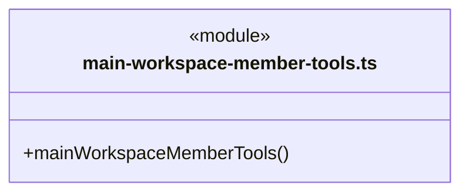
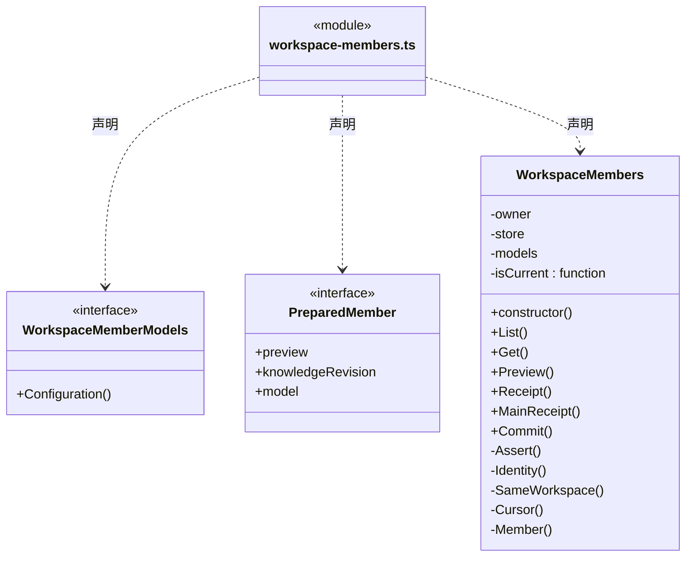
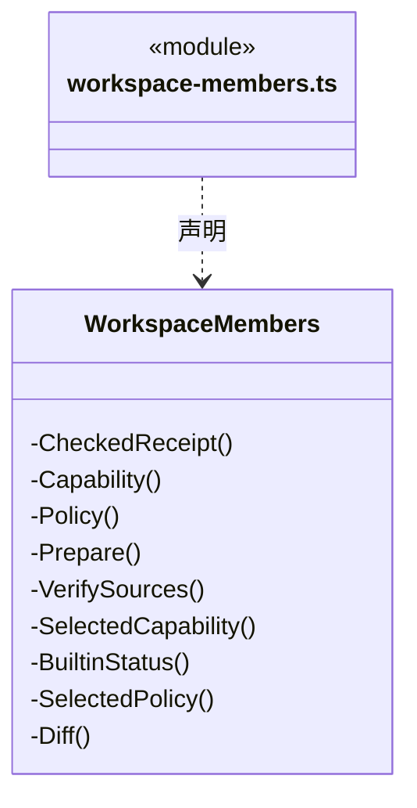
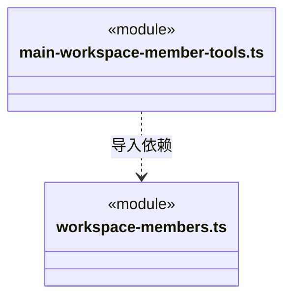

# src/logic/team/service 架构

本目录只维护这一份说明。设计与契约直接编辑本文；文件清单、类图和导航由 [架构脚本](../../../../scripts/source-architecture.mjs) 更新，生成区域之外的人工说明会保留。

## 封装意图

岗位、来源与责任登记的应用服务；协调知识、文件实现和 Logic 领域规则，不拥有正式运行准入。

## 类与模块的设计意图

下表依据源码声明及文件头说明定位封装。字段表示该实例持有的状态或协作引用，不表示它拥有被引用服务的生命周期；实际资源责任和调用限制见下文契约及源码注释。

| 类／模块 | 实现形式与实例字段 | 封装依据 |
| --- | --- | --- |
| [main-workspace-member-tools.ts](main-workspace-member-tools.ts) | 函数／契约模块 | 登记/采纳复用唯一 Store，不建立第二份成员表；模型选型继承静态 Agent，停止排空与回执核实沿原周期。 |
| [WorkspaceMembers](workspace-members.ts) | 实例类；持有 `owner`、`store`、`models`、`isCurrent` | 每个工作区实例只装配一次，共用派发存储；本服务没有执行、领取或停止模型的端口。 |

## 接口设计契约

##### 多角色模型采纳

岗位预览调用 EngineModelProfiles 一次捕获 primary 与全部附加角色，公开快照和选型一起保存；变化检测包含角色引用，额外角色改变须重新采纳，不能沿用旧配置指纹。

main-workspace-member-tools 依赖 execution 的 MainToolContext，不再依赖 AutoCollaboration 类型。新主调用与旧主批次都可提供已受理身份，岗位提交仍绑定原 actor 与 commandId，保留来源采纳、明确模型配置和停止排空规则。

## 开闭边界

本目录的职责及允许协作由[封装意图](#封装意图)限定，输入输出、状态与失败语义以[接口设计契约](#接口设计契约)为准。扩展从已有公开入口及实际装配位置进入；没有明确可替换契约的部分按真实影响修改和验证，不预建未使用的基类或插件入口。

<!-- architecture:generated:start -->

## 文件清单

| 文件 | 形式 | 当前职责 |
| --- | --- | --- |
| [ARCHITECTURE.md](ARCHITECTURE.md) | 说明文档 | 本目录的文件清单、真实声明、依赖与子封装导航。 |
| [main-workspace-member-tools.ts](main-workspace-member-tools.ts) | 源码模块 | 把岗位服务装配到真实主运行；工作区、actor 和命令身份由闭包持有。 |
| [workspace-members.ts](workspace-members.ts) | 源码模块 | 将桌面岗位登记、采纳与当前差异查询接到工作区唯一 DispatchStore，公开模型配置由 Main 注入。 |

## 架构类图

成员标记：`+` 公开、`-` 私有、`#` 受保护、`$` 静态；`function` 为函数值成员，`get`／`set` 为访问器。调用／构造／索引签名按匿名签名列出，不虚构方法名；`global.` 表示全局声明补充，非运行时嵌套类。构造函数单独列出，运行时私有字段保留 `#`。文档和资源仅在文件清单中导航，不作为代码节点。

### main-workspace-member-tools.ts

[查看源码](main-workspace-member-tools.ts)。

直接依赖：[../../../core/errors.ts](../../../core/errors.ts)、[../../execution/rules/conversation-binding.ts](../../execution/rules/conversation-binding.ts)、[../../knowledge/rules/ports.ts](../../knowledge/rules/ports.ts)、[../../knowledge/rules/read-models/index.ts](../../knowledge/rules/read-models/index.ts)、[../../tasks/rules/types.ts](../../tasks/rules/types.ts)、[../rules/agent-runtime.ts](../rules/agent-runtime.ts)、[../rules/workspace-member-rules.ts](../rules/workspace-member-rules.ts)、[../rules/workspace-member-tools.ts](../rules/workspace-member-tools.ts)、[../rules/workspace-member.ts](../rules/workspace-member.ts)、[workspace-members.ts](workspace-members.ts)。

### workspace-members.ts

[查看源码](workspace-members.ts)。

成员 1/2（同名节点为同一声明，跨图合并阅读）。

成员 2/2（同名节点为同一声明，跨图合并阅读）。

直接依赖：[../../../core/errors.ts](../../../core/errors.ts)、[../../dispatch/rules/dispatch-storage.ts](../../dispatch/rules/dispatch-storage.ts)、[../../execution/context/dispatch-context.ts](../../execution/context/dispatch-context.ts)、[../../knowledge/rules/read-models/index.ts](../../knowledge/rules/read-models/index.ts)、[../../knowledge/rules/types.ts](../../knowledge/rules/types.ts)、[../../knowledge/service/knowledge-sources.ts](../../knowledge/service/knowledge-sources.ts)、[../rules/agent-runtime.ts](../rules/agent-runtime.ts)、[../rules/workspace-member-rules.ts](../rules/workspace-member-rules.ts)、[../rules/workspace-member.ts](../rules/workspace-member.ts)、[../../workspace/rules/knowledge-source-rules.ts](../../workspace/rules/knowledge-source-rules.ts)、[../../workspace/rules/knowledge-source.ts](../../workspace/rules/knowledge-source.ts)。

### 本目录调用边界

## 子目录导航

无子目录。

[返回上层](../ARCHITECTURE.md)。

每次修改本目录代码，同步维护文件头、关键契约说明及本图。未实现的治理、证据验收和自动编排能力不列入当前类图。

<!-- architecture:generated:end -->
