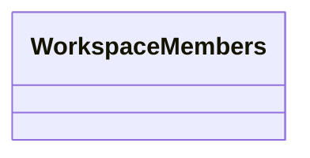

# src/logic/team/service 架构

## 设计意图

提供工作区岗位登记、来源采纳与差异查询，使长期人员配置独立于模型执行。

`WorkspaceMembers` 在唯一 DispatchStore 内核实并保存登记，`main-workspace-member-tools` 把它绑定到可信主运行。模型配置与工作区身份由外部提供，保存岗位不会隐式启动成员或取得正式执行准入。

## 主要组成

| 组成 | 定位 |
| --- | --- |
| [WorkspaceMembers](workspace-members.ts) | 将桌面岗位登记、采纳与当前差异查询接到工作区唯一 DispatchStore，公开模型配置由 Main 注入。 |

<!-- architecture:generated:start -->

## 架构关系

[上层设计](../ARCHITECTURE.md)

<!-- architecture:generated:end -->
