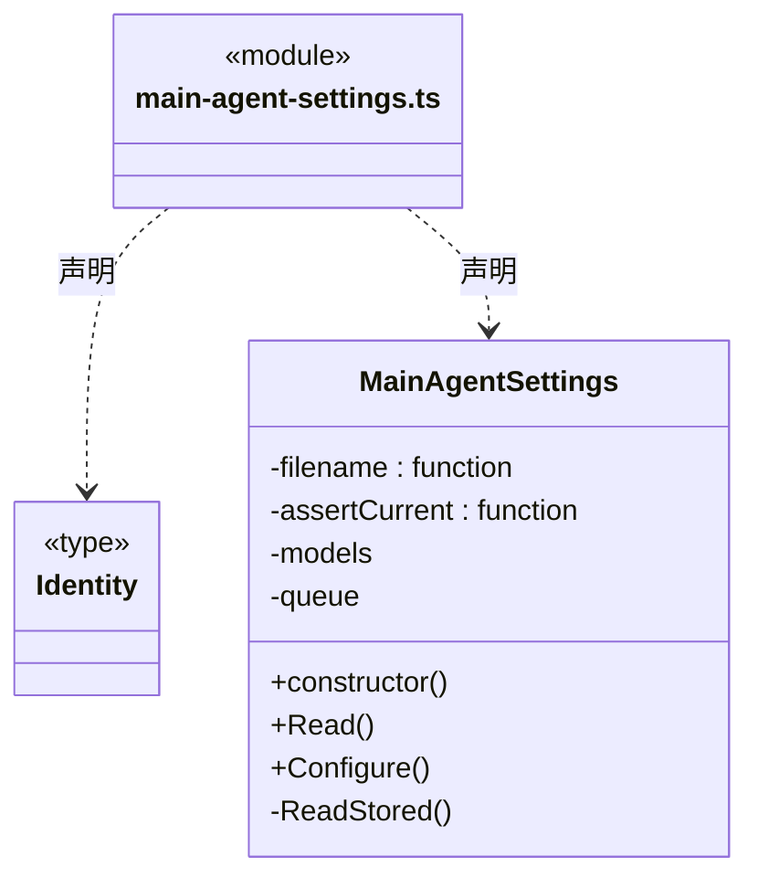

# src/logic/team/settings 架构

本目录只维护这一份说明。设计与契约直接编辑本文；文件清单、类图和导航由 [架构脚本](../../../../scripts/source-architecture.mjs) 更新，生成区域之外的人工说明会保留。

## 封装意图

仅保留主 Agent 设置及工作区 revision 校验；模型配置服务已迁至 logic/models/service，经 logic/engines/service 的引擎投影复用同一个模型配置短锁。

## 类与模块的设计意图

下表依据源码声明及文件头说明定位封装。字段表示该实例持有的状态或协作引用，不表示它拥有被引用服务的生命周期；实际资源责任和调用限制见下文契约及源码注释。

| 类／模块 | 实现形式与实例字段 | 封装依据 |
| --- | --- | --- |
| [MainAgentSettings](main-agent-settings.ts) | 实例类；持有 `queue`、`filename`、`assertCurrent`、`models` | 应用唯一实例；路径及当前工作区校验由 Main 注入，IPC 不接受文件路径。 |

## 接口设计契约

### 主 Agent 设置

MainAgentSettings，拥有工作区主 Agent 的选型 revision 与保存队列。通过 [引擎选型服务](../../engines/ARCHITECTURE.md#contract) 组合 EngineModelProfiles；该服务将引擎策略投影为模型需求，底层 LlmProfiles 仍独占模型身份、设置队列与配置短锁。

configure 先核对工作区实例和 revision，再在模型配置短锁内写入新 revision；写盘成功才返回结果。read 不解密或启动执行。两处界面读取同一份设置，已捕获的运行快照不被新设置热替换。

本模块组合 core/utility 的 SerialQueue 和 core/platform/node/files 的原子替换；每个实例独立，失败不阻断后续任务。选型契约由同域 rules/agent-runtime.ts 定义；本模块属于 Logic 的团队配置服务，不依赖 Bridge 或 View。

## 开闭边界

本目录的职责及允许协作由[封装意图](#封装意图)限定，输入输出、状态与失败语义以[接口设计契约](#接口设计契约)为准。扩展从已有公开入口及实际装配位置进入；没有明确可替换契约的部分按真实影响修改和验证，不预建未使用的基类或插件入口。

<!-- architecture:generated:start -->

## 文件清单

| 文件 | 形式 | 当前职责 |
| --- | --- | --- |
| [ARCHITECTURE.md](ARCHITECTURE.md) | 说明文档 | 本目录的文件清单、真实声明、依赖与子封装导航。 |
| [main-agent-settings.ts](main-agent-settings.ts) | 源码模块 | 保存工作区主 Agent 的引擎和模型，两处界面共用这一份配置。 |

## 架构类图

成员标记：`+` 公开、`-` 私有、`#` 受保护、`$` 静态；`function` 为函数值成员，`get`／`set` 为访问器。调用／构造／索引签名按匿名签名列出，不虚构方法名；`global.` 表示全局声明补充，非运行时嵌套类。构造函数单独列出，运行时私有字段保留 `#`。文档和资源仅在文件清单中导航，不作为代码节点。

### main-agent-settings.ts

[查看源码](main-agent-settings.ts)。

直接依赖：[../../../core/errors.ts](../../../core/errors.ts)、[../../../core/platform/node/files/index.ts](../../../core/platform/node/files/index.ts)、[../../../core/utility/index.ts](../../../core/utility/index.ts)、[../../engines/service/index.ts](../../engines/service/index.ts)、[../rules/agent-runtime.ts](../rules/agent-runtime.ts)。

## 子目录导航

无子目录。

[返回上层](../ARCHITECTURE.md)。

每次修改本目录代码，同步维护文件头、关键契约说明及本图。未实现的治理、证据验收和自动编排能力不列入当前类图。

<!-- architecture:generated:end -->
