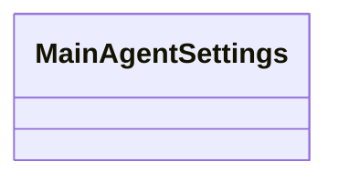

# src/logic/team/settings 架构

## 设计意图

仅保留主 Agent 设置及工作区 revision 校验；模型配置服务已迁至 logic/models/service，经 logic/engines/service 的引擎投影复用同一个模型配置短锁。

## 主要组成

| 组成 | 定位 |
| --- | --- |
| [MainAgentSettings](main-agent-settings.ts) | 保存工作区主 Agent 的引擎和模型，两处界面共用这一份配置。 |

<!-- architecture:generated:start -->

## 架构关系

[上层设计](../ARCHITECTURE.md)

<!-- architecture:generated:end -->
