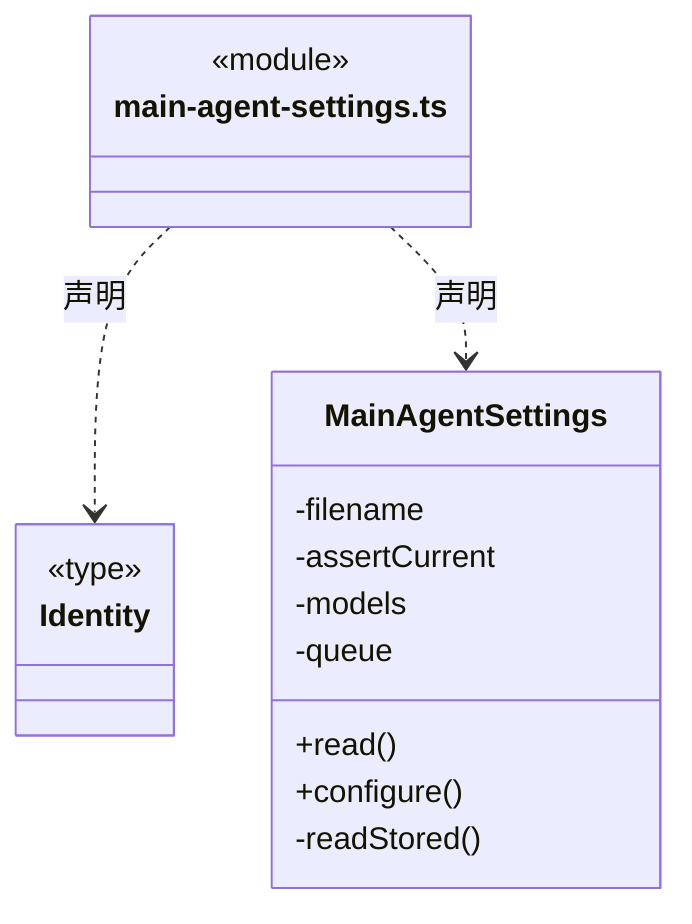

# src/logic/team/settings 架构

## 目录定位

仅保留主 Agent 设置及工作区 revision 校验；模型配置服务已迁至 logic/models/service，经 logic/engines/service 的引擎投影复用同一个模型配置短锁。

本文描述当前实现。通过分析目录边界后维护的 [源码架构脚本](../../../../scripts/source-architecture.mjs) 同步清单和声明；代码变更时仍须核对职责、关键成员与关系。

## 代码清单

| 文件 | 当前职责 |
| --- | --- |
| [main-agent-settings.ts](main-agent-settings.ts) | 保存工作区主 Agent 的引擎和模型，两处界面共用这一份配置。 |

## 架构类图

### main-agent-settings.ts

直接依赖：[../../../core/utility/index.ts](../../../core/utility/index.ts)、[../../../core/platform/node/files/index.ts](../../../core/platform/node/files/index.ts)、[../../../core/errors.ts](../../../core/errors.ts)、[../rules/agent-runtime.ts](../rules/agent-runtime.ts)、[../../engines/service/index.ts](../../engines/service/index.ts)。

## 子目录导航

无子目录。

[返回上层](../ARCHITECTURE.md)。

每次修改本目录代码，同步维护文件头、关键契约说明及本图。未实现的治理、证据验收和自动编排能力不列入当前类图。

## 设计契约 v1 与落地范围

以下内容区分已接通能力与后续设计；以各节的实现状态为准，不将目标图当作现状图。维护源：[CONTRACT.md](CONTRACT.md)；生成类图时同步附加，勿直接修改本附录。

# 主 Agent 设置

MainAgentSettings，拥有工作区主 Agent 的选型 revision 与保存队列。通过 [引擎选型服务](../../engines/CONTRACT.md) 组合 EngineModelProfiles；该服务将引擎策略投影为模型需求，底层 LlmProfiles 仍独占模型身份、设置队列与配置短锁。

configure 先核对工作区实例和 revision，再在模型配置短锁内写入新 revision；写盘成功才返回结果。read 不解密或启动执行。两处界面读取同一份设置，已捕获的运行快照不被新设置热替换。

本模块组合 core/utility 的 SerialQueue 和 core/platform/node/files 的原子替换；每个实例独立，失败不阻断后续任务。选型契约由同域 rules/agent-runtime.ts 定义；本模块属于 Logic 的团队配置服务，不依赖 Bridge 或 View。
