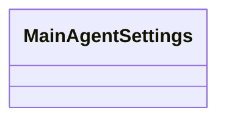

# src/logic/team/settings 架构

## 设计意图

保存每个工作区主 Agent 的引擎与模型选择，让对话栏和团队配置使用同一份状态。

`MainAgentSettings` 校验工作区实例与 revision，通过 engines/service 复用 models 的原子配置捕获。它只负责主 Agent 选择，不接管供应商凭据、模型目录或成员运行中的冻结快照。

## 主要组成

| 组成 | 定位 |
| --- | --- |
| [MainAgentSettings](main-agent-settings.ts) | 保存工作区主 Agent 的引擎和模型，两处界面共用这一份配置。 |

<!-- architecture:generated:start -->

## 架构关系

[上层设计](../ARCHITECTURE.md)

<!-- architecture:generated:end -->
