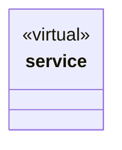

# src/logic/terminal 架构

## 设计意图

桌面手动命令终端业务；按工作区与页签持有进程和有界输出，不向界面暴露 Node。

## 主要组成

本层由下列子模块组合，每个子模块作为独立的虚拟类封装参与本层协作。

<!-- architecture:generated:start -->

## 架构关系

标注为 `virtual` 的节点是直接子模块的虚拟类封装；内部设计沿下方入口阅读。

## 子模块

| 虚拟封装 | 整体职责 |
| --- | --- |
| [service](service/ARCHITECTURE.md) | 逐条命令执行及持续 UTF-8 解码；关闭释放当前进程，不模拟 PTY 或跨命令 shell 会话。 |

[上层设计](../ARCHITECTURE.md)

<!-- architecture:generated:end -->
