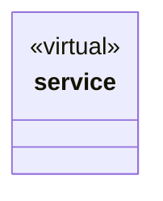

# src/logic/terminal 架构

## 设计意图

提供工作区内显式手动命令的终端能力，按页签隔离输出和进程生命周期。

`service` 实现命令执行与清理，Bridge 接入受限操作，View 展示有界输出。该入口不同于 Agent 工具执行，不共享其自动调度或恢复账本，也不向页面开放 Node 对象。

## 主要组成

本层没有直接产品实现，由下方子模块组成；每个直接子模块作为一个虚拟封装，只在本层呈现整体职责与协作。

<!-- architecture:generated:start -->

## 架构关系

标注为 `virtual` 的节点是直接子模块的虚拟类封装；内部设计沿下方入口阅读。

## 子模块

| 虚拟封装 | 整体职责 |
| --- | --- |
| [service](service/ARCHITECTURE.md) | 按工作区和页签执行用户明确提交的单条命令，保存有界输出并管理当前进程。 |

[上层设计](../ARCHITECTURE.md)

<!-- architecture:generated:end -->
