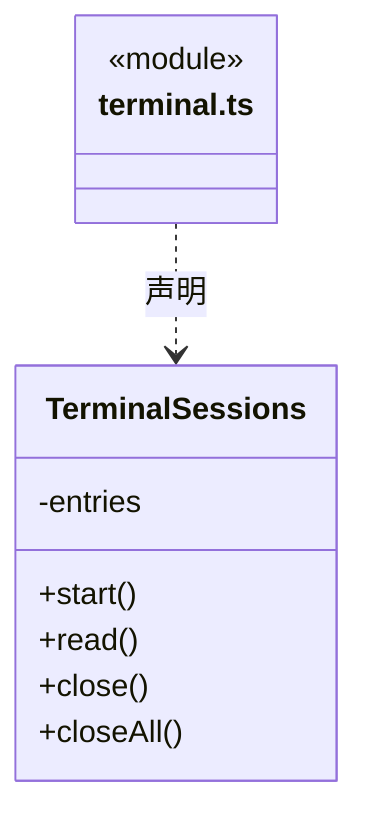

# src/logic/terminal/service 架构

## 目录定位

逐条命令执行及持续 UTF-8 解码；关闭释放当前进程，不模拟 PTY 或跨命令 shell 会话。

本文描述当前实现。通过分析目录边界后维护的 [源码架构脚本](../../../../scripts/source-architecture.mjs) 同步清单和声明；代码变更时仍须核对职责、关键成员与关系。

## 代码清单

| 文件 | 当前职责 |
| --- | --- |
| [terminal.ts](terminal.ts) | 桌面扩展区的命令模式终端，按工作区/页签隔离手动命令与输出。 |

## 架构类图

### terminal.ts

## 子目录导航

无子目录。

[返回上层](../ARCHITECTURE.md)。

每次修改本目录代码，同步维护文件头、关键契约说明及本图。未实现的治理、证据验收和自动编排能力不列入当前类图。
