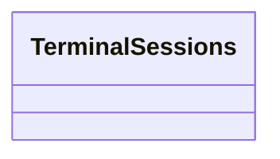

# src/logic/terminal/service 架构

## 设计意图

按工作区和页签执行用户明确提交的单条命令，保存有界输出并管理当前进程。

`TerminalSessions` 维护各会话及持续 UTF-8 解码，关闭时收束当前命令。它是命令模式终端，不模拟 PTY 或跨命令 shell 环境；新命令不能借前一条输出推断工作目录和环境已经改变。

## 主要组成

| 组成 | 定位 |
| --- | --- |
| [TerminalSessions](terminal.ts) | 桌面扩展区的命令模式终端，按工作区/页签隔离手动命令与输出。 |

<!-- architecture:generated:start -->

## 架构关系

[上层设计](../ARCHITECTURE.md)

<!-- architecture:generated:end -->
