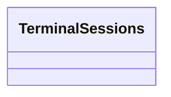

# src/logic/terminal/service 架构

## 设计意图

逐条命令执行及持续 UTF-8 解码；关闭释放当前进程，不模拟 PTY 或跨命令 shell 会话。

## 主要组成

| 组成 | 定位 |
| --- | --- |
| [TerminalSessions](terminal.ts) | 桌面扩展区的命令模式终端，按工作区/页签隔离手动命令与输出。 |

<!-- architecture:generated:start -->

## 架构关系

[上层设计](../ARCHITECTURE.md)

<!-- architecture:generated:end -->
