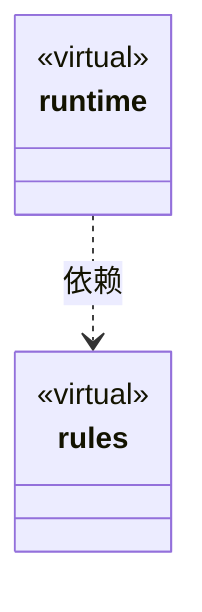

# src/logic/tools 架构

## 设计意图

把业务能力组织为可发现、可校验的模型工具。规则定义工具协议和授权策略，runtime 包装实际服务；注册工具不等于授予执行权限。

## 主要组成

本层由下列子模块组合，每个子模块作为独立的虚拟类封装参与本层协作。

<!-- architecture:generated:start -->

## 架构关系

标注为 `virtual` 的节点是直接子模块的虚拟类封装；内部设计沿下方入口阅读。

## 子模块

| 虚拟封装 | 整体职责 |
| --- | --- |
| [rules](rules/ARCHITECTURE.md) | 统一工具描述、调用输入输出及授权策略。ToolRegistry 维护登记和发现，提问与回执协议表达交互事实，策略子模块裁决调用边界。 |
| [runtime](runtime/ARCHITECTURE.md) | 把已装配的业务服务包装为模型工具。各工具类负责一个业务入口的输入校验和结果投影，运行身份与权限从可信上下文注入；真正业务状态仍由对应服务持有。 |

[上层设计](../ARCHITECTURE.md)

<!-- architecture:generated:end -->
