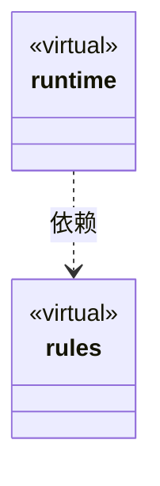

# src/logic/tools 架构

## 设计意图

把业务能力转换为可发现、可校验的模型工具，同时保持注册与授权分离。

`rules` 定义调用协议、回执和授权策略，`runtime` 包装实际服务。可信运行身份与能力由装配注入，工具目录说明可调用什么，策略和业务服务继续决定本次是否允许以及如何提交。

## 主要组成

本层没有直接产品实现，由下方子模块组成；每个直接子模块作为一个虚拟封装，只在本层呈现整体职责与协作。

<!-- architecture:generated:start -->

## 架构关系

标注为 `virtual` 的节点是直接子模块的虚拟类封装；内部设计沿下方入口阅读。

## 子模块

| 虚拟封装 | 整体职责 |
| --- | --- |
| [rules](rules/ARCHITECTURE.md) | 统一工具描述、输入输出与回执语义，让发现、执行前校验和授权使用同一协议边界。 |
| [runtime](runtime/ARCHITECTURE.md) | 把已装配业务服务包装为模型可调用的工具入口，隔离工具协议与真正的领域状态。 |

[上层设计](../ARCHITECTURE.md)

<!-- architecture:generated:end -->
