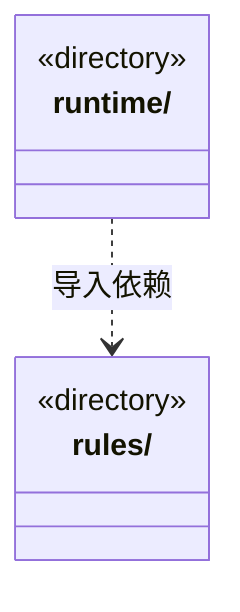

# src/logic/tools 架构

本目录只维护这一份说明。设计与契约直接编辑本文；文件清单、类图和导航由 [架构脚本](../../../scripts/source-architecture.mjs) 更新，生成区域之外的人工说明会保留。

## 封装意图

工具登记、结果协议及业务工具输入规则；服务与规则分开归属，实际依赖通过明确入口验证。

## 类与模块的设计意图

本层没有直接源码声明，负责组合下级封装；各子系统的类、状态与公开入口见本文的[子目录导航](#子目录导航)。

## 接口设计契约

本层没有独立代码入口或运行实例。公开契约与资源生命周期分别归属下级封装，按[子目录导航](#子目录导航)进入实际所有者。

## 开闭边界

本目录的职责及允许协作由[封装意图](#封装意图)限定，输入输出、状态与失败语义以[接口设计契约](#接口设计契约)为准。扩展从已有公开入口及实际装配位置进入；没有明确可替换契约的部分按真实影响修改和验证，不预建未使用的基类或插件入口。

<!-- architecture:generated:start -->

## 文件清单

| 文件 | 形式 | 当前职责 |
| --- | --- | --- |
| [ARCHITECTURE.md](ARCHITECTURE.md) | 说明文档 | 本目录的文件清单、真实声明、依赖与子封装导航。 |

本层无直接代码文件。

## 架构类图

成员标记：`+` 公开、`-` 私有、`#` 受保护、`$` 静态；`function` 为函数值成员，`get`／`set` 为访问器。调用／构造／索引签名按匿名签名列出，不虚构方法名；`global.` 表示全局声明补充，非运行时嵌套类。构造函数单独列出，运行时私有字段保留 `#`。文档和资源仅在文件清单中导航，不作为代码节点。

各图中的同名节点表示同一目录边界；跨组及完整直接依赖如下（无边不代表继承）：

- `runtime` → `rules`：导入。

## 子目录导航

- [rules/](rules/ARCHITECTURE.md)：工具 Schema、版本、副作用、调用决策、严格提问/答案及回执。提问按原题同序核验，取消与答案排他；during_wait只承诺结束未完成交互。结果只核唯一 JSON 快照，不用解析改写制造成功；历史可读不等于当前业务证据有效。注册、发现及用户回答不授予权限。 原生能力按 Pi/Claude Code/Codex 提供真实预检清单，Codex 由宿主执行既有文件操作，Claude 不宣称独立 ls。 GitHub 反馈使用独立 scope 和 external-write 效果；不把外部提交回执当作业务文件或知识成果。
- [runtime/](runtime/ARCHITECTURE.md)：把知识、主调度及实际装配的用户交互注册为 cbim_ 工具。新增前置追加与已有主调度工具共用固定运行身份、原命令映射和严格单次编码输出，回执只证明保存；坏回包先核实原记录。QuestionTools冻结原题，严格核验答案或取消，坏回包不重问；维护和问答回执不算业务证据，执行者不获得调度权。 知识查询和事务刷新分别注入最小读/写端口，写权限及原请求版本检查保持。 负责人发现和计划/派发选择共享严格协议，固定主运行身份，历史回执不签发新领取许可。 主工具显式放弃原检查点/预约，绑定原 run/call 命令，坏回包只核实原事实，不取得业务完成资格。 主 Agent 可按明确原 run/call 查询控制面事务；可信闭包固定工作区和根，读取本身无写命令且不触发成员执行。 知识提交和对象提交的执行参数与历史核实使用同一解析定义，权限及当前实例核验仍在实际执行入口。 FeedbackTools 只在桌面主会话实际连接后注册；严格解析反馈字段，未知只核实原提交，不能让模型改投目标或提供凭据。

[返回上层](../ARCHITECTURE.md)。

每次修改本目录代码，同步维护文件头、关键契约说明及本图。未实现的治理、证据验收和自动编排能力不列入当前类图。

<!-- architecture:generated:end -->
