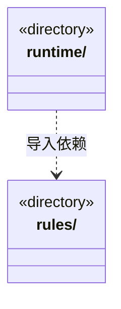

# src/logic/tools 架构

## 目录定位

工具登记、结果协议及业务工具输入规则；服务与规则分开归属，实际依赖通过明确入口验证。

本文描述当前实现。通过分析目录边界后维护的 [源码架构脚本](../../../scripts/source-architecture.mjs) 同步清单和声明；代码变更时仍须核对职责、关键成员与关系。

## 代码清单

本层无直接代码文件。

## 架构类图

各图中的同名节点表示同一目录边界；跨组及完整直接依赖如下（无边不代表继承）：

- `runtime` → `rules`：导入。

## 子目录导航

- [rules/](rules/ARCHITECTURE.md)：工具 Schema、版本、副作用、调用决策、严格提问/答案及回执。提问按原题同序核验，取消与答案排他；during_wait只承诺结束未完成交互。结果只核唯一 JSON 快照，不用解析改写制造成功；历史可读不等于当前业务证据有效。注册、发现及用户回答不授予权限。 原生能力按 Pi/Claude Code/Codex 提供真实预检清单，Codex 由宿主执行既有文件操作，Claude 不宣称独立 ls。 GitHub 反馈使用独立 scope 和 external-write 效果；不把外部提交回执当作业务文件或知识成果。
- [runtime/](runtime/ARCHITECTURE.md)：把知识、主调度及实际装配的用户交互注册为 cbim_ 工具。新增前置追加与已有主调度工具共用固定运行身份、原命令映射和严格单次编码输出，回执只证明保存；坏回包先核实原记录。QuestionTools冻结原题，严格核验答案或取消，坏回包不重问；维护和问答回执不算业务证据，执行者不获得调度权。 知识查询和事务刷新分别注入最小读/写端口，写权限及原请求版本检查保持。 负责人发现和计划/派发选择共享严格协议，固定主运行身份，历史回执不签发新领取许可。 主工具显式放弃原检查点/预约，绑定原 run/call 命令，坏回包只核实原事实，不取得业务完成资格。 主 Agent 可按明确原 run/call 查询控制面事务；可信闭包固定工作区和根，读取本身无写命令且不触发成员执行。 知识提交和对象提交的执行参数与历史核实使用同一解析定义，权限及当前实例核验仍在实际执行入口。 FeedbackTools 只在桌面主会话实际连接后注册；严格解析反馈字段，未知只核实原提交，不能让模型改投目标或提供凭据。

[返回上层](../ARCHITECTURE.md)。

每次修改本目录代码，同步维护文件头、关键契约说明及本图。未实现的治理、证据验收和自动编排能力不列入当前类图。
