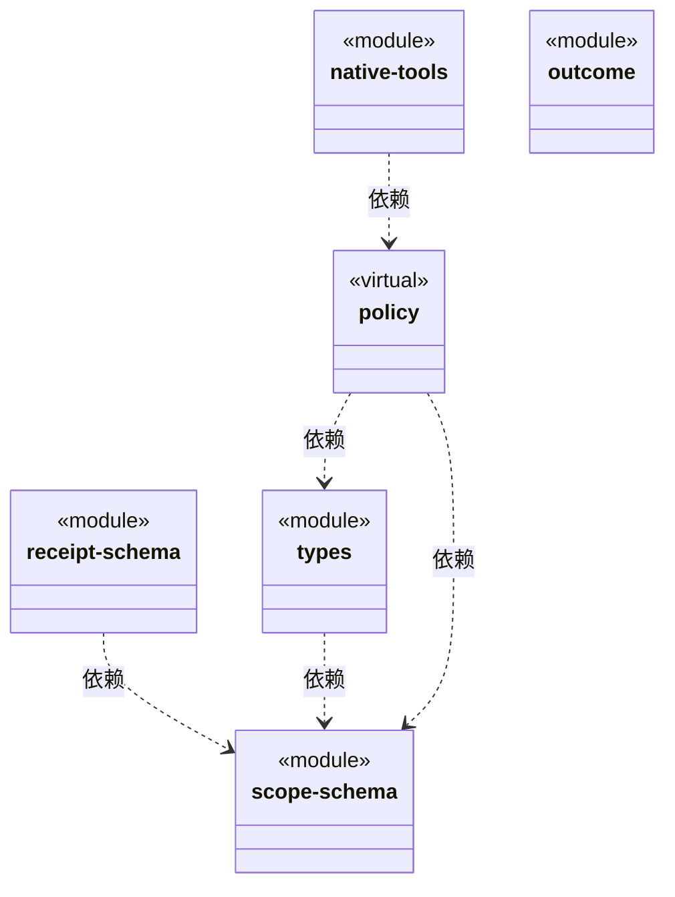
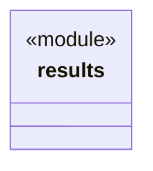

# src/logic/tools/rules 架构

## 设计意图

保存引擎共用的工具描述、结果和权限策略。权限由可信运行配置提供，模型参数不能提升权限；Office 桌面工具还会检查 read / ask / execute。

## 主要组成

| 组成 | 定位 |
| --- | --- |
| [native-tools](native-tools.ts) | 定义当前引擎真实装配的原生工具及可信副作用分类；引擎身份来自官方静态目录。 |
| [outcome](outcome.ts) | 引擎工具回包的统一结果与下一步说明；独立于具体业务账本。 |
| [receipt-schema](receipt-schema.ts) | 执行报告与任务工具共用的真实工具回执字段协议。 |
| [results](results.ts) | 校验内部工具传给大脑的结果，并将领域返回值封装为合法文本块。 |
| [scope-schema](scope-schema.ts) | 工具回执与可信授权描述共用的纯范围协议，区分项目文件、知识、未知影响和外部仓库读取。 |
| [types](types.ts) | 引擎无关的工具调用、副作用、策略决策及运行回执契约。 |

<!-- architecture:generated:start -->

## 架构关系

标注为 `virtual` 的节点是直接子模块的虚拟类封装；内部设计沿下方入口阅读。

### 关系组 1：policy

### 关系组 2：results

### 跨图协作

按引用方归并目标，保留全部跨图关系；分图只用于阅读，不表示新增模块或依赖边界。

| 引用方 | 关系 | 目标 |
| --- | --- | --- |
| [outcome](outcome.ts)（图 1） | 依赖 | [results](results.ts)（图 2） |

## 子模块

| 虚拟封装 | 整体职责 |
| --- | --- |
| [policy](policy/ARCHITECTURE.md) | 保存引擎共用的工具描述、结果和权限策略。权限由可信运行配置提供，模型参数不能提升权限；Office 桌面工具还会检查 read / ask / execute。 |

[上层设计](../ARCHITECTURE.md)

<!-- architecture:generated:end -->
