# src/logic/tools/rules 架构

本目录只维护这一份说明。设计与契约直接编辑本文；文件清单、类图和导航由 [架构脚本](../../../../scripts/source-architecture.mjs) 更新，生成区域之外的人工说明会保留。

## 封装意图

工具 Schema、版本、副作用、调用决策、严格提问/答案及回执。提问按原题同序核验，取消与答案排他；during_wait只承诺结束未完成交互。结果只核唯一 JSON 快照，不用解析改写制造成功；历史可读不等于当前业务证据有效。注册、发现及用户回答不授予权限。 原生能力按 Pi/Claude Code/Codex 提供真实预检清单，Codex 由宿主执行既有文件操作，Claude 不宣称独立 ls。 GitHub 反馈使用独立 scope 和 external-write 效果；不把外部提交回执当作业务文件或知识成果。

## 类与模块的设计意图

下表依据源码声明及文件头说明定位封装。字段表示该实例持有的状态或协作引用，不表示它拥有被引用服务的生命周期；实际资源责任和调用限制见下文契约及源码注释。

| 类／模块 | 实现形式与实例字段 | 封装依据 |
| --- | --- | --- |
| [contracts.ts](contracts.ts) | 函数／契约模块 | 真实能力必须可查询且有边界；external-write 区分外部提交，Schema 与恢复说明不签发权限、不自动重试或承诺回滚。 |
| [input-validation.ts](input-validation.ts) | 函数／契约模块 | 可选和默认参数由各 Schema 解析；这里只解释实际 issues，不从字段清单推断缺参，也不推断执行是否发生。 |
| [native-tools.ts](native-tools.ts) | 函数／契约模块 | 适配器启动参数、能力预检、授权与 canonical 证据共用同一纯表，避免分类漂移或把模型声明当能力。 |
| [outcome.ts](outcome.ts) | 函数／契约模块 | 异常不能证明未执行，所有失败默认禁止自动重放；仅可信适配器可提供原命令的只读核实入口。 |
| [questions.ts](questions.ts) | 函数／契约模块 | 答案必须对应原题且不能把取消补成空回答；这里仅检查协议，不从文字推断选项来源、用户认证、授权或业务验收。 |
| [receipt-schema.ts](receipt-schema.ts) | 函数／契约模块 | 回执由运行时生成，公开输出共用成功、失败与未知；外部写保留 external-write，不冒充业务文件证据，旧字段形状兼容。 |
| [receipts.ts](receipts.ts) | 函数／契约模块 | 身份和哈希由运行时生成，模型返回的 approved、receipt 或验收结论不能替代执行事实。 |
| [ToolRegistry](registry.ts) | 实例类；持有 `entries` | 只负责协议和参数；实例、版本与副作用规则由领域入口检查。 |
| [results.ts](results.ts) | 函数／契约模块 | 工具外壳与业务字段都需核验；固定唯一 JSON 快照，防缺字段、Schema 改写或重复序列化补造成功，同时拒绝会污染会话的缺失 text。 |
| [scope-schema.ts](scope-schema.ts) | 函数／契约模块 | 仓库读取与 GitHub 反馈有独立目标和连接代际，不能被记录成工作区文件证据；旧三类日志维持原字段形状。 |
| [types.ts](types.ts) | 函数／契约模块 | 不同工具共用可追溯身份与结果语义；回执区分拒绝、失败与未知，不依赖具体知识服务。 |

## 接口设计契约

##### GitHub 外部写与可信范围

`external-write` 区分已连接 GitHub 目标的 Issue 写入，不是 business-write 或 knowledge-write。`githubFeedbackScopeSchema` 严格保存工作区、连接代际、不可变仓库 ID 和 owner/repo，不含 URL、正文或令牌。统一工具效果与回执 Schema 兼容旧日志，并保留新效果；外部回执不能充当业务文件或知识提交证明。

##### 结构化提问的纯契约

`questions.ts` 统一 `questionToolName`、严格嵌套问题输入、桌面答案输入与排他的 answers/cancelled 输出。模型不能夹带身份、批准或范围字段；桌面只提交原选项索引或其它文字。`questionResultForInput` 独立保存已解析原题，核对回答数量、顺序、原题文字及补充的选项关系，不裁剪、填默认值或修剪输出 wire。

没有 supplement 的答案可能来自选项或其它文字，不能反推选择来源、认证身份、工具授权或人工验收。工具成功和取消事实保留在日志，但不成为业务完成证据。取消元数据 `during_wait` 只用于尚未完成的交互；其它工具的 `preflight_only` 及既有领域事务语义不改变。

##### 当前工具结果边界

`results.ts` 是内部工具结果的共同协议边界。`jsonToolResult` 将明确的领域值编码为文本块，拒绝 `undefined`、循环对象和不可序列化值；显式 `null` 可以正常返回。

知识注册工具通过 `checkedJsonToolResult` 验证业务输出：领域 `execute` 只调用一次，原值只进行一次 JSON 序列化；用该编码的独立解析副本执行输出 Schema 校验，并与未交给校验器的原快照作结构比较。Zod 裁剪、默认值、类型转换、原地修改或增加 `undefined` 字段都不能补成成功；对象键顺序不改变 JSON 事实。通过后直接发送原编码文本，不重新编码领域值或 Schema 结果，因此 `toJSON` 不能在验证后偷偷改变发送内容。

业务输出失败为 `TOOL_OUTPUT_INVALID`，错误仅提供掩去动态键的结构位置和校验类别，不包含输出正文、凭据或原始异常。它明确表示操作可能已发生，要求核实既有记录、不自动重试；不会撤销事务、返还单次批准或再调用领域操作。合法的 `invalid`、`not_found`、校验问题和已提交清理警告由各领域 Schema 保留，不被转换为执行成功或回滚。

`validateToolResult` 校验实际 JSON 传输快照：`content` 必须为数组；文本块必须有字符串 `text`；图片块必须有非空 `data` 和图片 `mimeType`；可选 `isError` 必须为布尔值。校验失败抛出 `TOOL_RESULT_INVALID`，错误不携带原始返回内容。

知识适配器在返回时校验，Pi 执行桥在结果进入原生会话前再次校验。桥将失败转为带错误码的合法工具错误，已消费的单次授权不因结果错误而恢复，也不重放可能已发生副作用的操作。有效的结果结构不代表业务成功，业务状态和验收仍由对应领域负责。

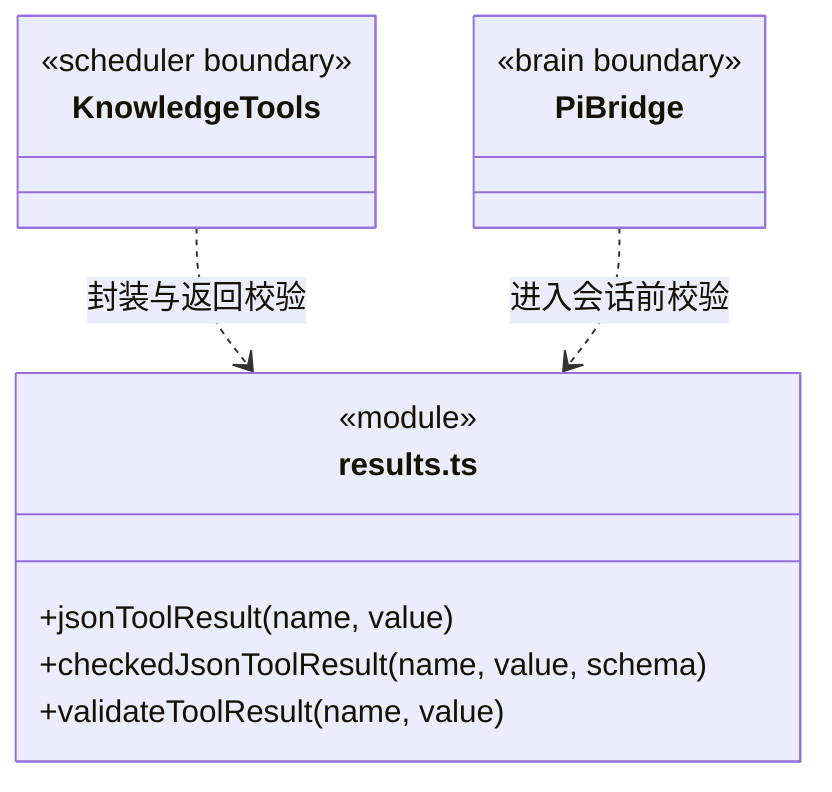

历史会话修复属于显式维护，不在模型调用或结果校验中静默修改旧记录。

##### 实际注册表与按需发现

`ToolRegistry` 只登记合法 `cbim_` 名称，并强制声明正整数版本、副作用、输出 Schema、取消语义和恢复说明。解析输入与执行分离；只有本注册表实际解析出的定义可以调用 `InvokeResolved`，不能借同名外来对象执行。`List` 保持引擎需要的紧凑输入清单；`Catalog/Describe` 仅查询该知识注册表，不能执行工具或凭元数据授权。

`contracts.ts` 保存取消/恢复和发现输出的纯协议。知识目录返回 `family:knowledge` 与实际名称、可选描述、版本、副作用；详情按名称返回有限输入/输出 JSON Schema 和取消/恢复说明。自描述通过有限 Schema 引用表达，不递归嵌套整个注册表，不公开 `execute`、凭据、原生工具或派发工具。原始定义/人员诊断允许保留任意 JSON 事实（包括自有 `__proto__` 键），不裁剪成看似合格的业务对象。

##### 原生工具的单一可信分类

`native-tools.ts` 保存当前引擎实际支持的原生工具描述，供 Pi 注册、正式成员能力预检、授权分类和 Workflow canonical 评价共用。`nativeToolDescriptor` 返回独立描述，未知名称及对象继承属性不属于注册工具；`nativeToolNames(false)` 只包含只读工具。

表中 read/grep/find/ls 属于 read，write/edit 属于 business-write，bash 属于 command。该清单不发放权限、不执行工具、不决定路径是否可访问；路径守卫、ask 审批与工作区身份仍由策略执行。任务评价只能核对实际成功调用，不能凭名称声明业务验证或完整文件覆盖。

##### 工具范围与外部资料身份

`scope-schema.ts` 是授权策略、工具回执和证据解析共用的纯范围协议。原 workspace/knowledge/unknown 分支保留 `{kind,workspaceId}` 形状；repository 分支严格保存 workspaceId、connectorId、repositoryId、connectionId 与 list/get 操作，不接受 URL、凭据或调用方声明的授权。仓库身份来自本轮可信捕获描述，不从模型输入直接创建能力。

成功的 repository read 表示所绑定仓库操作收到真实回执，不能降格为 workspace read，也不能冒充本地文件、任务交付或成员检查点的证据。共享解析保留这种身份供主运行历史与 canonical 核实；下游业务证据仍分别检查来源边界。

##### 共享回执结构与当前证据资格

`receipt-schema.ts` 提供报告、执行进度公开输出共同使用的 `toolReceiptSchema` 与副作用枚举。它保持历史报告原结构：空 effects、空 toolName 和缺省 resultHash 仍可读取，不能因此补造成功结果或执行范围；各字段的真实归属、日志链及业务用途由调用层核实。

进度工具在此结构之上要求真实 workspaceId/taskId/runId、相同作用域工作区、明确 succeeded、非空工具名与实际 resultHash。内部维护、目标调度、治理和 repository 资料不作为业务交付证据。Schema 通过仅说明返回协议合法，不授予执行、验收或重试权。

`checkedJsonToolResult` 也供主调度八工具与成员七工具使用。保存后输出异常不会回滚领域记录；工具包装必须在调用端口前独立冻结请求、绑定和必要前态，不能将端口可能改动的原对象同时作为核验依据。

#### 冻结范围成员执行

取消元数据新增during_execution，表示可信宿主能终止当前实际执行并等退出；不改变preflight_only、during_wait及恢复的原语义，也不声称副作用回滚。

##### 原生能力预检

nativeToolNames 按引擎提供真实规范名：Pi 保持既有清单，Codex 通过宿主工具提供同一规范名，Claude Code 排除不存在的独立 ls。该清单供岗位 Workflow 准备预检，不是逐调用许可；真实路径、效果、授权仍由运行时核实。

##### 统一调用结果

`outcome.ts` 定义 status（returned/rejected/unknown）、retryable=false、terminal=true、reconcileTool/reconcileArgs 和 nextStep。terminal 表示本次请求已返回且不能自动重复，不表示业务目标终态。成功放在 ToolResult.details.outcome，保留原领域正文；异常同时用 JSON 文本交给模型。无可靠只读核实入口时两个 reconcile 字段明确 null，原生文件/命令须查原日志和实际副作用。只有可信适配器可附原命令地址，不从错误正文解析或补造身份。

#### 知识工具输入诊断

`ToolRegistry.Resolve` 在执行前校验参数。失败只列最多八项字段及类型/缺项提示，不回显输入正文；涉及 workspaceId/instanceId 时要求先调用当前身份工具，不自动补齐或沿用旧实例。领域身份、版本及权限仍由原入口检查；诊断不授权重放先前结果未知的调用。

#### 输入校验与缺省参数

input-validation.ts 只解释实际 Schema issues，不根据工具字段清单推断缺参；optional/default 由原 Schema 决定，null、空字符串、显式值不转换为缺省。工具注册表使用共享无原值字段说明。toolInputError 仅用于执行前校验，ZodError 转为 TOOL_INPUT_INVALID，outcome 明确 rejected；执行后未知异常不使用此转换。字段说明经 Bridge 供旧 UI 投影共用，不赋予执行或重试许可。

反馈范围 Schema 的唯一实现已迁入 Logic feedback；scope-schema.ts 组合并兼容重导出它，旧日志字段与校验保持，工具权限仍由可信调用方签发。

## 开闭边界

本目录的职责及允许协作由[封装意图](#封装意图)限定，输入输出、状态与失败语义以[接口设计契约](#接口设计契约)为准。扩展从已有公开入口及实际装配位置进入；没有明确可替换契约的部分按真实影响修改和验证，不预建未使用的基类或插件入口。

<!-- architecture:generated:start -->

## 文件清单

| 文件 | 形式 | 当前职责 |
| --- | --- | --- |
| [ARCHITECTURE.md](ARCHITECTURE.md) | 说明文档 | 本目录的文件清单、真实声明、依赖与子封装导航。 |
| [contracts.ts](contracts.ts) | 源码模块 | 工具取消、恢复说明及按需契约发现的纯协议，不导入具体领域或执行服务。 |
| [input-validation.ts](input-validation.ts) | 源码模块 | 将工具输入校验转换为不含原参数值的字段说明，供执行前拒绝与历史展示共用。 |
| [native-tools.ts](native-tools.ts) | 源码模块 | 定义当前引擎真实装配的原生工具及可信副作用分类；引擎身份来自官方静态目录。 |
| [outcome.ts](outcome.ts) | 源码模块 | 引擎工具回包的统一结果与下一步说明；独立于具体业务账本。 |
| [questions.ts](questions.ts) | 源码模块 | 结构化提问的严格输入、桌面答案、排他结果与待答快照，供队列、工具包装和证据边界共用。 |
| [receipt-schema.ts](receipt-schema.ts) | 源码模块 | 执行报告与任务工具共用的真实工具回执字段协议。 |
| [receipts.ts](receipts.ts) | 源码模块 | 把已核实的工具调用、授权和终态整理为可追溯回执。 |
| [registry.ts](registry.ts) | 源码模块 | 实际内部工具的输入/业务输出协议、版本、副作用及取消/恢复说明，支持摘要与按需完整描述。 |
| [results.ts](results.ts) | 源码模块 | 校验内部工具传给大脑的结果，并将领域返回值封装为合法文本块。 |
| [scope-schema.ts](scope-schema.ts) | 源码模块 | 工具回执与可信授权描述共用的纯范围协议，区分项目文件、知识、未知影响和外部仓库读取。 |
| [types.ts](types.ts) | 源码模块 | 引擎无关的工具调用、副作用、策略决策及运行回执契约。 |

## 架构类图

成员标记：`+` 公开、`-` 私有、`#` 受保护、`$` 静态；`function` 为函数值成员，`get`／`set` 为访问器。调用／构造／索引签名按匿名签名列出，不虚构方法名；`global.` 表示全局声明补充，非运行时嵌套类。构造函数单独列出，运行时私有字段保留 `#`。文档和资源仅在文件清单中导航，不作为代码节点。

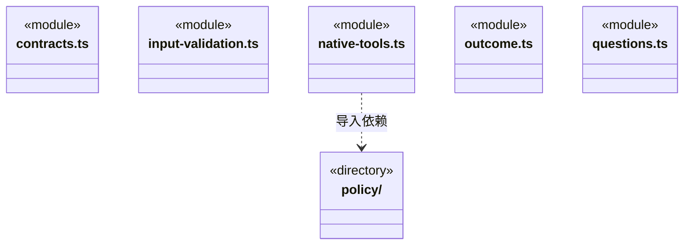

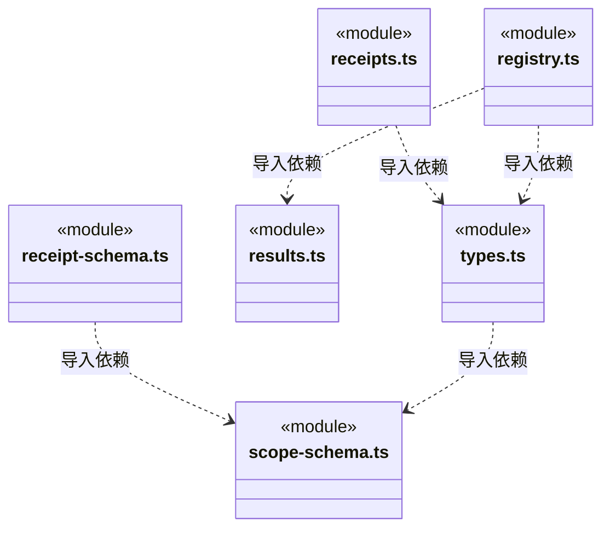

各图中的同名节点表示同一目录边界；跨组及完整直接依赖如下（无边不代表继承）：

- `native-tools.ts` → `policy`：导入。
- `outcome.ts` → `results.ts`：导入。
- `policy` → `scope-schema.ts`：导入。
- `policy` → `types.ts`：导入。
- `receipt-schema.ts` → `scope-schema.ts`：导入。
- `receipts.ts` → `types.ts`：导入。
- `registry.ts` → `contracts.ts`：导入。
- `registry.ts` → `input-validation.ts`：导入。
- `registry.ts` → `results.ts`：导入。
- `registry.ts` → `types.ts`：导入。
- `types.ts` → `scope-schema.ts`：导入。

### contracts.ts

[查看源码](contracts.ts)。

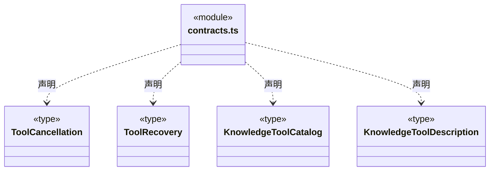

### input-validation.ts

[查看源码](input-validation.ts)。

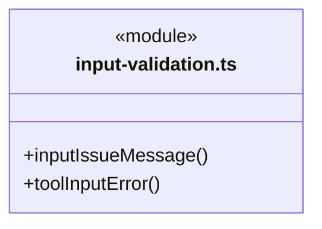

直接依赖：[../../../core/errors.ts](../../../core/errors.ts)。

### native-tools.ts

[查看源码](native-tools.ts)。

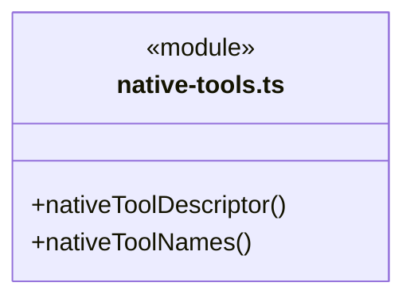

直接依赖：[../../engines/index.ts](../../engines/index.ts)、[policy/tool-policy.ts](policy/tool-policy.ts)。

### outcome.ts

[查看源码](outcome.ts)。

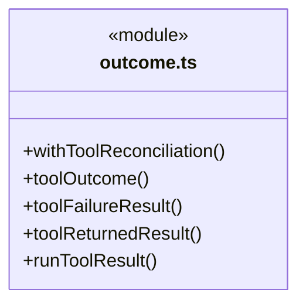

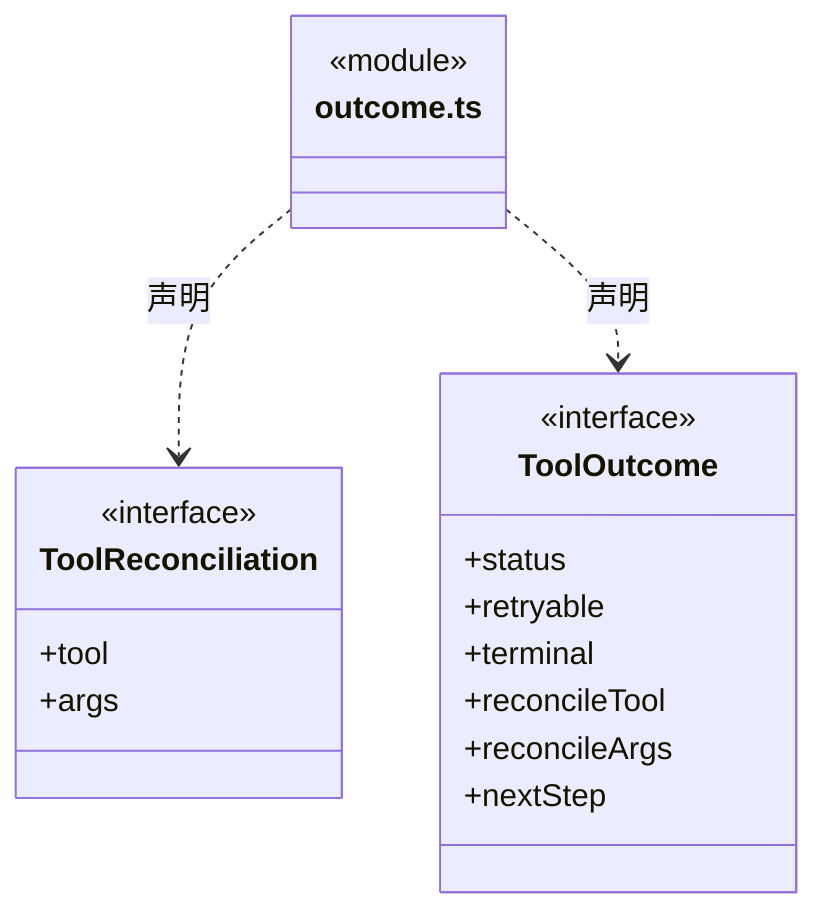

直接依赖：[../../../core/errors.ts](../../../core/errors.ts)、[results.ts](results.ts)。

### questions.ts

[查看源码](questions.ts)。

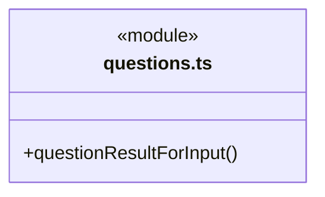

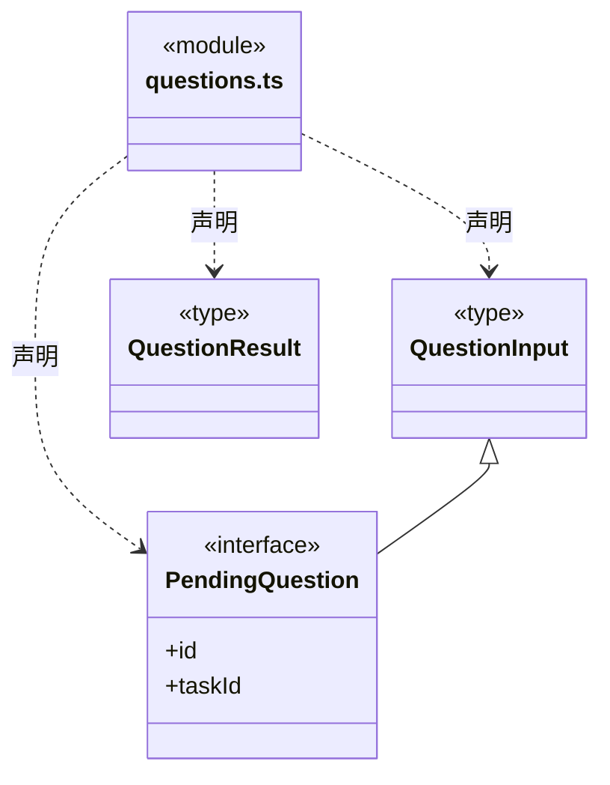

### receipt-schema.ts

[查看源码](receipt-schema.ts)。

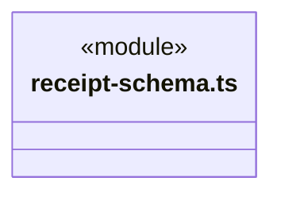
直接依赖：[scope-schema.ts](scope-schema.ts)。

### receipts.ts

[查看源码](receipts.ts)。

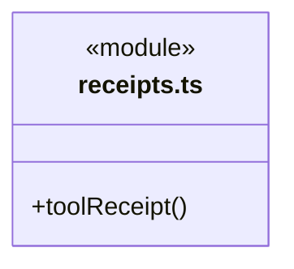

直接依赖：[../../../core/platform/node/serialization.ts](../../../core/platform/node/serialization.ts)、[types.ts](types.ts)。

### registry.ts

[查看源码](registry.ts)。

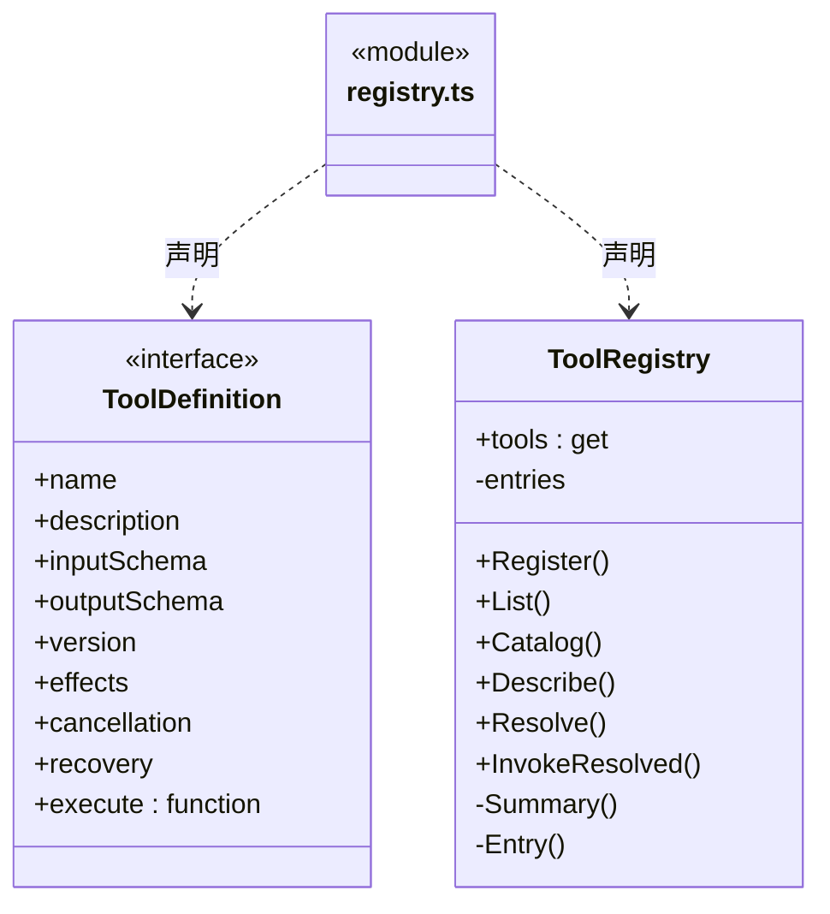

直接依赖：[../../../core/errors.ts](../../../core/errors.ts)、[contracts.ts](contracts.ts)、[input-validation.ts](input-validation.ts)、[results.ts](results.ts)、[types.ts](types.ts)。

### results.ts

[查看源码](results.ts)。

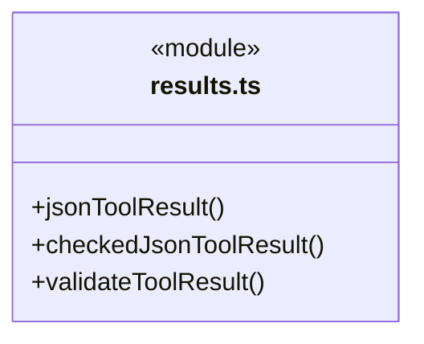

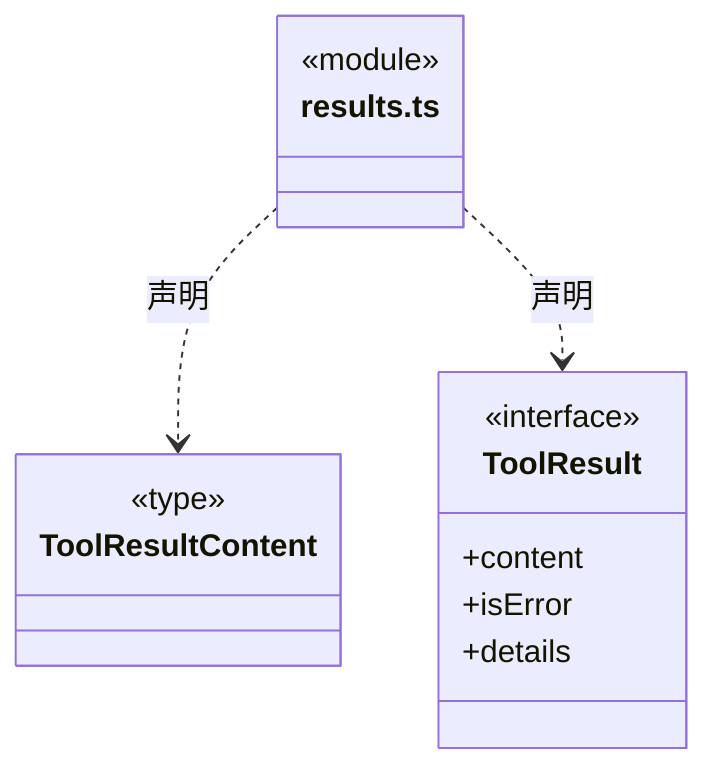

直接依赖：[../../../core/errors.ts](../../../core/errors.ts)。

### scope-schema.ts

[查看源码](scope-schema.ts)。

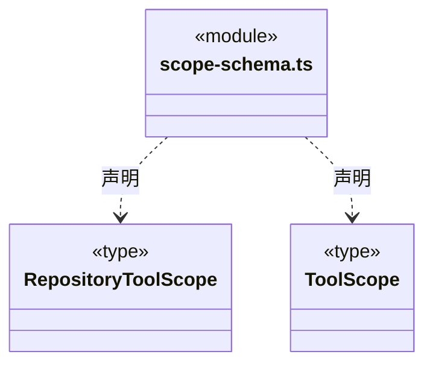

直接依赖：[../../connectors/rules/definition.ts](../../connectors/rules/definition.ts)、[../../feedback/index.ts](../../feedback/index.ts)。

### types.ts

[查看源码](types.ts)。

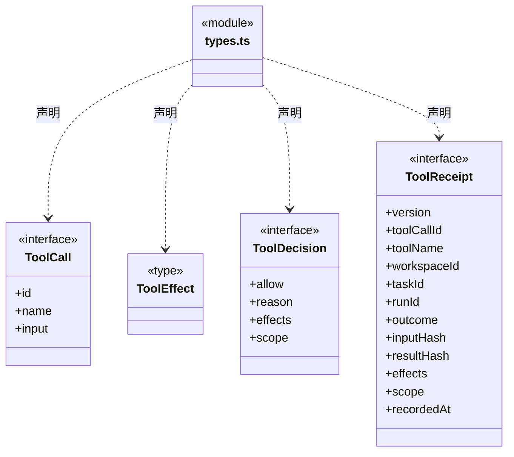

直接依赖：[scope-schema.ts](scope-schema.ts)。

## 子目录导航

- [policy/](policy/ARCHITECTURE.md)：工具统一授权策略：read/ask/execute 决策及协议；业务写入和知识写入共用策略，不能豁免平台边界，也不等于操作系统隔离。

[返回上层](../ARCHITECTURE.md)。

每次修改本目录代码，同步维护文件头、关键契约说明及本图。未实现的治理、证据验收和自动编排能力不列入当前类图。

<!-- architecture:generated:end -->
