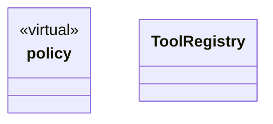

# src/logic/tools/rules 架构

## 设计意图

统一工具描述、调用输入输出及授权策略。ToolRegistry 维护登记和发现，提问与回执协议表达交互事实，策略子模块裁决调用边界。

## 主要组成

| 组成 | 定位 |
| --- | --- |
| [ToolRegistry](registry.ts) | 实际内部工具的输入/业务输出协议、版本、副作用及取消/恢复说明，支持摘要与按需完整描述。 |

<!-- architecture:generated:start -->

## 架构关系

标注为 `virtual` 的节点是直接子模块的虚拟类封装；内部设计沿下方入口阅读。

## 子模块

| 虚拟封装 | 整体职责 |
| --- | --- |
| [policy](policy/ARCHITECTURE.md) | 工具统一授权策略：read/ask/execute 决策及协议；业务写入和知识写入共用策略，不能豁免平台边界，也不等于操作系统隔离。 |

[上层设计](../ARCHITECTURE.md)

<!-- architecture:generated:end -->
