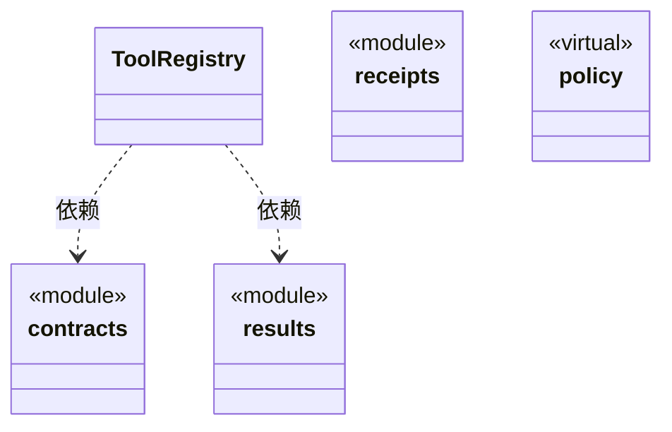

# src/logic/tools/rules 架构

## 设计意图

统一工具描述、输入输出与回执语义，让发现、执行前校验和授权使用同一协议边界。

`ToolRegistry` 登记真实工具及其约束，结果与回执函数核对可公开事实，提问协议区分待答与完成；`policy` 裁决 read/ask/execute。工具有注册记录不代表获得权限，结果合法也不自动证明对应业务事务已完成。

## 主要组成

| 组成 | 定位 |
| --- | --- |
| [ToolRegistry](registry.ts) | 实际内部工具的输入/业务输出协议、版本、副作用及取消/恢复说明，支持摘要与按需完整描述。 |
| [contracts](contracts.ts) | 工具契约发现、取消及恢复说明的纯协议。 |
| [receipts](receipts.ts) | 从已核实调用、授权和终态生成可追溯回执。 |
| [results](results.ts) | 校验业务工具结果并封装合法文本块。 |

## 现状与目标边界

当前工具注册、协议、结果和回执直接放在父层，授权策略已在 policy 封装。目标是按工具目录、调用协议与授权决策的职责继续分离，父层描述组合；现有 ToolRegistry 和函数集合仍是真实组成。迁移不能把注册等同授权，也不能用一个全域工具出口制造运行服务的反向依赖。

<!-- architecture:generated:start -->

## 架构关系

标注为 `virtual` 的节点是直接子模块的虚拟类封装；内部设计沿下方入口阅读。

## 子模块

| 虚拟封装 | 整体职责 |
| --- | --- |
| [policy](policy/ARCHITECTURE.md) | 集中表达工具调用的 read/ask/execute 决策，统一业务文件与正式知识写入的授权语义。 |

[上层设计](../ARCHITECTURE.md)

<!-- architecture:generated:end -->
