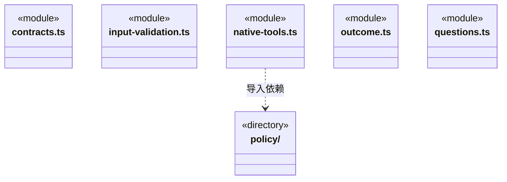
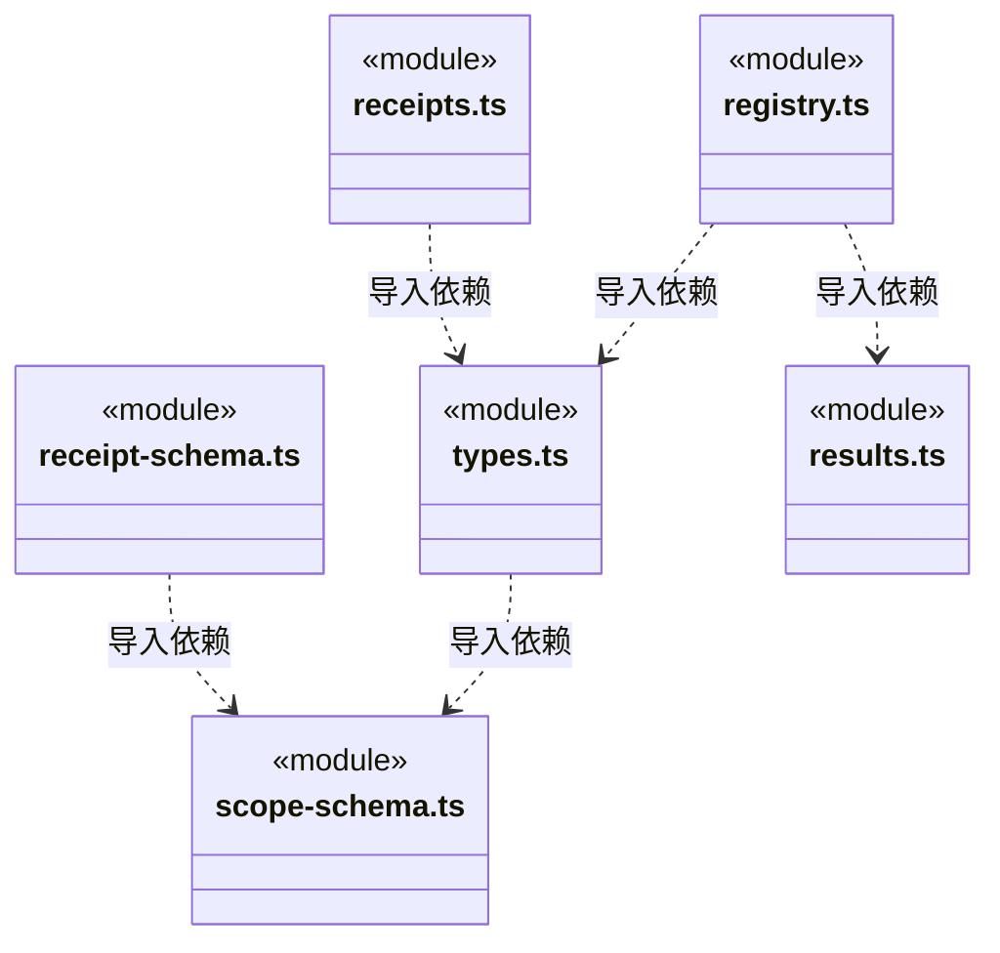
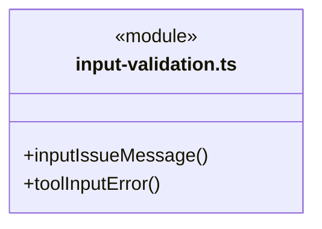
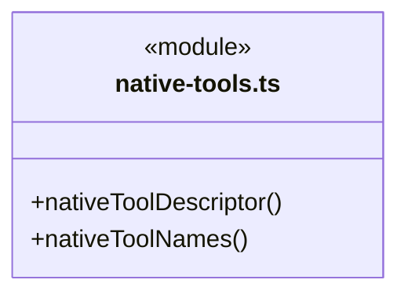
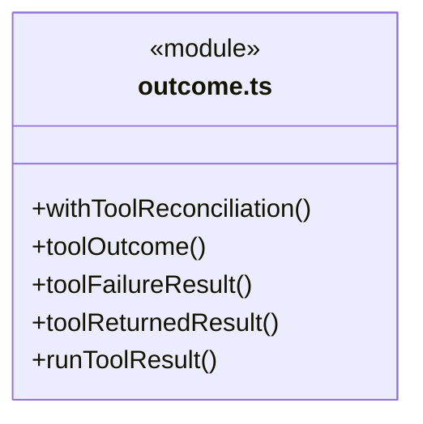
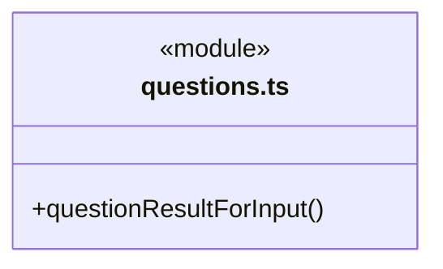
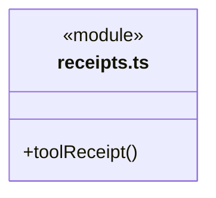
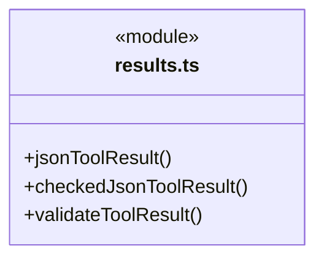
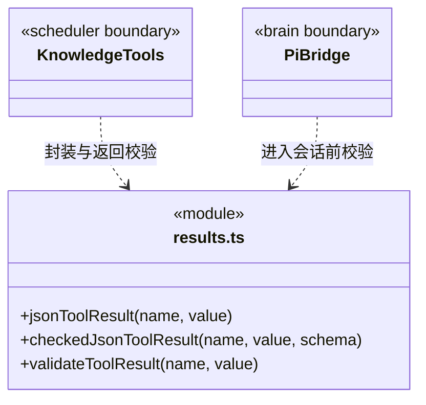

# src/logic/tools/rules 架构

## 目录定位

工具 Schema、版本、副作用、调用决策、严格提问/答案及回执。提问按原题同序核验，取消与答案排他；during_wait只承诺结束未完成交互。结果只核唯一 JSON 快照，不用解析改写制造成功；历史可读不等于当前业务证据有效。注册、发现及用户回答不授予权限。 原生能力按 Pi/Claude Code/Codex 提供真实预检清单，Codex 由宿主执行既有文件操作，Claude 不宣称独立 ls。 GitHub 反馈使用独立 scope 和 external-write 效果；不把外部提交回执当作业务文件或知识成果。

本文描述当前实现。通过分析目录边界后维护的 [源码架构脚本](../../../../scripts/source-architecture.mjs) 同步清单和声明；代码变更时仍须核对职责、关键成员与关系。

## 代码清单

| 文件 | 当前职责 |
| --- | --- |
| [contracts.ts](contracts.ts) | 工具取消、恢复说明及按需契约发现的纯协议，不导入具体领域或执行服务。 |
| [input-validation.ts](input-validation.ts) | 将工具输入校验转换为不含原参数值的字段说明，供执行前拒绝与历史展示共用。 |
| [native-tools.ts](native-tools.ts) | 定义当前引擎真实装配的原生工具及可信副作用分类。 |
| [outcome.ts](outcome.ts) | 引擎工具回包的统一结果与下一步说明；独立于具体业务账本。 |
| [questions.ts](questions.ts) | 结构化提问的严格输入、桌面答案、排他结果与待答快照，供队列、工具包装和证据边界共用。 |
| [receipt-schema.ts](receipt-schema.ts) | 执行报告与任务工具共用的真实工具回执字段协议。 |
| [receipts.ts](receipts.ts) | 把已核实的工具调用、授权和终态整理为可追溯回执。 |
| [registry.ts](registry.ts) | 实际内部工具的输入/业务输出协议、版本、副作用及取消/恢复说明，支持摘要与按需完整描述。 |
| [results.ts](results.ts) | 校验内部工具传给大脑的结果，并将领域返回值封装为合法文本块。 |
| [scope-schema.ts](scope-schema.ts) | 工具回执与可信授权描述共用的纯范围协议，区分项目文件、知识、未知影响和外部仓库读取。 |
| [types.ts](types.ts) | 引擎无关的工具调用、副作用、策略决策及运行回执契约。 |

## 架构类图

各图中的同名节点表示同一目录边界；跨组及完整直接依赖如下（无边不代表继承）：

- `native-tools.ts` → `policy`：导入。
- `outcome.ts` → `results.ts`：导入。
- `policy` → `types.ts`：导入。
- `policy` → `scope-schema.ts`：导入。
- `receipt-schema.ts` → `scope-schema.ts`：导入。
- `receipts.ts` → `types.ts`：导入。
- `registry.ts` → `input-validation.ts`：导入。
- `registry.ts` → `types.ts`：导入。
- `registry.ts` → `results.ts`：导入。
- `registry.ts` → `contracts.ts`：导入。
- `types.ts` → `scope-schema.ts`：导入。

### input-validation.ts 公开入口

### native-tools.ts 公开入口

### outcome.ts 公开入口

### questions.ts 公开入口

### receipts.ts 公开入口

### results.ts 公开入口

## 子目录导航

- [policy/](policy/ARCHITECTURE.md)：工具统一授权策略：read/ask/execute 决策及协议；业务写入和知识写入共用策略，不能豁免平台边界，也不等于操作系统隔离。

[返回上层](../ARCHITECTURE.md)。

每次修改本目录代码，同步维护文件头、关键契约说明及本图。未实现的治理、证据验收和自动编排能力不列入当前类图。

## 设计契约 v1 与落地范围

以下内容区分已接通能力与后续设计；以各节的实现状态为准，不将目标图当作现状图。维护源：[CONTRACT.md](CONTRACT.md)；生成类图时同步附加，勿直接修改本附录。

### GitHub 外部写与可信范围

`external-write` 区分已连接 GitHub 目标的 Issue 写入，不是 business-write 或 knowledge-write。`githubFeedbackScopeSchema` 严格保存工作区、连接代际、不可变仓库 ID 和 owner/repo，不含 URL、正文或令牌。统一工具效果与回执 Schema 兼容旧日志，并保留新效果；外部回执不能充当业务文件或知识提交证明。

### 结构化提问的纯契约

`questions.ts` 统一 `questionToolName`、严格嵌套问题输入、桌面答案输入与排他的 answers/cancelled 输出。模型不能夹带身份、批准或范围字段；桌面只提交原选项索引或其它文字。`questionResultForInput` 独立保存已解析原题，核对回答数量、顺序、原题文字及补充的选项关系，不裁剪、填默认值或修剪输出 wire。

没有 supplement 的答案可能来自选项或其它文字，不能反推选择来源、认证身份、工具授权或人工验收。工具成功和取消事实保留在日志，但不成为业务完成证据。取消元数据 `during_wait` 只用于尚未完成的交互；其它工具的 `preflight_only` 及既有领域事务语义不改变。

### 当前工具结果边界

`results.ts` 是内部工具结果的共同协议边界。`jsonToolResult` 将明确的领域值编码为文本块，拒绝 `undefined`、循环对象和不可序列化值；显式 `null` 可以正常返回。

知识注册工具通过 `checkedJsonToolResult` 验证业务输出：领域 `execute` 只调用一次，原值只进行一次 JSON 序列化；用该编码的独立解析副本执行输出 Schema 校验，并与未交给校验器的原快照作结构比较。Zod 裁剪、默认值、类型转换、原地修改或增加 `undefined` 字段都不能补成成功；对象键顺序不改变 JSON 事实。通过后直接发送原编码文本，不重新编码领域值或 Schema 结果，因此 `toJSON` 不能在验证后偷偷改变发送内容。

业务输出失败为 `TOOL_OUTPUT_INVALID`，错误仅提供掩去动态键的结构位置和校验类别，不包含输出正文、凭据或原始异常。它明确表示操作可能已发生，要求核实既有记录、不自动重试；不会撤销事务、返还单次批准或再调用领域操作。合法的 `invalid`、`not_found`、校验问题和已提交清理警告由各领域 Schema 保留，不被转换为执行成功或回滚。

`validateToolResult` 校验实际 JSON 传输快照：`content` 必须为数组；文本块必须有字符串 `text`；图片块必须有非空 `data` 和图片 `mimeType`；可选 `isError` 必须为布尔值。校验失败抛出 `TOOL_RESULT_INVALID`，错误不携带原始返回内容。

知识适配器在返回时校验，Pi 执行桥在结果进入原生会话前再次校验。桥将失败转为带错误码的合法工具错误，已消费的单次授权不因结果错误而恢复，也不重放可能已发生副作用的操作。有效的结果结构不代表业务成功，业务状态和验收仍由对应领域负责。

历史会话修复属于显式维护，不在模型调用或结果校验中静默修改旧记录。

### 实际注册表与按需发现

`ToolRegistry` 只登记合法 `cbim_` 名称，并强制声明正整数版本、副作用、输出 Schema、取消语义和恢复说明。解析输入与执行分离；只有本注册表实际解析出的定义可以调用 `invokeResolved`，不能借同名外来对象执行。`list` 保持引擎需要的紧凑输入清单；`catalog/describe` 仅查询该知识注册表，不能执行工具或凭元数据授权。

`contracts.ts` 保存取消/恢复和发现输出的纯协议。知识目录返回 `family:knowledge` 与实际名称、可选描述、版本、副作用；详情按名称返回有限输入/输出 JSON Schema 和取消/恢复说明。自描述通过有限 Schema 引用表达，不递归嵌套整个注册表，不公开 `execute`、凭据、原生工具或派发工具。原始定义/人员诊断允许保留任意 JSON 事实（包括自有 `__proto__` 键），不裁剪成看似合格的业务对象。

### 原生工具的单一可信分类

`native-tools.ts` 保存当前引擎实际支持的原生工具描述，供 Pi 注册、正式成员能力预检、授权分类和 Workflow canonical 评价共用。`nativeToolDescriptor` 返回独立描述，未知名称及对象继承属性不属于注册工具；`nativeToolNames(false)` 只包含只读工具。

表中 read/grep/find/ls 属于 read，write/edit 属于 business-write，bash 属于 command。该清单不发放权限、不执行工具、不决定路径是否可访问；路径守卫、ask 审批与工作区身份仍由策略执行。任务评价只能核对实际成功调用，不能凭名称声明业务验证或完整文件覆盖。

### 工具范围与外部资料身份

`scope-schema.ts` 是授权策略、工具回执和证据解析共用的纯范围协议。原 workspace/knowledge/unknown 分支保留 `{kind,workspaceId}` 形状；repository 分支严格保存 workspaceId、connectorId、repositoryId、connectionId 与 list/get 操作，不接受 URL、凭据或调用方声明的授权。仓库身份来自本轮可信捕获描述，不从模型输入直接创建能力。

成功的 repository read 表示所绑定仓库操作收到真实回执，不能降格为 workspace read，也不能冒充本地文件、任务交付或成员检查点的证据。共享解析保留这种身份供主运行历史与 canonical 核实；下游业务证据仍分别检查来源边界。

### 共享回执结构与当前证据资格

`receipt-schema.ts` 提供报告、执行进度公开输出共同使用的 `toolReceiptSchema` 与副作用枚举。它保持历史报告原结构：空 effects、空 toolName 和缺省 resultHash 仍可读取，不能因此补造成功结果或执行范围；各字段的真实归属、日志链及业务用途由调用层核实。

进度工具在此结构之上要求真实 workspaceId/taskId/runId、相同作用域工作区、明确 succeeded、非空工具名与实际 resultHash。内部维护、目标调度、治理和 repository 资料不作为业务交付证据。Schema 通过仅说明返回协议合法，不授予执行、验收或重试权。

`checkedJsonToolResult` 也供主调度八工具与成员七工具使用。保存后输出异常不会回滚领域记录；工具包装必须在调用端口前独立冻结请求、绑定和必要前态，不能将端口可能改动的原对象同时作为核验依据。

## 冻结范围成员执行

取消元数据新增during_execution，表示可信宿主能终止当前实际执行并等退出；不改变preflight_only、during_wait及恢复的原语义，也不声称副作用回滚。

### 原生能力预检

nativeToolNames 按引擎提供真实规范名：Pi 保持既有清单，Codex 通过宿主工具提供同一规范名，Claude Code 排除不存在的独立 ls。该清单供岗位 Workflow 准备预检，不是逐调用许可；真实路径、效果、授权仍由运行时核实。

### 统一调用结果

`outcome.ts` 定义 status（returned/rejected/unknown）、retryable=false、terminal=true、reconcileTool/reconcileArgs 和 nextStep。terminal 表示本次请求已返回且不能自动重复，不表示业务目标终态。成功放在 ToolResult.details.outcome，保留原领域正文；异常同时用 JSON 文本交给模型。无可靠只读核实入口时两个 reconcile 字段明确 null，原生文件/命令须查原日志和实际副作用。只有可信适配器可附原命令地址，不从错误正文解析或补造身份。

## 知识工具输入诊断

`ToolRegistry.resolve` 在执行前校验参数。失败只列最多八项字段及类型/缺项提示，不回显输入正文；涉及 workspaceId/instanceId 时要求先调用当前身份工具，不自动补齐或沿用旧实例。领域身份、版本及权限仍由原入口检查；诊断不授权重放先前结果未知的调用。

## 输入校验与缺省参数

input-validation.ts 只解释实际 Schema issues，不根据工具字段清单推断缺参；optional/default 由原 Schema 决定，null、空字符串、显式值不转换为缺省。工具注册表使用共享无原值字段说明。toolInputError 仅用于执行前校验，ZodError 转为 TOOL_INPUT_INVALID，outcome 明确 rejected；执行后未知异常不使用此转换。字段说明经 Bridge 供旧 UI 投影共用，不赋予执行或重试许可。

反馈范围 Schema 的唯一实现已迁入 Logic feedback；scope-schema.ts 组合并兼容重导出它，旧日志字段与校验保持，工具权限仍由可信调用方签发。
