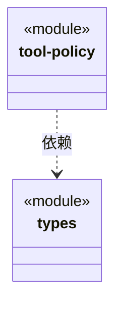

# src/logic/tools/rules/policy 架构

## 设计意图

集中表达工具调用的 read/ask/execute 决策，统一业务文件与正式知识写入的授权语义。

`types` 定义权限模式和单次批准，`tool-policy` 结合可信副作用分类作出判断。策略不执行工具、不持有批准队列，也不替代操作系统隔离和路径边界；实际运行必须同时满足这些约束。

## 主要组成

| 组成 | 定位 |
| --- | --- |
| [tool-policy](tool-policy.ts) | 内部 Loop 的统一工具授权策略，同时处理业务文件与正式知识写入。 |
| [types](types.ts) | 对话权限模式和单次人工确认契约。 |

<!-- architecture:generated:start -->

## 架构关系

[上层设计](../ARCHITECTURE.md)

<!-- architecture:generated:end -->
