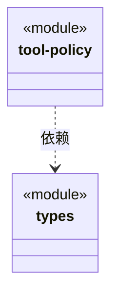

# src/logic/tools/rules/policy 架构

## 设计意图

工具统一授权策略：read/ask/execute 决策及协议；业务写入和知识写入共用策略，不能豁免平台边界，也不等于操作系统隔离。

## 主要组成

| 组成 | 定位 |
| --- | --- |
| [tool-policy](tool-policy.ts) | 内部 Loop 的统一工具授权策略，同时处理业务文件与正式知识写入。 |
| [types](types.ts) | 对话权限模式和单次人工确认契约。 |

<!-- architecture:generated:start -->

## 架构关系

[上层设计](../ARCHITECTURE.md)

<!-- architecture:generated:end -->
