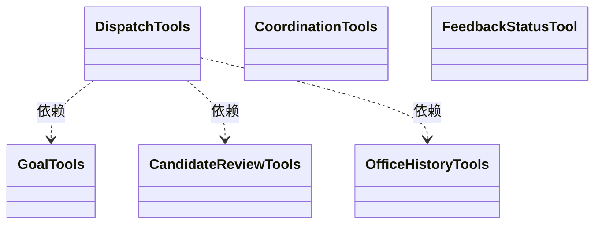
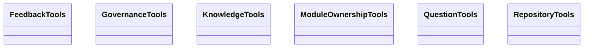
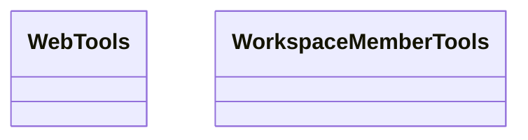

# src/logic/tools/runtime 架构

## 设计意图

把已装配的业务服务包装为模型工具。各工具类负责一个业务入口的输入校验和结果投影，运行身份与权限从可信上下文注入；真正业务状态仍由对应服务持有。

## 主要组成

| 组成 | 定位 |
| --- | --- |
| [CandidateReviewTools](candidate-review-tools.ts) | 仅向主运行提供精确成员候选审阅入口。 |
| [CoordinationTools](coordination-tools.ts) | 主运行的统一状态与原回执读取入口，保留各领域实际校验和恢复语义。 |
| [DispatchTools](dispatch-tools.ts) | 把主调度的派发、查询、未启动撤销、依赖修订及检查点预约/明确放弃转换为内部工具，并组合目标工具。 |
| [FeedbackStatusTool](feedback-status-tool.ts) | 主会话的反馈可用性只读诊断，区分本轮装配事实与当前本机连接事实。 |
| [FeedbackTools](feedback-tools.ts) | 主会话的 GitHub 反馈提交与原提交核实工具，承接两项内置 Skill 的格式字段。 |
| [GoalTools](goal-tools.ts) | 将主 Agent 当前用户目标、真实补充历史的读取及规划审阅端口注册为内部 Loop 工具。 |
| [GovernanceTools](governance-tools.ts) | 将每个真实主运行的治理窄端口装配成发现、分类与调用一致的四项工具。 |
| [KnowledgeTools](knowledge-tools.ts) | 向 CBIM 内部大脑提供知识查询、对象事务和内置 Skill 工具。 |
| [ModuleOwnershipTools](module-ownership-tools.ts) | 把本轮真实主运行的模块责任端口转换为发现、分类和执行一致的四工具。 |
| [OfficeHistoryTools](office-history-tools.ts) | 只向主运行提供当前办公室的话题归档读取工具。 |
| [QuestionTools](question-tools.ts) | 为已装配用户交互端口的主/成员运行提供结构化提问工具及严格答案回包。 |
| [RepositoryTools](repository-tools.ts) | 把主进程捕获的资源仓库只读端口装配为主调度可调用的两个工具。 |
| [WebTools](web-tools.ts) | 将主进程公开网页读取端口注册为两个只读主 Agent 工具。 |
| [WorkspaceMemberTools](workspace-member-tools.ts) | 将主运行岗位端口注册为查询、预览、提交与原回执四项工具。 |

<!-- architecture:generated:start -->

## 架构关系

### 关系组 1

### 关系组 2

### 关系组 3

[上层设计](../ARCHITECTURE.md)

<!-- architecture:generated:end -->
