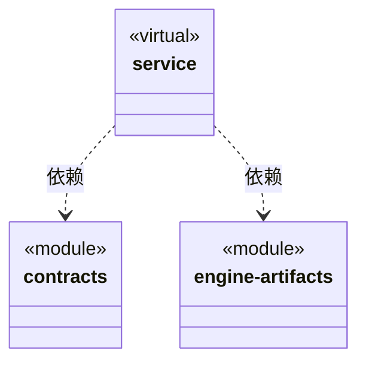

# src/logic/updates 架构

## 设计意图

桌面资源与安装更新状态和服务；校验签名、原子选择、失败恢复与业务应用生命周期分离。

## 主要组成

| 组成 | 定位 |
| --- | --- |
| [contracts](contracts.ts) | 正式桌面版本、后台预下载进度与用户确认重启安装的公开 IPC 数据。 |
| [engine-artifacts](engine-artifacts.ts) | R 引擎管理与 C 制品验证之间的便携窄端口。 |

<!-- architecture:generated:start -->

## 架构关系

标注为 `virtual` 的节点是直接子模块的虚拟类封装；内部设计沿下方入口阅读。

## 子模块

| 虚拟封装 | 整体职责 |
| --- | --- |
| [service](service/ARCHITECTURE.md) | 将版本发现、资源准备、安装与恢复封装为独立更新系统。桌面安装、运行资源和引擎制品各有状态与存储，只有明确安装时才通过关闭回调等待业务应用退出。 |

[上层设计](../ARCHITECTURE.md)

<!-- architecture:generated:end -->
