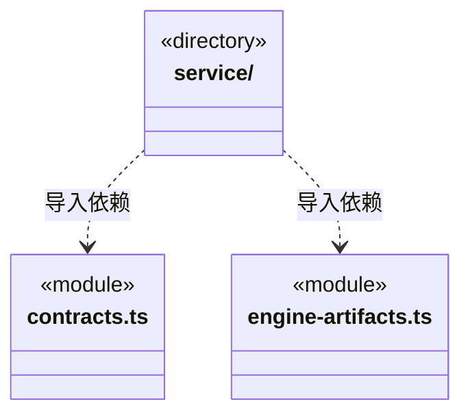

# src/logic/updates 架构

## 目录定位

桌面资源与安装更新状态和服务；校验签名、原子选择、失败恢复与业务应用生命周期分离。

本文描述当前实现。通过分析目录边界后维护的 [源码架构脚本](../../../scripts/source-architecture.mjs) 同步清单和声明；代码变更时仍须核对职责、关键成员与关系。

## 代码清单

| 文件 | 当前职责 |
| --- | --- |
| [contracts.ts](contracts.ts) | 正式桌面版本、后台预下载进度与用户确认重启安装的公开 IPC 数据。 |
| [engine-artifacts.ts](engine-artifacts.ts) | R 引擎管理与 C 制品验证之间的便携窄端口。 |

## 架构类图

各图中的同名节点表示同一目录边界；跨组及完整直接依赖如下（无边不代表继承）：

- `service` → `contracts.ts`：导入。
- `service` → `engine-artifacts.ts`：导入。

## 子目录导航

- [service/](service/ARCHITECTURE.md)：独立桌面更新子系统：公开 Release 读取、稳定版本筛选、后台预下载与用户确认重启的状态机和 NSIS 适配均在此目录。只组合本域更新契约、获准的便携 Core utility 及系统/第三方库，不依赖普通应用服务或业务编排；仅明确安装时通过关闭回调等待主程序排空。安装包缓存独立于运行数据。 C/R 复用一个准备和显式应用状态机；Ed25519 清单、完整 ZIP 文件集合、不可变包缓存和激活日志属于冷壳可信机制。候选一旦接触数据，失败只能恢复，不能自动降级。

[返回上层](../ARCHITECTURE.md)。

每次修改本目录代码，同步维护文件头、关键契约说明及本图。未实现的治理、证据验收和自动编排能力不列入当前类图。

## 设计契约 v1 与落地范围

以下内容区分已接通能力与后续设计；以各节的实现状态为准，不将目标图当作现状图。维护源：[CONTRACT.md](CONTRACT.md)；生成类图时同步附加，勿直接修改本附录。

### 引擎准备与应用更新分离

EngineArtifactsPort 的 prepare 接受可选进度回调，报告准备过程但不授予安装或运行许可；选择及短期进度由 Logic/engines 的包管理服务拥有。旧冷宿主可忽略回调，调用结果与错误语义不变。

DesktopUpdateStatus.enginePreparations 仅保留旧冷宿主兼容，不再由应用更新界面消费；引擎状态通过 engines.settings 展示。具体支持清单仍随 R 静态代码提供，冷框架不登记厂商引擎。
