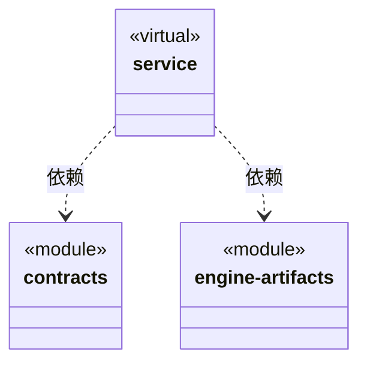

# src/logic/updates 架构

## 设计意图

管理桌面冷基础、运行资源和引擎制品的更新边界，使准备候选与明确激活分离。

本层契约向界面公开版本与进度，并在冷壳和引擎管理间提供制品端口；`service` 实施签名核验、不可变缓存、选择记录和恢复。更新只经关闭回调等待业务排空，不反向持有普通应用服务。

## 主要组成

| 组成 | 定位 |
| --- | --- |
| [contracts](contracts.ts) | 正式桌面版本、后台预下载进度与用户确认重启安装的公开 IPC 数据。 |
| [engine-artifacts](engine-artifacts.ts) | R 引擎管理与 C 制品验证之间的便携窄端口。 |

## 现状与目标边界

当前 [contracts.ts](contracts.ts) 与 [engine-artifacts.ts](engine-artifacts.ts) 是父层纯协议，service 承担更新状态与平台适配。目标是将公开状态及冷壳制品端口归入明确契约封装，父层只表达组合。冷壳与业务资源跨版本协作依赖这些协议，迁移要核实旧资源兼容及固定入口，不能联动加载普通应用服务。

<!-- architecture:generated:start -->

## 架构关系

标注为 `virtual` 的节点是直接子模块的虚拟类封装；内部设计沿下方入口阅读。

## 子模块

| 虚拟封装 | 整体职责 |
| --- | --- |
| [service](service/ARCHITECTURE.md) | 实现独立于普通业务的版本发现、制品准备、激活与恢复，保护用户数据和原运行选择。 |

[上层设计](../ARCHITECTURE.md)

<!-- architecture:generated:end -->
