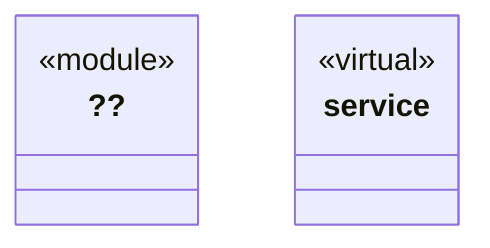

# 应用内的更新操作

## 设计意图

负责应用内的更新操作。

## 主要组成

| ?? | ?? |
| --- | --- |
| [??](index.ts) | index.ts 预留模块的公共入口。 |

<!-- architecture:generated:start -->

## 架构关系

标注为 `virtual` 的节点是直接子模块的虚拟类封装；内部设计沿下方入口阅读。

## 子模块

| 虚拟封装 | 整体职责 |
| --- | --- |
| [service](service/ARCHITECTURE.md) | 实现独立于普通业务的版本发现、制品准备、激活与恢复，保护用户数据和原运行选择。 |

[上层设计](../ARCHITECTURE.md)

<!-- architecture:generated:end -->
