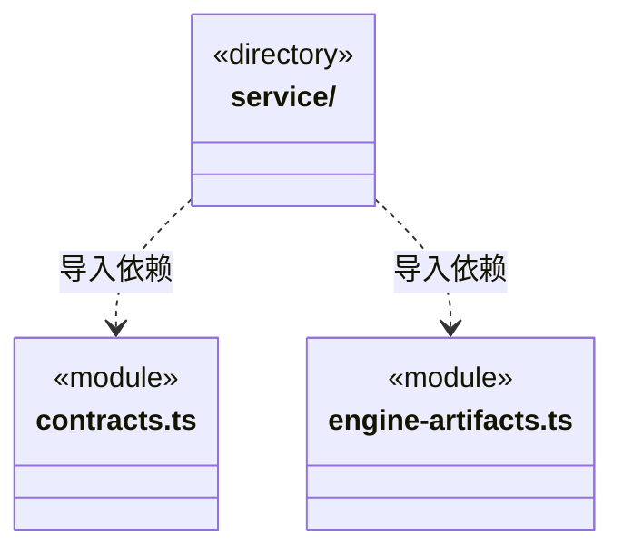
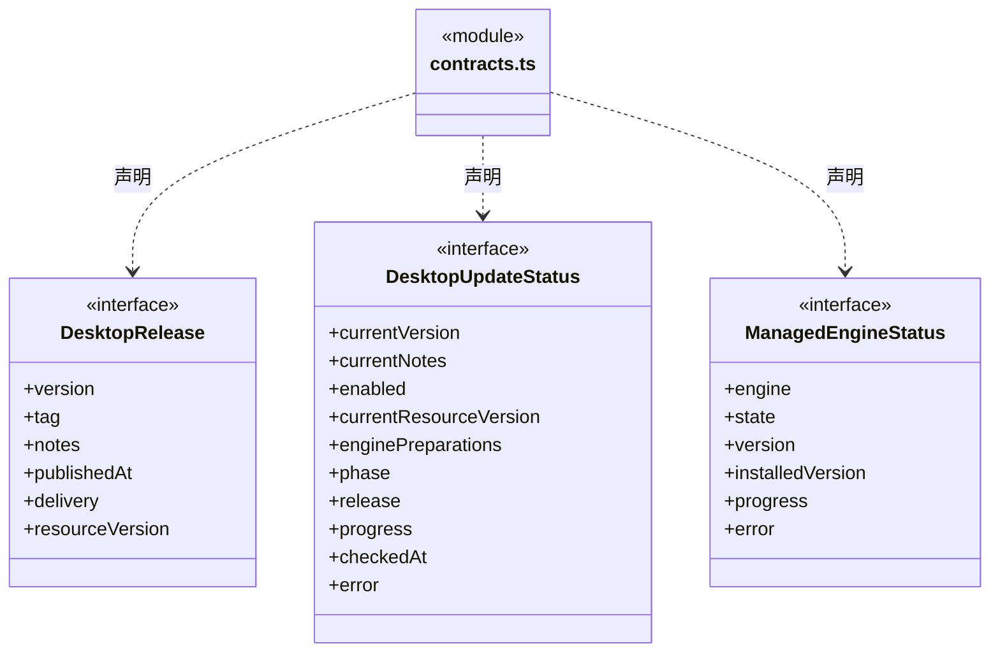
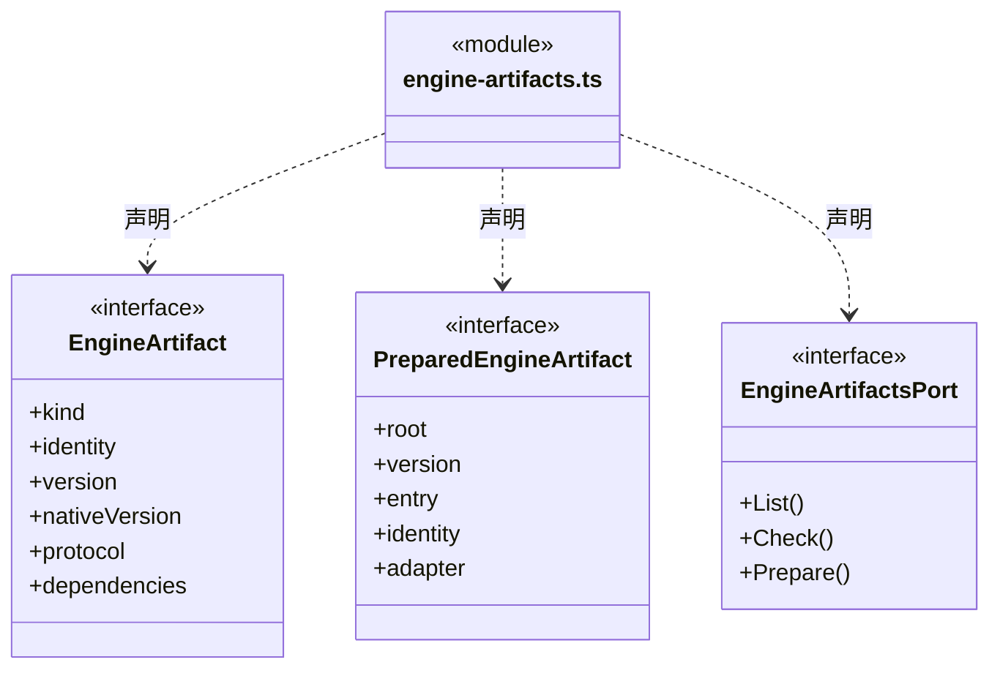

# src/logic/updates 架构

本目录只维护这一份说明。设计与契约直接编辑本文；文件清单、类图和导航由 [架构脚本](../../../scripts/source-architecture.mjs) 更新，生成区域之外的人工说明会保留。

## 封装意图

桌面资源与安装更新状态和服务；校验签名、原子选择、失败恢复与业务应用生命周期分离。

## 类与模块的设计意图

下表依据源码声明及文件头说明定位封装。字段表示该实例持有的状态或协作引用，不表示它拥有被引用服务的生命周期；实际资源责任和调用限制见下文契约及源码注释。

| 类／模块 | 实现形式与实例字段 | 封装依据 |
| --- | --- | --- |
| [contracts.ts](contracts.ts) | 函数／契约模块 | 页面只展示版本和进度，不接收安装路径、执行命令、更新源配置或 GitHub 凭据。 |
| [engine-artifacts.ts](engine-artifacts.ts) | 函数／契约模块 | 冷壳只认识签名制品身份、依赖和通用协议；支持名单、安装选择和 Agent 引用归 R，不在这里注册引擎。 |

## 接口设计契约

##### 引擎准备与应用更新分离

EngineArtifactsPort 的 prepare 接受可选进度回调，报告准备过程但不授予安装或运行许可；选择及短期进度由 Logic/engines 的包管理服务拥有。旧冷宿主可忽略回调，调用结果与错误语义不变。

DesktopUpdateStatus.enginePreparations 仅保留旧冷宿主兼容，不再由应用更新界面消费；引擎状态通过 engines.settings 展示。具体支持清单仍随 R 静态代码提供，冷框架不登记厂商引擎。

## 开闭边界

本目录的职责及允许协作由[封装意图](#封装意图)限定，输入输出、状态与失败语义以[接口设计契约](#接口设计契约)为准。扩展从已有公开入口及实际装配位置进入；没有明确可替换契约的部分按真实影响修改和验证，不预建未使用的基类或插件入口。

<!-- architecture:generated:start -->

## 文件清单

| 文件 | 形式 | 当前职责 |
| --- | --- | --- |
| [ARCHITECTURE.md](ARCHITECTURE.md) | 说明文档 | 本目录的文件清单、真实声明、依赖与子封装导航。 |
| [contracts.ts](contracts.ts) | 源码模块 | 正式桌面版本、后台预下载进度与用户确认重启安装的公开 IPC 数据。 |
| [engine-artifacts.ts](engine-artifacts.ts) | 源码模块 | R 引擎管理与 C 制品验证之间的便携窄端口。 |

## 架构类图

成员标记：`+` 公开、`-` 私有、`#` 受保护、`$` 静态；构造函数单独列出。文档和资源仅在文件清单中导航，不作为代码节点。

各图中的同名节点表示同一目录边界；跨组及完整直接依赖如下（无边不代表继承）：

- `service` → `contracts.ts`：导入。
- `service` → `engine-artifacts.ts`：导入。

### contracts.ts

### engine-artifacts.ts

## 子目录导航

- [service/](service/ARCHITECTURE.md)：独立桌面更新子系统：公开 Release 读取、稳定版本筛选、后台预下载与用户确认重启的状态机和 NSIS 适配均在此目录。只组合本域更新契约、获准的便携 Core utility 及系统/第三方库，不依赖普通应用服务或业务编排；仅明确安装时通过关闭回调等待主程序排空。安装包缓存独立于运行数据。 C/R 复用一个准备和显式应用状态机；Ed25519 清单、完整 ZIP 文件集合、不可变包缓存和激活日志属于冷壳可信机制。候选一旦接触数据，失败只能恢复，不能自动降级。

[返回上层](../ARCHITECTURE.md)。

每次修改本目录代码，同步维护文件头、关键契约说明及本图。未实现的治理、证据验收和自动编排能力不列入当前类图。

<!-- architecture:generated:end -->
