# src/logic/updates/service 架构

本目录只维护这一份说明。设计与契约直接编辑本文；文件清单、类图和导航由 [架构脚本](../../../../scripts/source-architecture.mjs) 更新，生成区域之外的人工说明会保留。

## 封装意图

独立桌面更新子系统：公开 Release 读取、稳定版本筛选、后台预下载与用户确认重启的状态机和 NSIS 适配均在此目录。只组合本域更新契约、获准的便携 Core utility 及系统/第三方库，不依赖普通应用服务或业务编排；仅明确安装时通过关闭回调等待主程序排空。安装包缓存独立于运行数据。 C/R 复用一个准备和显式应用状态机；Ed25519 清单、完整 ZIP 文件集合、不可变包缓存和激活日志属于冷壳可信机制。候选一旦接触数据，失败只能恢复，不能自动降级。

## 类与模块的设计意图

下表依据源码声明及文件头说明定位封装。字段表示该实例持有的状态或协作引用，不表示它拥有被引用服务的生命周期；实际资源责任和调用限制见下文契约及源码注释。

| 类／模块 | 实现形式与实例字段 | 封装依据 |
| --- | --- | --- |
| [desktop-releases.ts](desktop-releases.ts) | 函数／契约模块 | 同仓库已有 Python 内核版本；按标签、平台附件和地址核验，不能把仓库 latest 当成桌面升级。 |
| [DesktopUpdates](desktop-updates.ts) | 实例类；持有 `state`、`busy`、`retryDownloadAfter`、`controller`、`timer`、`initial`、`latest`、`installer`、`beforeInstall`、`enginePreparations` | 把联网等待移到后台，同时将下载和安装授权分开；已校验候选冻结，普通退出和迟到回包都不能触发安装；按需 E 进度来自只读端口，不改变应用候选和安装资格。 |
| [EngineArtifacts](engine-artifacts.ts) | 实例类；持有 `queue`、`initialized`、`envelopes`、`seeds`、`available`、`current`、`head`、`digest`、`stateFile`、`store`、`seed`、`signal`、`fetchIndex`、`progress`、`historicalKeys` | 构造时 seed 已由启动资源验签；stateFile 位于用户状态区，清缓存不清已接纳发布序号。 |
| [engine-index.ts](engine-index.ts) | 函数／契约模块 | E 的发布序号不依赖 C/R 版本；公钥与平台仍由冷壳固定，索引只能提供制品，不能扩大 R 的静态支持名单。 |
| [ManagedEngines](managed-engines.ts) | 实例类；持有 `states`、`jobs`、`initialization`、`store`、`descriptors`、`signal` | 对话菜单和执行工厂复用同一准备任务，查看不下载，更新不覆盖运行中的不可变包。 |
| [NsisUpdateInstaller](nsis-updater.ts) | 实例类；持有 `updater`、`pending`、`error`、`closed`、`downloaded` | 每次下载先重核版本与唯一 EXE；不允许远端清单把下载转为其它仓库、网络安装器或不同版本。 |
| [release-http.ts](release-http.ts) | 函数／契约模块 | 不复用运行时反馈服务或凭据；地址、GET、期限及字节上限由更新模块决定，仅组合 utility 的流消费机制。 |
| [restart-profile.ts](restart-profile.ts) | 函数／契约模块 | Windows Shell 重启不会继承原进程环境；必须保留自定义目录，避免更新后打开另一份历史。 |
| [runtime-archive.ts](runtime-archive.ts) | 函数／契约模块 | 不覆盖活动程序，不信任 ZIP 路径与大小；流式处理限制内存，符号链接和额外文件一律拒绝。 |
| [runtime-download.ts](runtime-download.ts) | 函数／契约模块 | GitHub 附件需要对象存储跳转，但凭据、任意主机和超出清单的内容不应进入更新链路。 |
| [runtime-host.ts](runtime-host.ts) | 函数／契约模块 | 业务只取得已验证资源路径、受管引擎解析和生命周期回执，不自行改活动版本或选择任意下载来源。 |
| [RuntimeJournal](runtime-journal.ts) | 实例类；持有 `directory`、`initial` | 只在同一安装身份的单实例进程中使用；同步小记录也可在 Electron profile 初始化前执行。 |
| [runtime-manifest.ts](runtime-manifest.ts) | 函数／契约模块 | C/R 与引擎依赖分别标识，远端只能声明固定仓库制品；完整文件集合参与签名，校验逻辑不归待加载的业务包。 |
| [RuntimeStore](runtime-store.ts) | 实例类；持有 `preparing`、`root`、`cold`、`download`、`reuseRoots` | 缓存仅含发布代码；用户数据、engineHome 与业务工作区不得位于此根目录。 |
| [RuntimeUpdates](runtime-updates.ts) | 实例类；持有 `candidate`、`selected`、`prepared`、`ready`、`controller`、`store`、`journal`、`current`、`installer`、`restart`、`sources`、`usedEngines` | 包管理只依赖窄的重启回调；不认识窗口、任务或任何业务数据存储。 |

## 接口设计契约

<a id="contract"></a>

<a id="contract-受管引擎菜单"></a>

#### 受管引擎菜单

ManagedEngines 从已验签的启动清单取得固定 E，目录状态只读本地缓存，不检查网络、不安装。首次查询校验当前包并缓存快照；prepare 与执行 resolve 共享 Promise，真实下载/解压/校验经 RuntimeStore。成功后按引擎持久化最后准备的摘要/版本，仅用于区分可安装与可更新，不作为执行路径或信任来源。改变摘要时准备新不可变目录，原进程引用不变。失败可显式重试，不覆盖损坏缓存。冷壳旧版没有 engineStatus 时界面说明不可管理；开发态说明随应用提供，不假装已完成安装校验。

<a id="contract-桌面更新子系统"></a>

### 桌面更新子系统

<a id="contract-有界响应体与基础库"></a>

#### 有界响应体与基础库

Release 列表（2 MiB / 20 秒）和小清单（16 MiB / 30 秒）组合 utility 通用入口的 ByteUtils.ReadBoundedBytes，保留既有上限与错误文案。utility 只拥有 reader 的取消/释放；更新模块仍决定公开地址、GET/跳转、无凭据传输、解析、签名及安装状态。正文未完整或停止时不交付部分 JSON，也不自动重发。

仅允许更新子系统依赖 utility 通用公开入口，不能由此进入 Node 专用入口、其他基础方案或 Main。大安装包继续流式写盘并累计摘要，不使用内存收集器。本次读取完成不代表签名、解压、安装或物理资源退出已完成。

C 为冷基础三段版本，R 为同 C 内递增资源号；E 是签名清单中固定的三个外部引擎。RuntimeUpdates 优先选择当前 C 的新 R，没有兼容 R 时才提示更高 C。公开 UI 只有一个状态机，下载阶段包含解压和校验，只有 ready 允许点击安装图标。

RuntimeManifest 使用冷壳固定 Ed25519 公钥验证准确 payload 字节，声明 C/R、能力指纹、Windows x64、有效期、源提交及完整 R/E 文件集合。首次发现验证有效期；已安装包允许过期后离线启动。资源通道固定 runtime-c<C>/latest.json，E 附件固定 runtime-engines；都只访问 nan023062/cbim 的 HTTPS 附件及受限对象存储跳转，不发送凭据。最高已授权 R 防止自动降级/重放。

RuntimeStore 下载 SHA-256 完整 ZIP，拒绝不符的长度、文件集合、路径、链接、设备与摘要。先写新 staging 目录，完整验证后改名到 packages/<摘要>，从不覆盖活动目录；准备同一包的并发调用合并。失败只清理自己创建的临时目录，旧版本不自动回收。R 下载也准备当前进程已使用引擎在候选中的新包；其它引擎保持首次使用准备。

R 安装只在业务排空后授权 RuntimeJournal 并短重启，不运行 NSIS。日志将 authorized、data-access 与 confirmed 分开，记录最高 R、上一确认版本和隔离摘要；读取异常和已访问数据的失败只进入冷壳恢复。状态在用户身份目录，代码缓存独立；清缓存不重置版本。具体加载边界见 [bootstrap](../../../bridge/server/bootstrap/ARCHITECTURE.md#contract)。

更新程序集中于本目录，与普通应用服务、业务编排及运行事实规则分离。只依赖自身更新契约、获准的便携 Core utility、系统和第三方库；Bridge 桌面宿主负责启动和固定 IPC，Logic/Application 提供业务关闭回调，不向本模块暴露工作区、模型或反馈 Token。

`release-http` 只读固定公开 GitHub Release 列表，不附凭据、不重定向，单请求 20 秒、响应 2 MiB。`desktop-releases` 只接受 `nan023062/cbim` 的 `desktop-vX.Y.Z` 稳定版本、匹配的 Windows x64 安装包及清单；不消费旧 Python 内核 v1.x。检查失败明确报告，不以空列表冒充当前已是最新版。

`DesktopUpdates` 在正式安装版启动后 10 秒检查，定时器每 60 秒触发；发现新版后自动准备、下载并校验，成功停在 ready，不排空业务或安装。在途操作合并；已就绪候选冻结到用户安装或进程退出，不因后续检查替换。检查失败保留已知新版与本次完成时间，下一分钟重新检查。下载失败后五分钟内只检查版本；五分钟后重试下载，发现不同版本或用户手动重试时无需等待。错误仅在更新页显示，不弹全局错误。checkedAt 是最近完成检查的时间，失败也记录，不能据此声称已联网成功。

download 只手动重试准备对应的 C 或 R 包；后台预下载与手动下载都不授权重启。用户在 ready 明确点击 install 后，公开 installing 后让出一次事件循环，随后调用 Main 注入的正常关闭回调；只在排空成功后调用安装器。下载尚未完成时的 install 不排队授权，须就绪后再次确认。弹窗关闭或 IPC 回包丢失不触发第二次安装。下载失败回到 available；排空／安装失败停在 ready，保留缓存，只能明确重试 install，不由计时器或普通退出重放。

Main 的普通退出在开始排空前 close 更新服务；事件循环让出、下载中或排空中迟到的结果不能继续安装。close 清除计时器并禁用本进程的更新动作；如果普通关闭失败保留窗口，明确提示需重新启动以恢复检查。已授权安装由成功排空后的 quitting 标识与普通退出区分；仅缓存不会在新进程启动时安装；显式点击且排空后已持久授权的 R 由下次冷壳启动选择。

`NsisUpdateInstaller` 重新核对 `latest.yml` 的准确版本、唯一安装文件名及 SHA-512，关闭自动下载、退出自动安装、预发布、降级和网络安装器。首版未配置发布者证书，不宣称通过签名校验。固定 HTTPS 发布及清单负责来源与完整性，下载完成不代表升级完成。

NSIS 下载启用 electron-updater 的差分模式：读取新旧 `.exe.blockmap`，复用缓存 `installer.exe` 的相同数据块，通过单段 HTTP Range 获取变化块，再校验完整安装包 SHA-512。当前锁定版本的 Generic Provider 会同时替换发布目录和文件名里的版本；缺旧索引缓存时从对应旧 `desktop-v` 标签获取，不能只从新标签找旧文件。禁用多段 multipart Range，避免要求附件重定向后的对象存储支持该格式。缺缓存、索引不可用、Range 不支持或重建校验失败时由原下载器回退全量；全量也必须通过校验。缓存复用和差分成功均不触发安装。

差分降低网络传输，不改变最终缓存安装包大小或 NSIS 安装方式；具体节省量取决于版本差异。首次升级到包含本实现的版本仍由旧客户端执行，后续版本间更新才能使用新行为。真实公开安装升级及网络节省量须按对应版本制品验收，单元夹具不代表公开包比例。

安装包产物位于仓库 `build/desktop-release/<version>/`；用户下载缓存位于 `%LOCALAPPDATA%/cbim-desktop-updater/`，与安装程序目录、用户 `~/.cbim` 及业务工作区分开。重新启动后检查公开版本并重新校验已有缓存，相同包由 electron-updater 复用，成功仍停在 ready；缓存不会在启动或退出时自动安装。

`restart-profile` 在 Main 初始化之前核对重启目录。`packaging/updater/` 中的 NSIS 启动模板将原进程明确配置的 `CBIM_USER_DATA_ROOT` 作为更新重启参数传回，解决 Windows Shell 不继承环境的问题；只传目录、不传凭据，正常安装沿用默认目录。重复、相对、带引号／控制字符或超长参数直接拒绝，不静默打开默认用户数据。

<a id="contract-引擎与资源缓存分开"></a>

##### 引擎与资源缓存分开

签名 E 描述支持通用 ID、可选适配器入口/版本/协议和固定依赖摘要。冷壳只校验通用字段、文件清单与签名，支持名单由 R 静态代码决定。旧清单不补适配器字段，新正式资源不回退内嵌实现。

RuntimeStore 可接收可信旧缓存根：仅找到相同 SHA-256 内容目录且完整验证后复制到新共享缓存，复制后再次验证；坏缓存直接失败，不自动删除、覆盖或下载重试。同一共享根可供不同 C 使用，活动资源及恢复日志仍按 C 隔离。

<a id="contract-独立-e-发布索引"></a>

##### 独立 E 发布索引

0.1.19 起的新冷壳请求 `runtime-engines/latest-<当前公钥 SPKI DER SHA-256>.json`，同一签名身份跨 C 共用，换钥另建通道；旧客户端使用的 `latest.json` 保持原签名身份和字节。不得把新钥索引覆盖到旧地址。历史已接纳序号仍保留，新通道首次发布序号必须高于所有兼容历史索引；本次从旧序号 1 迁移到新序号 2。

engine-index 验证 Ed25519、平台、时效、单调发布序号、版本唯一性与准确依赖闭包，不要求 C/R 版本。engine-artifacts 保存签名索引和历史 C/R 的签名来源，仅用旧来源证明 E，不启动旧 R；同版本异包拒绝。查询不下载；prepare 只接受已验签的 kind/identity。缓存与本机激活指针由不同服务负责，失败不换指针、不自动重试。

<a id="contract-引擎详情的进度端口"></a>

##### 引擎详情的进度端口

冷壳签名身份轮换时，EngineArtifacts 仅对本机保存的历史 seeds/indexes 使用宿主显式固定的历史公钥；当前启动 seed 和远程 check 始终只接受当前公钥。历史验签仍执行完整平台、结构、依赖及版本冲突检查，失败不覆盖原文件。旧身份只证明 E 来源，不授权启动旧 R，也不改变已接纳索引序号。密钥名单不得从用户状态或网络推导。此兼容用于身份更换，不表示已撤销或泄露的身份仍应继续被信任。

EngineArtifacts.Prepare 通过可选第三参报告 0–100 的准备进度，包括本地文件校验；不将回调次数视为下载次数。EnginePackages 将其归到准确引擎/版本，应用更新图标忽略旧 enginePreparations 字段。旧冷宿主可忽略可选回调，资源层仍显示准备中而不编造百分比；缓存身份、验签、完整文件验证与跨 C 共享路径不变。


<a id="contract-共享算法调用边界"></a>

#### 共享算法调用边界

本目录通过 Core 公开入口调用 `ByteUtils.ReadBoundedBytes`。静态类只承载原算法；本目录继续决定字段、比较器、错误映射及资源生命周期。函数改为静态方法不改变原持久化字节或失败语义。

## 开闭边界

本目录的职责及允许协作由[封装意图](#封装意图)限定，输入输出、状态与失败语义以[接口设计契约](#接口设计契约)为准。扩展从已有公开入口及实际装配位置进入；没有明确可替换契约的部分按真实影响修改和验证，不预建未使用的基类或插件入口。

<!-- architecture:generated:start -->

## 文件清单

| 文件 | 形式 | 当前职责 |
| --- | --- | --- |
| [ARCHITECTURE.md](ARCHITECTURE.md) | 说明文档 | 本目录的文件清单、真实声明、依赖与子封装导航。 |
| [desktop-releases.ts](desktop-releases.ts) | 源码模块 | 读取固定 GitHub 仓库中独立 desktop-v 通道的公开稳定发布。 |
| [desktop-updates.ts](desktop-updates.ts) | 源码模块 | 桌面更新的单实例状态机，后台检查并预下载，用户确认后才排空业务和重启安装。 |
| [engine-artifacts.ts](engine-artifacts.ts) | 源码模块 | 冷壳持有的通用 E 制品服务，保存独立签名索引历史并准备准确摘要的包。 |
| [engine-index.ts](engine-index.ts) | 源码模块 | 独立 E 发布索引的签名、版本和准确依赖闭包验证。 |
| [managed-engines.ts](managed-engines.ts) | 源码模块 | 受管引擎目录、准备进度及固定版本解析；由冷壳注入已验签的清单和缓存。 |
| [nsis-updater.ts](nsis-updater.ts) | 源码模块 | electron-updater 的 Windows NSIS 适配，固定发布源并优先差分下载、校验安装包。 |
| [release-http.ts](release-http.ts) | 源码模块 | 更新子系统读取公开 Release 列表的独立 HTTP 边界。 |
| [restart-profile.ts](restart-profile.ts) | 源码模块 | 恢复安装器显式传回的本机用户目录，供 Main 在初始化任何业务数据之前调用。 |
| [runtime-archive.ts](runtime-archive.ts) | 源码模块 | 把已校验 ZIP 展开到新建候选目录，并核对签名清单定义的完整文件集合。 |
| [runtime-download.ts](runtime-download.ts) | 源码模块 | 公开资源 / 引擎附件的有界下载；下载只写独立候选，不改变活动版本。 |
| [runtime-host.ts](runtime-host.ts) | 源码模块 | 稳定桌面冷壳向业务入口提供的私有启动契约；不经过渲染 IPC。 |
| [runtime-journal.ts](runtime-journal.ts) | 源码模块 | 冷壳拥有的资源激活日志；区分准备缓存、用户授权、原数据访问和已确认启动。 |
| [runtime-manifest.ts](runtime-manifest.ts) | 源码模块 | 冷壳与资源更新器共用的签名清单、制品身份和路径约束。 |
| [runtime-store.ts](runtime-store.ts) | 源码模块 | 管理资源 / 引擎不可变版本目录及其签名清单；后台准备不修改活动选择。 |
| [runtime-updates.ts](runtime-updates.ts) | 源码模块 | 连接 C 安装通道与同 C 的 R 资源通道，准备候选并在业务排空后记录显式切换。 |

## 架构类图

成员标记：`+` 公开、`-` 私有、`#` 受保护、`$` 静态；构造函数单独列出。文档和资源仅在文件清单中导航，不作为代码节点。

### desktop-releases.ts

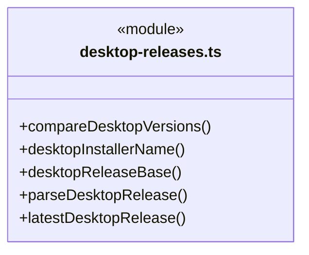

直接依赖：[../contracts.ts](../contracts.ts)、[release-http.ts](release-http.ts)。

### desktop-updates.ts

成员 1/2（同名节点为同一声明，跨图合并阅读）。

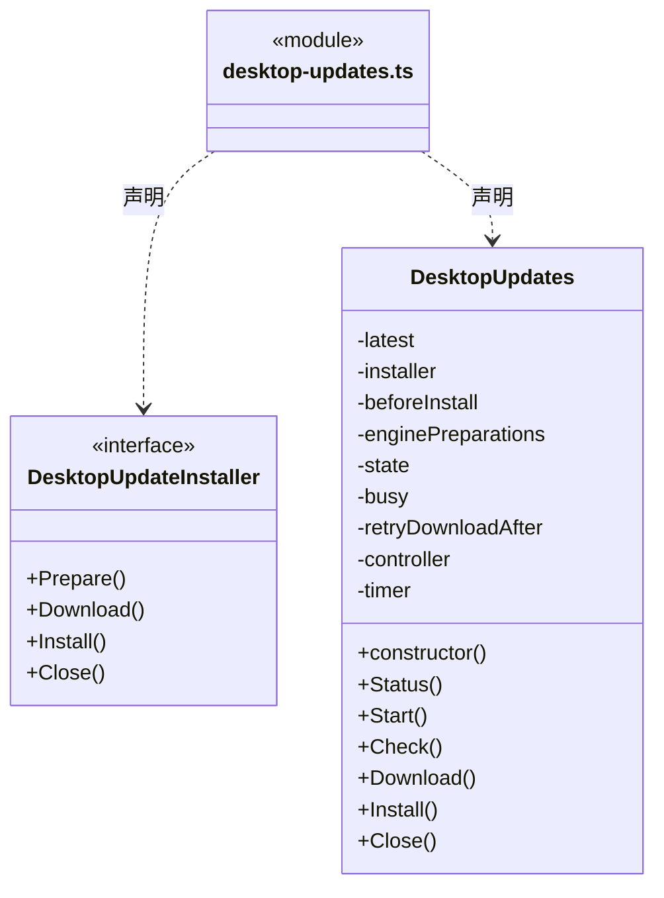

成员 2/2（同名节点为同一声明，跨图合并阅读）。

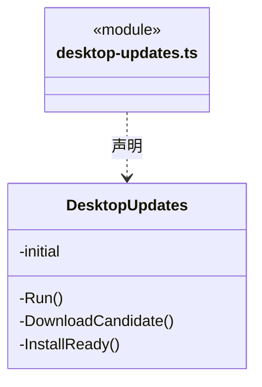

直接依赖：[../contracts.ts](../contracts.ts)、[desktop-releases.ts](desktop-releases.ts)。

### engine-artifacts.ts

成员 1/2（同名节点为同一声明，跨图合并阅读）。

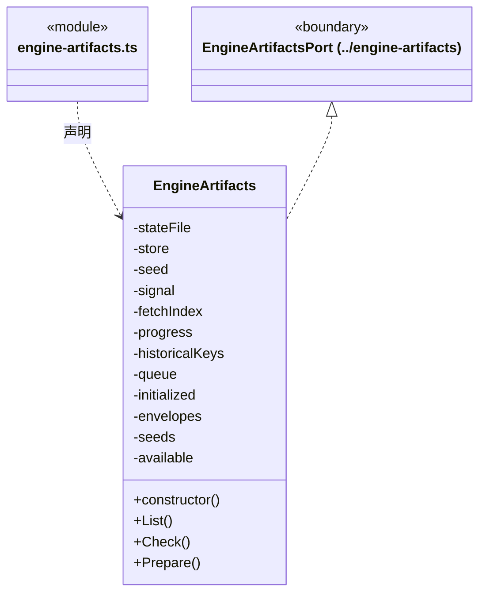

成员 2/2（同名节点为同一声明，跨图合并阅读）。

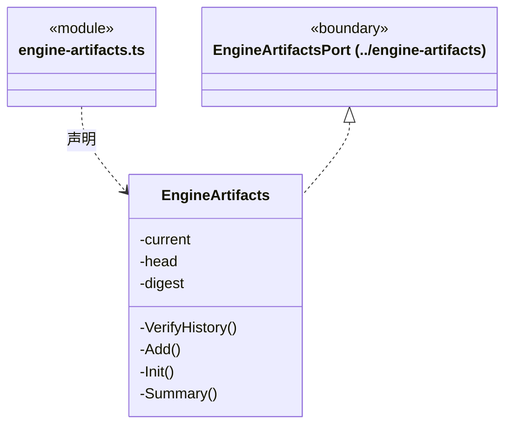

继承／实现来源：`EngineArtifactsPort` → [../engine-artifacts.ts](../engine-artifacts.ts)。
直接依赖：[../../../core/platform/node/files/index.ts](../../../core/platform/node/files/index.ts)、[../../../core/utility/index.ts](../../../core/utility/index.ts)、[../engine-artifacts.ts](../engine-artifacts.ts)、[engine-index.ts](engine-index.ts)、[runtime-download.ts](runtime-download.ts)、[runtime-manifest.ts](runtime-manifest.ts)、[runtime-store.ts](runtime-store.ts)。

### engine-index.ts

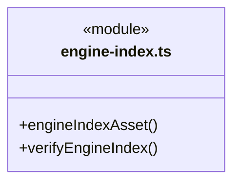

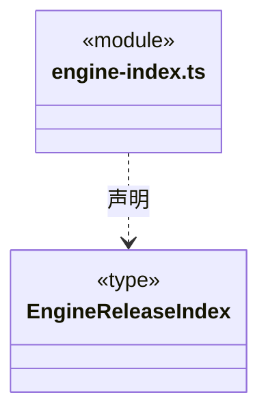

直接依赖：[runtime-manifest.ts](runtime-manifest.ts)。

### managed-engines.ts

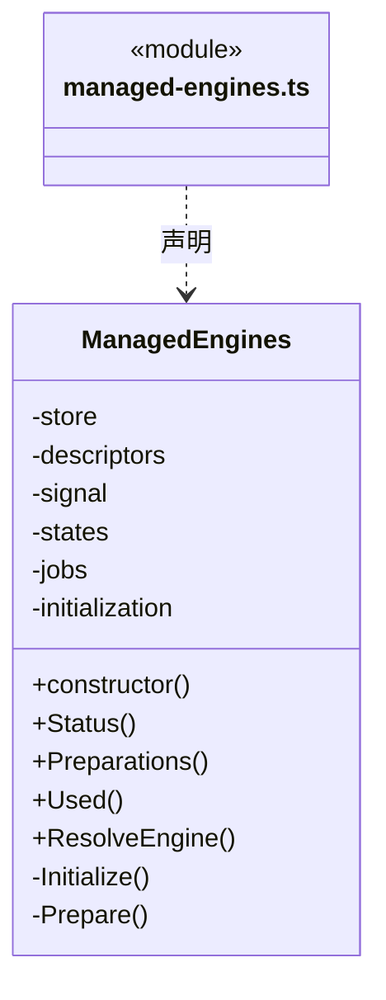

直接依赖：[../contracts.ts](../contracts.ts)、[runtime-archive.ts](runtime-archive.ts)、[runtime-manifest.ts](runtime-manifest.ts)、[runtime-store.ts](runtime-store.ts)。

### nsis-updater.ts

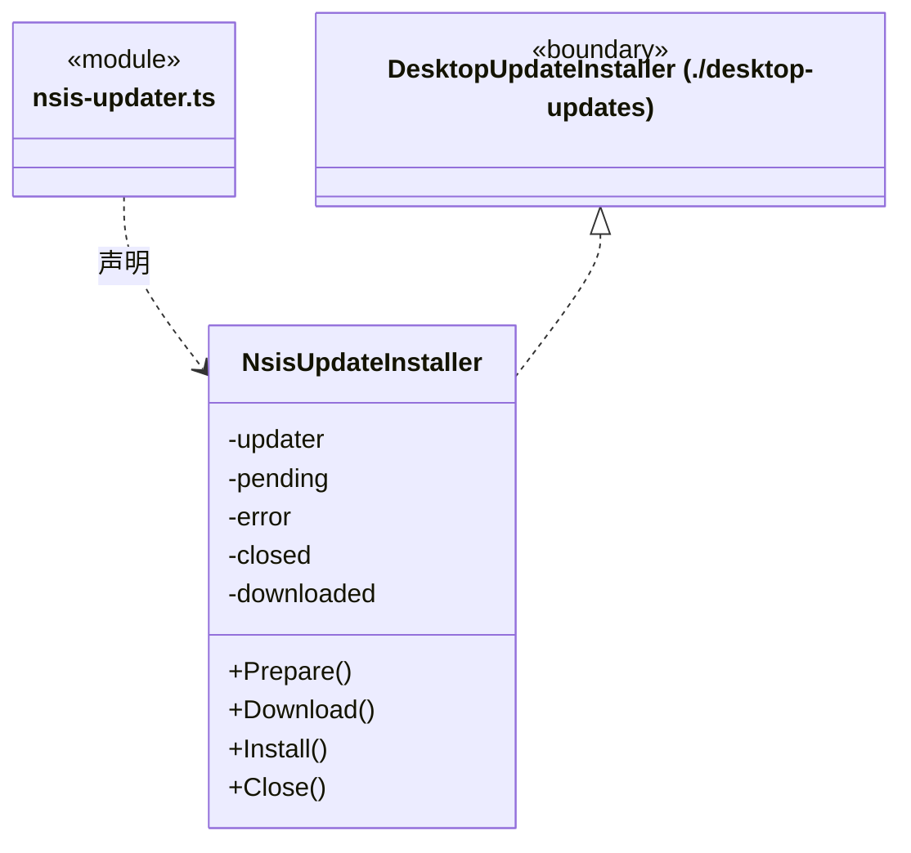

继承／实现来源：`DesktopUpdateInstaller` → [desktop-updates.ts](desktop-updates.ts)。
直接依赖：[../contracts.ts](../contracts.ts)、[desktop-releases.ts](desktop-releases.ts)、[desktop-updates.ts](desktop-updates.ts)。

### release-http.ts

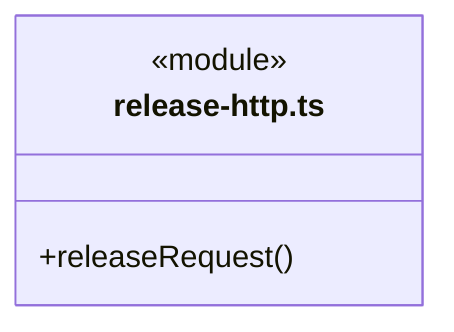

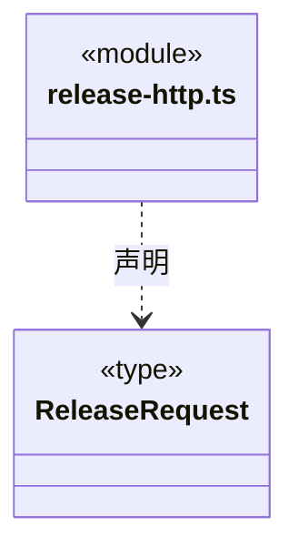

直接依赖：[../../../core/utility/index.ts](../../../core/utility/index.ts)。

### restart-profile.ts

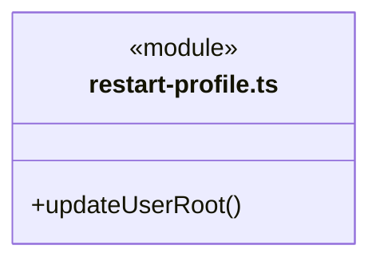


### runtime-archive.ts

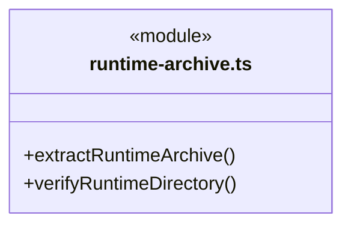

直接依赖：[runtime-manifest.ts](runtime-manifest.ts)。

### runtime-download.ts

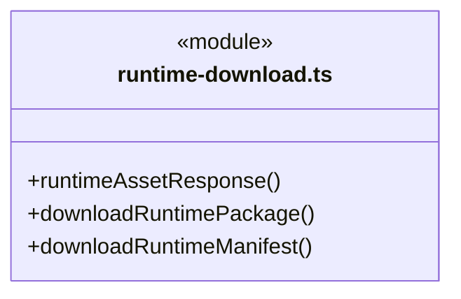

直接依赖：[../../../core/utility/index.ts](../../../core/utility/index.ts)、[runtime-manifest.ts](runtime-manifest.ts)。

### runtime-host.ts

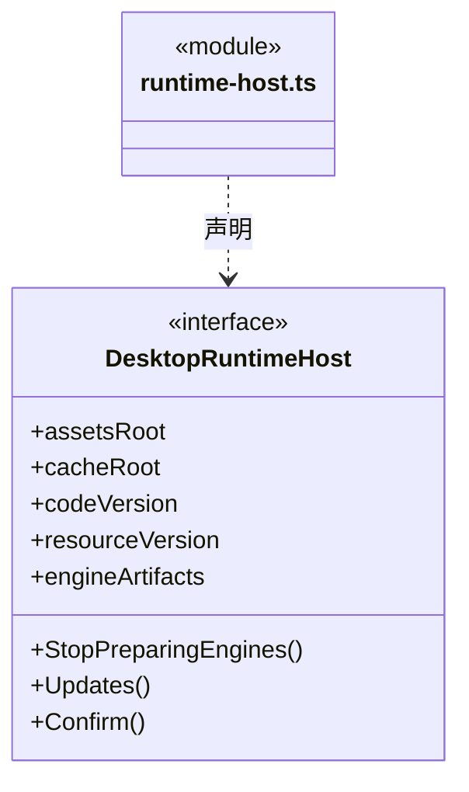

直接依赖：[../engine-artifacts.ts](../engine-artifacts.ts)、[desktop-updates.ts](desktop-updates.ts)。

### runtime-journal.ts

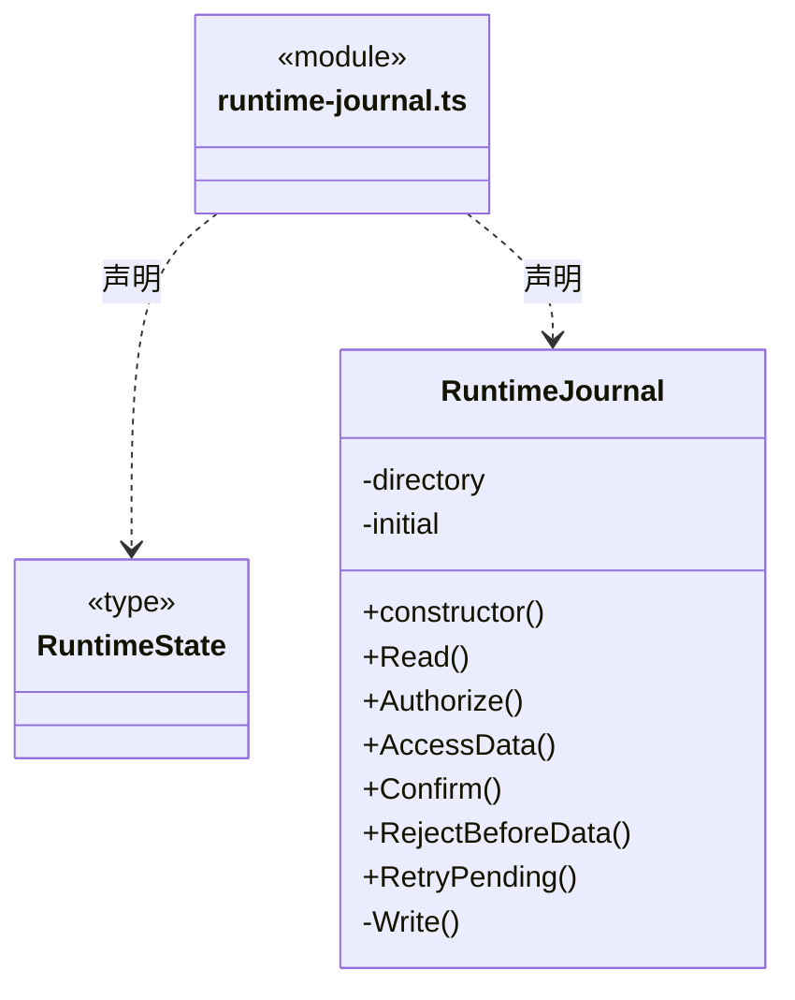


### runtime-manifest.ts

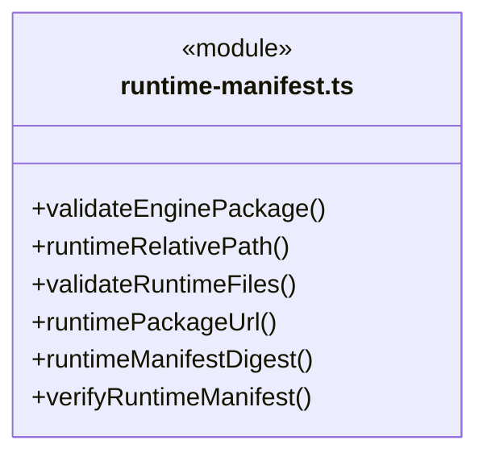

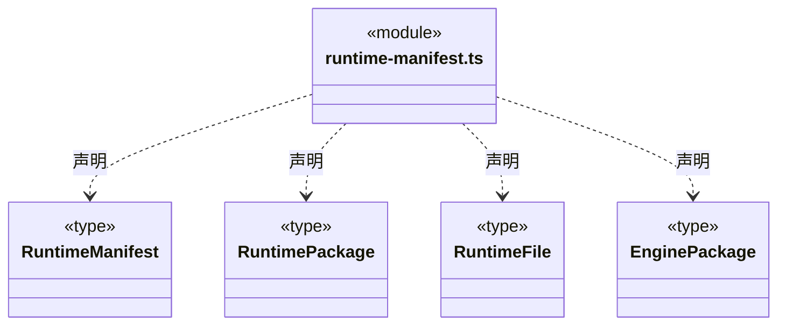

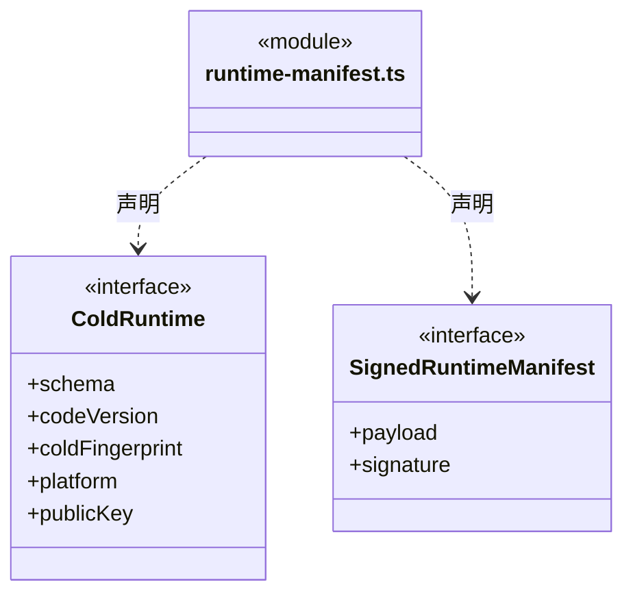


### runtime-store.ts

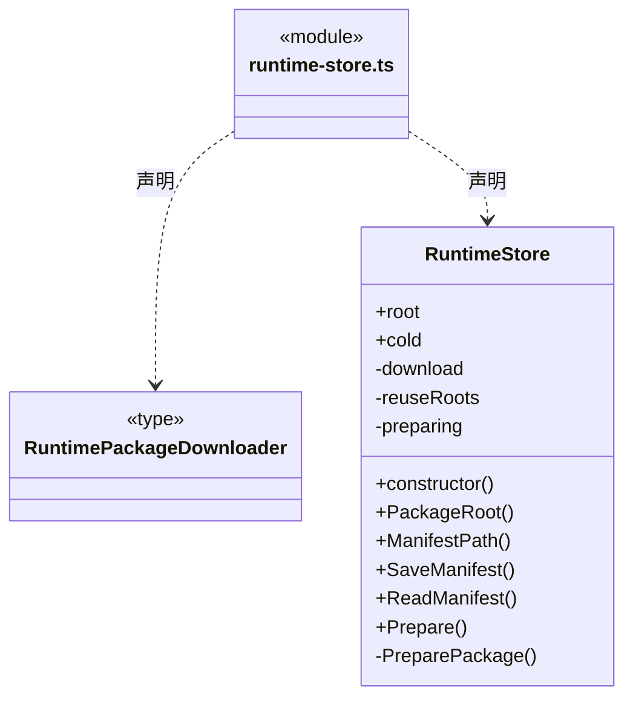

直接依赖：[runtime-archive.ts](runtime-archive.ts)、[runtime-download.ts](runtime-download.ts)、[runtime-manifest.ts](runtime-manifest.ts)。

### runtime-updates.ts

成员 1/2（同名节点为同一声明，跨图合并阅读）。

```mermaid
classDiagram
class N_src_logic_updates_service_runtime_updates_ts["runtime-updates.ts"] {
  <<module>>
}
class N_src_logic_updates_service_runtime_updates_ts_Candidate["Candidate"] {
  <<type>>
  +manifest
  +envelope
  +digest
}
N_src_logic_updates_service_runtime_updates_ts ..> N_src_logic_updates_service_runtime_updates_ts_Candidate : 声明
class N_src_logic_updates_service_runtime_updates_ts_RuntimeUpdateSources["RuntimeUpdateSources"] {
  <<interface>>
  +Cold()
  +Resources()
}
N_src_logic_updates_service_runtime_updates_ts ..> N_src_logic_updates_service_runtime_updates_ts_RuntimeUpdateSources : 声明
class N_src_logic_updates_service_runtime_updates_ts_RuntimeUpdates["RuntimeUpdates"] {
  +constructor()
  +Latest()
  +Prepare()
  +Download()
  +Install()
  +Close()
  -store
  -journal
  -current
  -installer
  -restart
  -sources
  -usedEngines
  -candidate
  -selected
  -prepared
}
N_src_logic_updates_service_runtime_updates_ts ..> N_src_logic_updates_service_runtime_updates_ts_RuntimeUpdates : 声明
class N_src_logic_updates_service_runtime_updates_ts_external_DesktopUpdateInstaller["DesktopUpdateInstaller (./desktop-updates)"] {
  <<boundary>>
}
N_src_logic_updates_service_runtime_updates_ts_external_DesktopUpdateInstaller <|.. N_src_logic_updates_service_runtime_updates_ts_RuntimeUpdates
```

成员 2/2（同名节点为同一声明，跨图合并阅读）。

```mermaid
classDiagram
class N_src_logic_updates_service_runtime_updates_ts["runtime-updates.ts"] {
  <<module>>
}
class N_src_logic_updates_service_runtime_updates_ts_RuntimeUpdates["RuntimeUpdates"] {
  -ready
  -controller
}
N_src_logic_updates_service_runtime_updates_ts ..> N_src_logic_updates_service_runtime_updates_ts_RuntimeUpdates : 声明
class N_src_logic_updates_service_runtime_updates_ts_external_DesktopUpdateInstaller["DesktopUpdateInstaller (./desktop-updates)"] {
  <<boundary>>
}
N_src_logic_updates_service_runtime_updates_ts_external_DesktopUpdateInstaller <|.. N_src_logic_updates_service_runtime_updates_ts_RuntimeUpdates
```

继承／实现来源：`DesktopUpdateInstaller` → [desktop-updates.ts](desktop-updates.ts)。
直接依赖：[../contracts.ts](../contracts.ts)、[desktop-releases.ts](desktop-releases.ts)、[desktop-updates.ts](desktop-updates.ts)、[runtime-download.ts](runtime-download.ts)、[runtime-journal.ts](runtime-journal.ts)、[runtime-manifest.ts](runtime-manifest.ts)、[runtime-store.ts](runtime-store.ts)。

### 本目录调用边界

```mermaid
classDiagram
class N_src_logic_updates_service_desktop_releases_ts["desktop-releases.ts"] {
  <<module>>
}
class N_src_logic_updates_service_release_http_ts["release-http.ts"] {
  <<module>>
}
class N_src_logic_updates_service_desktop_updates_ts["desktop-updates.ts"] {
  <<module>>
}
class N_src_logic_updates_service_engine_artifacts_ts["engine-artifacts.ts"] {
  <<module>>
}
class N_src_logic_updates_service_engine_index_ts["engine-index.ts"] {
  <<module>>
}
class N_src_logic_updates_service_runtime_download_ts["runtime-download.ts"] {
  <<module>>
}
N_src_logic_updates_service_desktop_releases_ts ..> N_src_logic_updates_service_release_http_ts : 导入依赖
N_src_logic_updates_service_desktop_updates_ts ..> N_src_logic_updates_service_desktop_releases_ts : 导入依赖
N_src_logic_updates_service_engine_artifacts_ts ..> N_src_logic_updates_service_engine_index_ts : 导入依赖
N_src_logic_updates_service_engine_artifacts_ts ..> N_src_logic_updates_service_runtime_download_ts : 导入依赖
```

```mermaid
classDiagram
class N_src_logic_updates_service_engine_artifacts_ts["engine-artifacts.ts"] {
  <<module>>
}
class N_src_logic_updates_service_runtime_manifest_ts["runtime-manifest.ts"] {
  <<module>>
}
class N_src_logic_updates_service_runtime_store_ts["runtime-store.ts"] {
  <<module>>
}
class N_src_logic_updates_service_engine_index_ts["engine-index.ts"] {
  <<module>>
}
class N_src_logic_updates_service_managed_engines_ts["managed-engines.ts"] {
  <<module>>
}
class N_src_logic_updates_service_runtime_archive_ts["runtime-archive.ts"] {
  <<module>>
}
N_src_logic_updates_service_engine_artifacts_ts ..> N_src_logic_updates_service_runtime_manifest_ts : 导入依赖
N_src_logic_updates_service_engine_artifacts_ts ..> N_src_logic_updates_service_runtime_store_ts : 导入依赖
N_src_logic_updates_service_engine_index_ts ..> N_src_logic_updates_service_runtime_manifest_ts : 导入依赖
N_src_logic_updates_service_managed_engines_ts ..> N_src_logic_updates_service_runtime_archive_ts : 导入依赖
```

```mermaid
classDiagram
class N_src_logic_updates_service_managed_engines_ts["managed-engines.ts"] {
  <<module>>
}
class N_src_logic_updates_service_runtime_manifest_ts["runtime-manifest.ts"] {
  <<module>>
}
class N_src_logic_updates_service_runtime_store_ts["runtime-store.ts"] {
  <<module>>
}
class N_src_logic_updates_service_nsis_updater_ts["nsis-updater.ts"] {
  <<module>>
}
class N_src_logic_updates_service_desktop_releases_ts["desktop-releases.ts"] {
  <<module>>
}
class N_src_logic_updates_service_desktop_updates_ts["desktop-updates.ts"] {
  <<module>>
}
N_src_logic_updates_service_managed_engines_ts ..> N_src_logic_updates_service_runtime_manifest_ts : 导入依赖
N_src_logic_updates_service_managed_engines_ts ..> N_src_logic_updates_service_runtime_store_ts : 导入依赖
N_src_logic_updates_service_nsis_updater_ts ..> N_src_logic_updates_service_desktop_releases_ts : 导入依赖
N_src_logic_updates_service_nsis_updater_ts ..> N_src_logic_updates_service_desktop_updates_ts : 导入依赖
```

```mermaid
classDiagram
class N_src_logic_updates_service_runtime_archive_ts["runtime-archive.ts"] {
  <<module>>
}
class N_src_logic_updates_service_runtime_manifest_ts["runtime-manifest.ts"] {
  <<module>>
}
class N_src_logic_updates_service_runtime_download_ts["runtime-download.ts"] {
  <<module>>
}
class N_src_logic_updates_service_runtime_host_ts["runtime-host.ts"] {
  <<module>>
}
class N_src_logic_updates_service_desktop_updates_ts["desktop-updates.ts"] {
  <<module>>
}
class N_src_logic_updates_service_runtime_store_ts["runtime-store.ts"] {
  <<module>>
}
N_src_logic_updates_service_runtime_archive_ts ..> N_src_logic_updates_service_runtime_manifest_ts : 导入依赖
N_src_logic_updates_service_runtime_download_ts ..> N_src_logic_updates_service_runtime_manifest_ts : 导入依赖
N_src_logic_updates_service_runtime_host_ts ..> N_src_logic_updates_service_desktop_updates_ts : 导入依赖
N_src_logic_updates_service_runtime_store_ts ..> N_src_logic_updates_service_runtime_archive_ts : 导入依赖
```

```mermaid
classDiagram
class N_src_logic_updates_service_runtime_store_ts["runtime-store.ts"] {
  <<module>>
}
class N_src_logic_updates_service_runtime_download_ts["runtime-download.ts"] {
  <<module>>
}
class N_src_logic_updates_service_runtime_manifest_ts["runtime-manifest.ts"] {
  <<module>>
}
class N_src_logic_updates_service_runtime_updates_ts["runtime-updates.ts"] {
  <<module>>
}
class N_src_logic_updates_service_desktop_releases_ts["desktop-releases.ts"] {
  <<module>>
}
class N_src_logic_updates_service_desktop_updates_ts["desktop-updates.ts"] {
  <<module>>
}
N_src_logic_updates_service_runtime_store_ts ..> N_src_logic_updates_service_runtime_download_ts : 导入依赖
N_src_logic_updates_service_runtime_store_ts ..> N_src_logic_updates_service_runtime_manifest_ts : 导入依赖
N_src_logic_updates_service_runtime_updates_ts ..> N_src_logic_updates_service_desktop_releases_ts : 导入依赖
N_src_logic_updates_service_runtime_updates_ts ..> N_src_logic_updates_service_desktop_updates_ts : 导入依赖
```

```mermaid
classDiagram
class N_src_logic_updates_service_runtime_updates_ts["runtime-updates.ts"] {
  <<module>>
}
class N_src_logic_updates_service_runtime_download_ts["runtime-download.ts"] {
  <<module>>
}
class N_src_logic_updates_service_runtime_journal_ts["runtime-journal.ts"] {
  <<module>>
}
class N_src_logic_updates_service_runtime_manifest_ts["runtime-manifest.ts"] {
  <<module>>
}
class N_src_logic_updates_service_runtime_store_ts["runtime-store.ts"] {
  <<module>>
}
N_src_logic_updates_service_runtime_updates_ts ..> N_src_logic_updates_service_runtime_download_ts : 导入依赖
N_src_logic_updates_service_runtime_updates_ts ..> N_src_logic_updates_service_runtime_journal_ts : 导入依赖
N_src_logic_updates_service_runtime_updates_ts ..> N_src_logic_updates_service_runtime_manifest_ts : 导入依赖
N_src_logic_updates_service_runtime_updates_ts ..> N_src_logic_updates_service_runtime_store_ts : 导入依赖
```


## 子目录导航

无子目录。

[返回上层](../ARCHITECTURE.md)。

每次修改本目录代码，同步维护文件头、关键契约说明及本图。未实现的治理、证据验收和自动编排能力不列入当前类图。

<!-- architecture:generated:end -->
