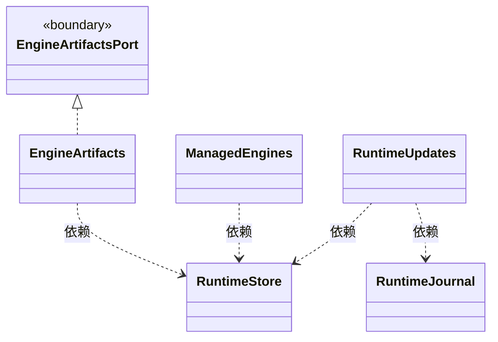
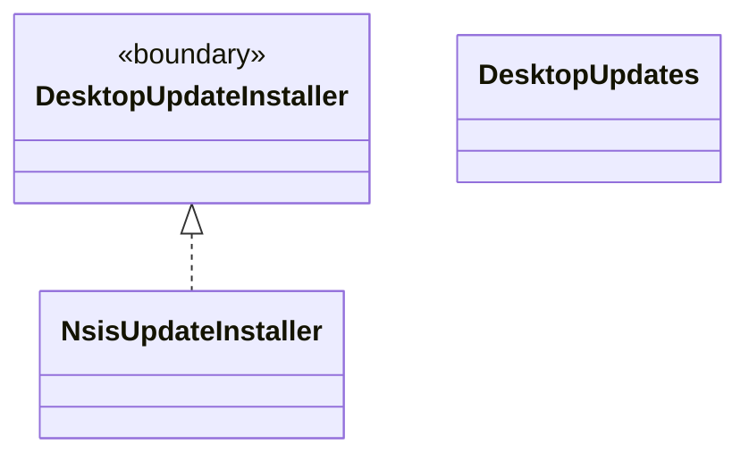

# src/logic/updates/service 架构

## 设计意图

将版本发现、资源准备、安装与恢复封装为独立更新系统。桌面安装、运行资源和引擎制品各有状态与存储，只有明确安装时才通过关闭回调等待业务应用退出。

## 主要组成

| 组成 | 定位 |
| --- | --- |
| [DesktopUpdates](desktop-updates.ts) | 桌面更新的单实例状态机，后台检查并预下载，用户确认后才排空业务和重启安装。 |
| [EngineArtifacts](engine-artifacts.ts) | 冷壳持有的通用 E 制品服务，保存独立签名索引历史并准备准确摘要的包。 |
| [ManagedEngines](managed-engines.ts) | 受管引擎目录、准备进度及固定版本解析；由冷壳注入已验签的清单和缓存。 |
| [NsisUpdateInstaller](nsis-updater.ts) | electron-updater 的 Windows NSIS 适配，固定发布源并优先差分下载、校验安装包。 |
| [RuntimeJournal](runtime-journal.ts) | 冷壳拥有的资源激活日志；区分准备缓存、用户授权、原数据访问和已确认启动。 |
| [RuntimeStore](runtime-store.ts) | 管理资源 / 引擎不可变版本目录及其签名清单；后台准备不修改活动选择。 |
| [RuntimeUpdates](runtime-updates.ts) | 连接 C 安装通道与同 C 的 R 资源通道，准备候选并在业务排空后记录显式切换。 |

<!-- architecture:generated:start -->

## 架构关系

### 关系组 1

### 关系组 2

### 跨图协作

- [RuntimeUpdates](runtime-updates.ts)（图 1）→ [DesktopUpdateInstaller](desktop-updates.ts)（图 2）：实现。

外部继承／实现边界：[EngineArtifactsPort](../engine-artifacts.ts)、[DesktopUpdateInstaller](desktop-updates.ts)。

[上层设计](../ARCHITECTURE.md)

<!-- architecture:generated:end -->
