# src/logic/updates/service 架构

## 目录定位

独立桌面更新子系统：公开 Release 读取、稳定版本筛选、后台预下载与用户确认重启的状态机和 NSIS 适配均在此目录。只组合本域更新契约、获准的便携 Core utility 及系统/第三方库，不依赖普通应用服务或业务编排；仅明确安装时通过关闭回调等待主程序排空。安装包缓存独立于运行数据。 C/R 复用一个准备和显式应用状态机；Ed25519 清单、完整 ZIP 文件集合、不可变包缓存和激活日志属于冷壳可信机制。候选一旦接触数据，失败只能恢复，不能自动降级。

本文描述当前实现。通过分析目录边界后维护的 [源码架构脚本](../../../../scripts/source-architecture.mjs) 同步清单和声明；代码变更时仍须核对职责、关键成员与关系。

## 代码清单

| 文件 | 当前职责 |
| --- | --- |
| [desktop-releases.ts](desktop-releases.ts) | 读取固定 GitHub 仓库中独立 desktop-v 通道的公开稳定发布。 |
| [desktop-updates.ts](desktop-updates.ts) | 桌面更新的单实例状态机，后台检查并预下载，用户确认后才排空业务和重启安装。 |
| [engine-artifacts.ts](engine-artifacts.ts) | 冷壳持有的通用 E 制品服务，保存独立签名索引历史并准备准确摘要的包。 |
| [engine-index.ts](engine-index.ts) | 独立 E 发布索引的签名、版本和准确依赖闭包验证。 |
| [nsis-updater.ts](nsis-updater.ts) | electron-updater 的 Windows NSIS 适配，固定发布源并优先差分下载、校验安装包。 |
| [release-http.ts](release-http.ts) | 更新子系统读取公开 Release 列表的独立 HTTP 边界。 |
| [restart-profile.ts](restart-profile.ts) | 恢复安装器显式传回的本机用户目录，供 Main 在初始化任何业务数据之前调用。 |
| [runtime-archive.ts](runtime-archive.ts) | 把已校验 ZIP 展开到新建候选目录，并核对签名清单定义的完整文件集合。 |
| [runtime-download.ts](runtime-download.ts) | 公开资源 / 引擎附件的有界下载；下载只写独立候选，不改变活动版本。 |
| [runtime-host.ts](runtime-host.ts) | 稳定桌面冷壳向业务入口提供的私有启动契约；不经过渲染 IPC。 |
| [runtime-journal.ts](runtime-journal.ts) | 冷壳拥有的资源激活日志；区分准备缓存、用户授权、原数据访问和已确认启动。 |
| [runtime-manifest.ts](runtime-manifest.ts) | 冷壳与资源更新器共用的签名清单、制品身份和路径约束。 |
| [runtime-store.ts](runtime-store.ts) | 管理资源 / 引擎不可变版本目录及其签名清单；后台准备不修改活动选择。 |
| [runtime-updates.ts](runtime-updates.ts) | 连接 C 安装通道与同 C 的 R 资源通道，准备候选并在业务排空后记录显式切换。 |

## 架构类图

### desktop-releases.ts

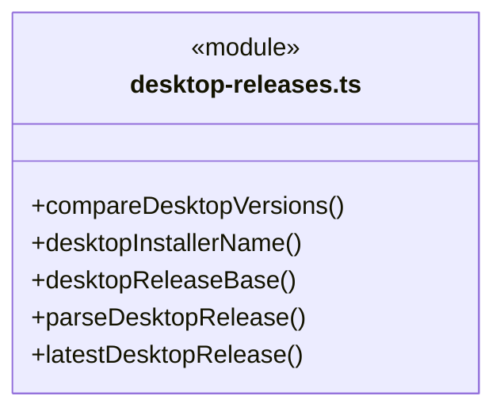

直接依赖：[../contracts.ts](../contracts.ts)、[release-http.ts](release-http.ts)。

### desktop-updates.ts

成员 1/2（同名节点为同一声明，跨图合并阅读）。

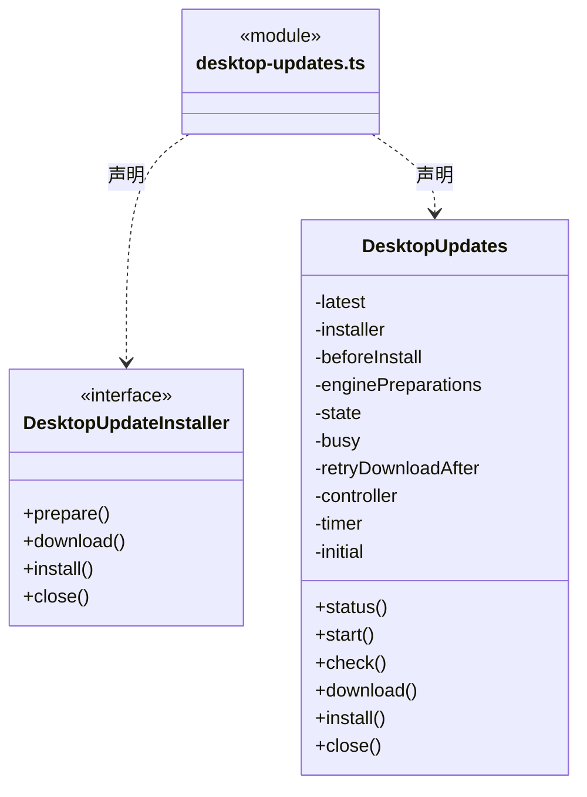

成员 2/2（同名节点为同一声明，跨图合并阅读）。

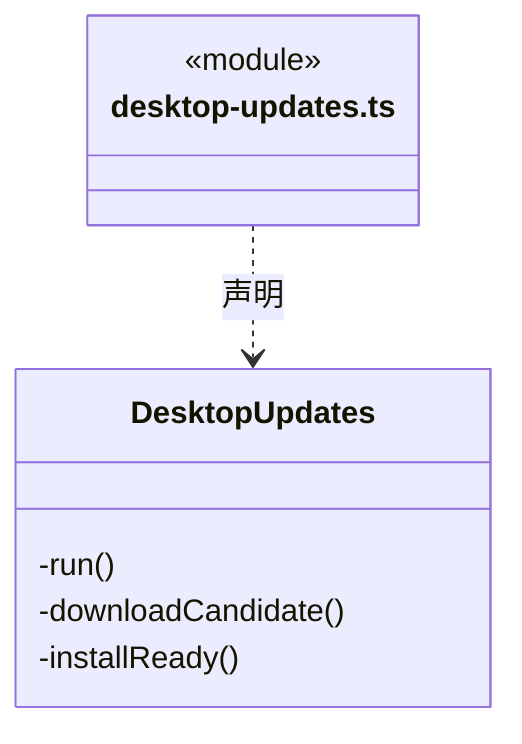

直接依赖：[../contracts.ts](../contracts.ts)、[desktop-releases.ts](desktop-releases.ts)。

### engine-artifacts.ts

成员 1/2（同名节点为同一声明，跨图合并阅读）。

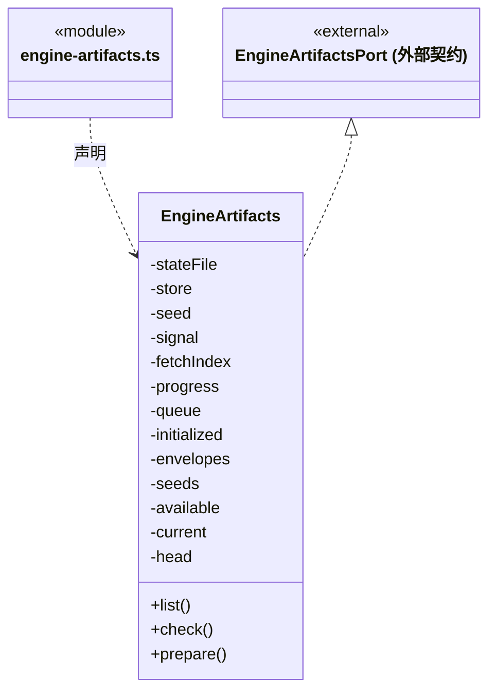

成员 2/2（同名节点为同一声明，跨图合并阅读）。

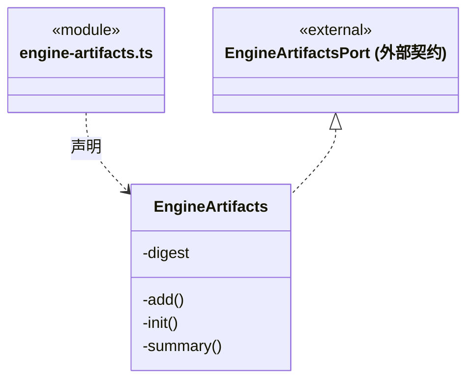

直接依赖：[../../../core/platform/node/files/index.ts](../../../core/platform/node/files/index.ts)、[../../../core/utility/index.ts](../../../core/utility/index.ts)、[../engine-artifacts.ts](../engine-artifacts.ts)、[engine-index.ts](engine-index.ts)、[runtime-manifest.ts](runtime-manifest.ts)、[runtime-store.ts](runtime-store.ts)、[runtime-download.ts](runtime-download.ts)。

### engine-index.ts

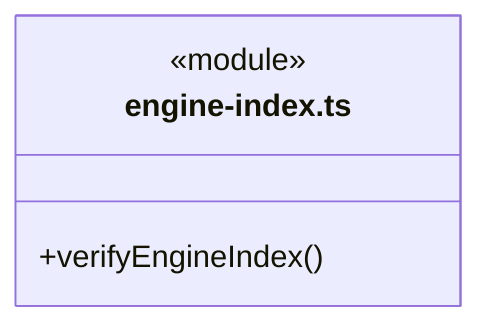

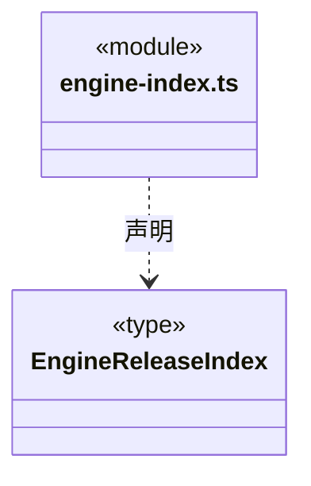

直接依赖：[runtime-manifest.ts](runtime-manifest.ts)。

### nsis-updater.ts

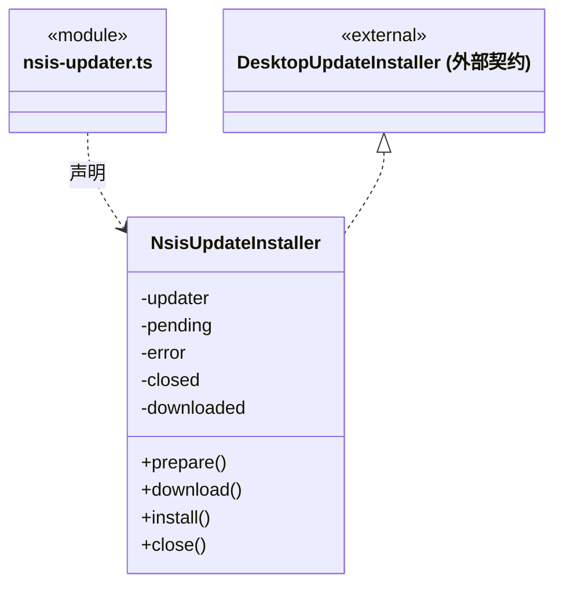

直接依赖：[../contracts.ts](../contracts.ts)、[desktop-updates.ts](desktop-updates.ts)、[desktop-releases.ts](desktop-releases.ts)。

### release-http.ts

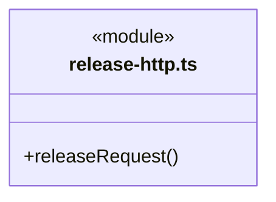

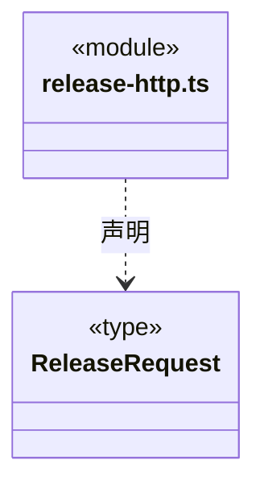

直接依赖：[../../../core/utility/index.ts](../../../core/utility/index.ts)。

### restart-profile.ts

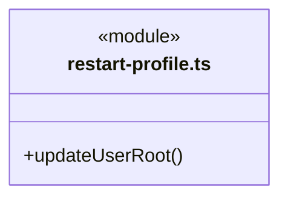


### runtime-archive.ts

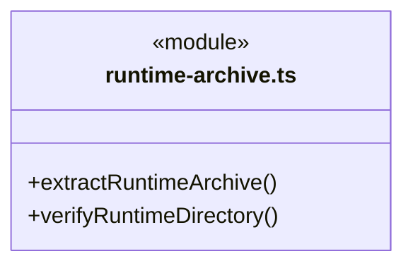

直接依赖：[runtime-manifest.ts](runtime-manifest.ts)。

### runtime-download.ts

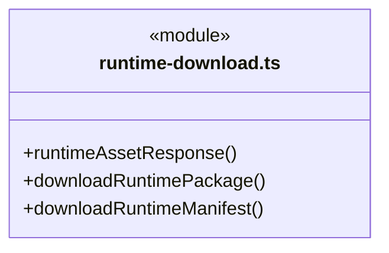

直接依赖：[../../../core/utility/index.ts](../../../core/utility/index.ts)、[runtime-manifest.ts](runtime-manifest.ts)。

### runtime-host.ts

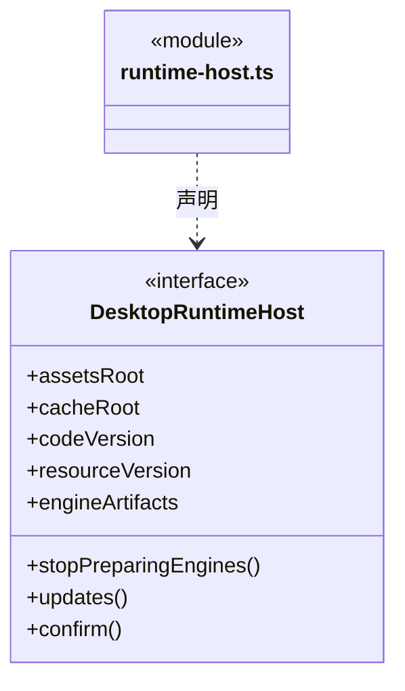

直接依赖：[../engine-artifacts.ts](../engine-artifacts.ts)、[desktop-updates.ts](desktop-updates.ts)。

### runtime-journal.ts

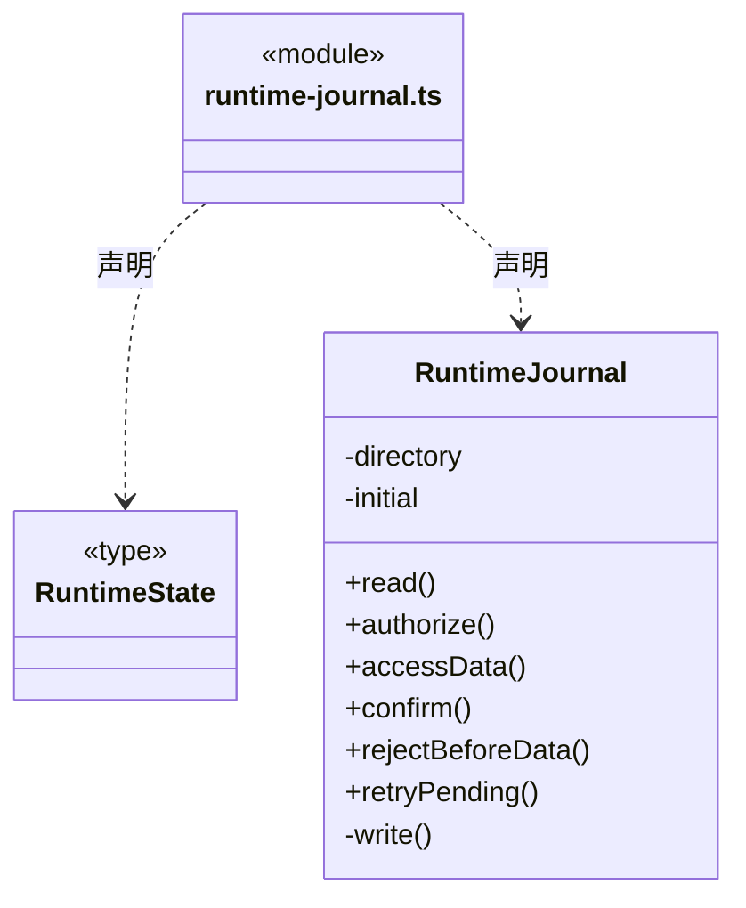


### runtime-manifest.ts

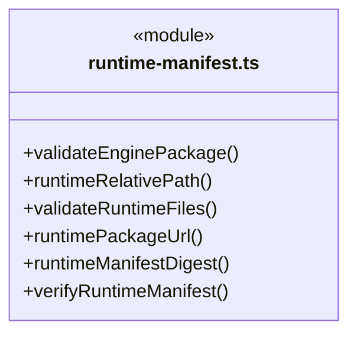

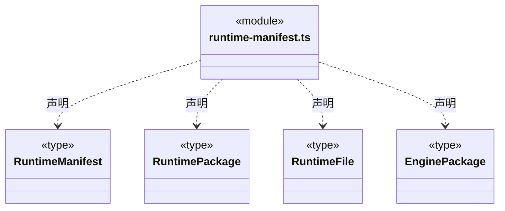

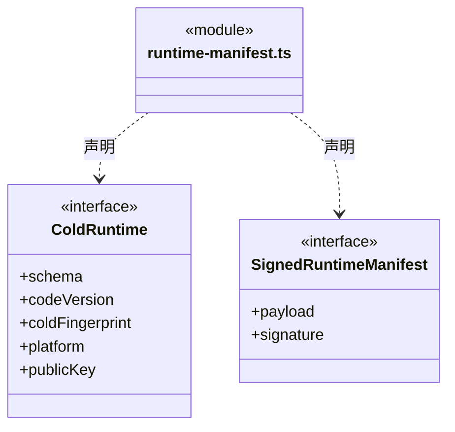


### runtime-store.ts

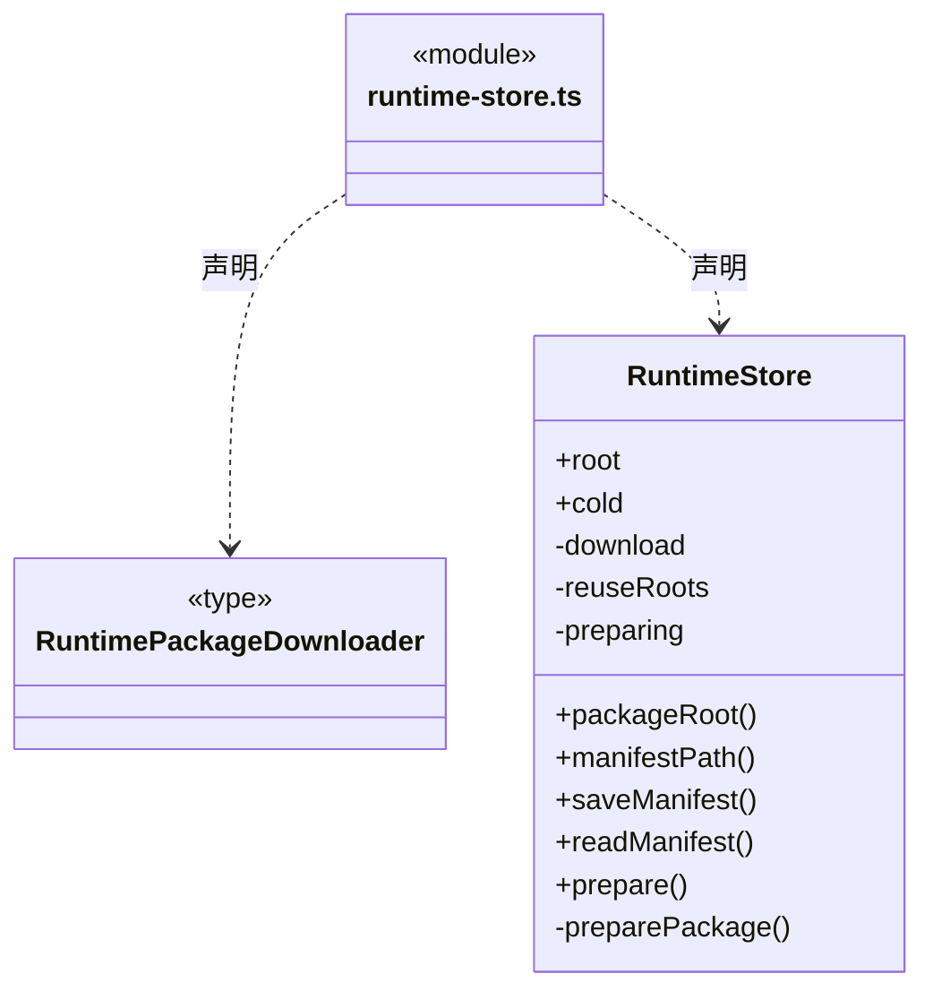

直接依赖：[runtime-archive.ts](runtime-archive.ts)、[runtime-download.ts](runtime-download.ts)、[runtime-manifest.ts](runtime-manifest.ts)。

### runtime-updates.ts

成员 1/2（同名节点为同一声明，跨图合并阅读）。

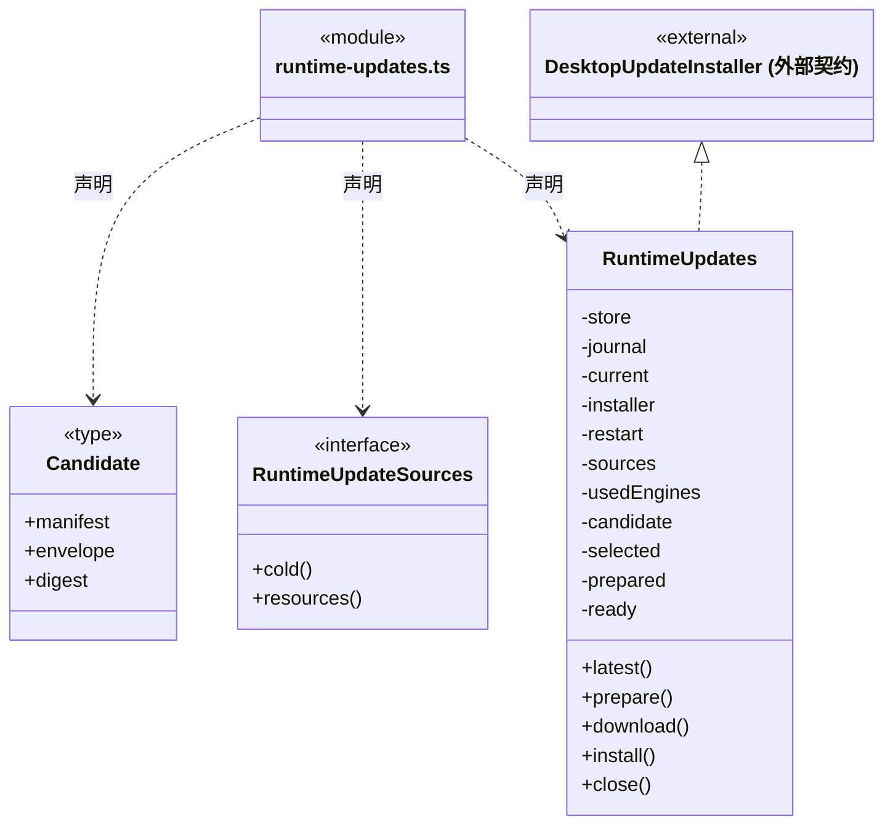

成员 2/2（同名节点为同一声明，跨图合并阅读）。

```mermaid
classDiagram
class N_src_logic_updates_service_runtime_updates_ts["runtime-updates.ts"] {
  <<module>>
}
class N_src_logic_updates_service_runtime_updates_ts_RuntimeUpdates["RuntimeUpdates"] {
  -controller
}
N_src_logic_updates_service_runtime_updates_ts ..> N_src_logic_updates_service_runtime_updates_ts_RuntimeUpdates : 声明
class N_src_logic_updates_service_runtime_updates_ts_external_DesktopUpdateInstaller["DesktopUpdateInstaller (外部契约)"] {
  <<external>>
}
N_src_logic_updates_service_runtime_updates_ts_external_DesktopUpdateInstaller <|.. N_src_logic_updates_service_runtime_updates_ts_RuntimeUpdates
```

直接依赖：[../contracts.ts](../contracts.ts)、[desktop-updates.ts](desktop-updates.ts)、[desktop-releases.ts](desktop-releases.ts)、[runtime-download.ts](runtime-download.ts)、[runtime-manifest.ts](runtime-manifest.ts)、[runtime-store.ts](runtime-store.ts)、[runtime-journal.ts](runtime-journal.ts)。

### 本目录调用边界

```mermaid
classDiagram
class N_src_logic_updates_service_desktop_releases_ts["desktop-releases.ts"] {
  <<module>>
}
class N_src_logic_updates_service_release_http_ts["release-http.ts"] {
  <<module>>
}
class N_src_logic_updates_service_desktop_updates_ts["desktop-updates.ts"] {
  <<module>>
}
class N_src_logic_updates_service_engine_artifacts_ts["engine-artifacts.ts"] {
  <<module>>
}
class N_src_logic_updates_service_engine_index_ts["engine-index.ts"] {
  <<module>>
}
class N_src_logic_updates_service_runtime_manifest_ts["runtime-manifest.ts"] {
  <<module>>
}
N_src_logic_updates_service_desktop_releases_ts ..> N_src_logic_updates_service_release_http_ts : 导入依赖
N_src_logic_updates_service_desktop_updates_ts ..> N_src_logic_updates_service_desktop_releases_ts : 导入依赖
N_src_logic_updates_service_engine_artifacts_ts ..> N_src_logic_updates_service_engine_index_ts : 导入依赖
N_src_logic_updates_service_engine_artifacts_ts ..> N_src_logic_updates_service_runtime_manifest_ts : 导入依赖
```

```mermaid
classDiagram
class N_src_logic_updates_service_engine_artifacts_ts["engine-artifacts.ts"] {
  <<module>>
}
class N_src_logic_updates_service_runtime_store_ts["runtime-store.ts"] {
  <<module>>
}
class N_src_logic_updates_service_runtime_download_ts["runtime-download.ts"] {
  <<module>>
}
class N_src_logic_updates_service_engine_index_ts["engine-index.ts"] {
  <<module>>
}
class N_src_logic_updates_service_runtime_manifest_ts["runtime-manifest.ts"] {
  <<module>>
}
class N_src_logic_updates_service_nsis_updater_ts["nsis-updater.ts"] {
  <<module>>
}
class N_src_logic_updates_service_desktop_updates_ts["desktop-updates.ts"] {
  <<module>>
}
N_src_logic_updates_service_engine_artifacts_ts ..> N_src_logic_updates_service_runtime_store_ts : 导入依赖
N_src_logic_updates_service_engine_artifacts_ts ..> N_src_logic_updates_service_runtime_download_ts : 导入依赖
N_src_logic_updates_service_engine_index_ts ..> N_src_logic_updates_service_runtime_manifest_ts : 导入依赖
N_src_logic_updates_service_nsis_updater_ts ..> N_src_logic_updates_service_desktop_updates_ts : 导入依赖
```

```mermaid
classDiagram
class N_src_logic_updates_service_nsis_updater_ts["nsis-updater.ts"] {
  <<module>>
}
class N_src_logic_updates_service_desktop_releases_ts["desktop-releases.ts"] {
  <<module>>
}
class N_src_logic_updates_service_runtime_archive_ts["runtime-archive.ts"] {
  <<module>>
}
class N_src_logic_updates_service_runtime_manifest_ts["runtime-manifest.ts"] {
  <<module>>
}
class N_src_logic_updates_service_runtime_download_ts["runtime-download.ts"] {
  <<module>>
}
class N_src_logic_updates_service_runtime_host_ts["runtime-host.ts"] {
  <<module>>
}
class N_src_logic_updates_service_desktop_updates_ts["desktop-updates.ts"] {
  <<module>>
}
N_src_logic_updates_service_nsis_updater_ts ..> N_src_logic_updates_service_desktop_releases_ts : 导入依赖
N_src_logic_updates_service_runtime_archive_ts ..> N_src_logic_updates_service_runtime_manifest_ts : 导入依赖
N_src_logic_updates_service_runtime_download_ts ..> N_src_logic_updates_service_runtime_manifest_ts : 导入依赖
N_src_logic_updates_service_runtime_host_ts ..> N_src_logic_updates_service_desktop_updates_ts : 导入依赖
```

```mermaid
classDiagram
class N_src_logic_updates_service_runtime_store_ts["runtime-store.ts"] {
  <<module>>
}
class N_src_logic_updates_service_runtime_archive_ts["runtime-archive.ts"] {
  <<module>>
}
class N_src_logic_updates_service_runtime_download_ts["runtime-download.ts"] {
  <<module>>
}
class N_src_logic_updates_service_runtime_manifest_ts["runtime-manifest.ts"] {
  <<module>>
}
class N_src_logic_updates_service_runtime_updates_ts["runtime-updates.ts"] {
  <<module>>
}
class N_src_logic_updates_service_desktop_updates_ts["desktop-updates.ts"] {
  <<module>>
}
N_src_logic_updates_service_runtime_store_ts ..> N_src_logic_updates_service_runtime_archive_ts : 导入依赖
N_src_logic_updates_service_runtime_store_ts ..> N_src_logic_updates_service_runtime_download_ts : 导入依赖
N_src_logic_updates_service_runtime_store_ts ..> N_src_logic_updates_service_runtime_manifest_ts : 导入依赖
N_src_logic_updates_service_runtime_updates_ts ..> N_src_logic_updates_service_desktop_updates_ts : 导入依赖
```

```mermaid
classDiagram
class N_src_logic_updates_service_runtime_updates_ts["runtime-updates.ts"] {
  <<module>>
}
class N_src_logic_updates_service_desktop_releases_ts["desktop-releases.ts"] {
  <<module>>
}
class N_src_logic_updates_service_runtime_download_ts["runtime-download.ts"] {
  <<module>>
}
class N_src_logic_updates_service_runtime_manifest_ts["runtime-manifest.ts"] {
  <<module>>
}
class N_src_logic_updates_service_runtime_store_ts["runtime-store.ts"] {
  <<module>>
}
N_src_logic_updates_service_runtime_updates_ts ..> N_src_logic_updates_service_desktop_releases_ts : 导入依赖
N_src_logic_updates_service_runtime_updates_ts ..> N_src_logic_updates_service_runtime_download_ts : 导入依赖
N_src_logic_updates_service_runtime_updates_ts ..> N_src_logic_updates_service_runtime_manifest_ts : 导入依赖
N_src_logic_updates_service_runtime_updates_ts ..> N_src_logic_updates_service_runtime_store_ts : 导入依赖
```

```mermaid
classDiagram
class N_src_logic_updates_service_runtime_updates_ts["runtime-updates.ts"] {
  <<module>>
}
class N_src_logic_updates_service_runtime_journal_ts["runtime-journal.ts"] {
  <<module>>
}
N_src_logic_updates_service_runtime_updates_ts ..> N_src_logic_updates_service_runtime_journal_ts : 导入依赖
```


## 子目录导航

无子目录。

[返回上层](../ARCHITECTURE.md)。

每次修改本目录代码，同步维护文件头、关键契约说明及本图。未实现的治理、证据验收和自动编排能力不列入当前类图。

## 设计契约 v1 与落地范围

以下内容区分已接通能力与后续设计；以各节的实现状态为准，不将目标图当作现状图。维护源：[CONTRACT.md](CONTRACT.md)；生成类图时同步附加，勿直接修改本附录。

# 桌面更新子系统

## 有界响应体与基础库

Release 列表（2 MiB / 20 秒）和小清单（16 MiB / 30 秒）组合 utility 通用入口的 readBoundedBytes，保留既有上限与错误文案。utility 只拥有 reader 的取消/释放；更新模块仍决定公开地址、GET/跳转、无凭据传输、解析、签名及安装状态。正文未完整或停止时不交付部分 JSON，也不自动重发。

仅允许更新子系统依赖 utility 通用公开入口，不能由此进入 Node 专用入口、其他基础方案或 Main。大安装包继续流式写盘并累计摘要，不使用内存收集器。本次读取完成不代表签名、解压、安装或物理资源退出已完成。

C 为冷基础三段版本，R 为同 C 内递增资源号；E 是签名清单中固定的三个外部引擎。RuntimeUpdates 优先选择当前 C 的新 R，没有兼容 R 时才提示更高 C。公开 UI 只有一个状态机，下载阶段包含解压和校验，只有 ready 允许点击安装图标。

RuntimeManifest 使用冷壳固定 Ed25519 公钥验证准确 payload 字节，声明 C/R、能力指纹、Windows x64、有效期、源提交及完整 R/E 文件集合。首次发现验证有效期；已安装包允许过期后离线启动。资源通道固定 runtime-c<C>/latest.json，E 附件固定 runtime-engines；都只访问 nan023062/cbim 的 HTTPS 附件及受限对象存储跳转，不发送凭据。最高已授权 R 防止自动降级/重放。

RuntimeStore 下载 SHA-256 完整 ZIP，拒绝不符的长度、文件集合、路径、链接、设备与摘要。先写新 staging 目录，完整验证后改名到 packages/<摘要>，从不覆盖活动目录；准备同一包的并发调用合并。失败只清理自己创建的临时目录，旧版本不自动回收。R 下载也准备当前进程已使用引擎在候选中的新包；其它引擎保持首次使用准备。

R 安装只在业务排空后授权 RuntimeJournal 并短重启，不运行 NSIS。日志将 authorized、data-access 与 confirmed 分开，记录最高 R、上一确认版本和隔离摘要；读取异常和已访问数据的失败只进入冷壳恢复。状态在用户身份目录，代码缓存独立；清缓存不重置版本。具体加载边界见 [bootstrap](../../../bridge/server/bootstrap/CONTRACT.md)。

更新程序集中于本目录，与普通应用服务、业务编排及运行事实规则分离。只依赖自身更新契约、获准的便携 Core utility、系统和第三方库；Bridge 桌面宿主负责启动和固定 IPC，Logic/Application 提供业务关闭回调，不向本模块暴露工作区、模型或反馈 Token。

`release-http` 只读固定公开 GitHub Release 列表，不附凭据、不重定向，单请求 20 秒、响应 2 MiB。`desktop-releases` 只接受 `nan023062/cbim` 的 `desktop-vX.Y.Z` 稳定版本、匹配的 Windows x64 安装包及清单；不消费旧 Python 内核 v1.x。检查失败明确报告，不以空列表冒充当前已是最新版。

`DesktopUpdates` 在正式安装版启动后 10 秒检查，定时器每 60 秒触发；发现新版后自动准备、下载并校验，成功停在 ready，不排空业务或安装。在途操作合并；已就绪候选冻结到用户安装或进程退出，不因后续检查替换。检查失败保留已知新版与本次完成时间，下一分钟重新检查。下载失败后五分钟内只检查版本；五分钟后重试下载，发现不同版本或用户手动重试时无需等待。错误仅在更新页显示，不弹全局错误。checkedAt 是最近完成检查的时间，失败也记录，不能据此声称已联网成功。

download 只手动重试准备对应的 C 或 R 包；后台预下载与手动下载都不授权重启。用户在 ready 明确点击 install 后，公开 installing 后让出一次事件循环，随后调用 Main 注入的正常关闭回调；只在排空成功后调用安装器。下载尚未完成时的 install 不排队授权，须就绪后再次确认。弹窗关闭或 IPC 回包丢失不触发第二次安装。下载失败回到 available；排空／安装失败停在 ready，保留缓存，只能明确重试 install，不由计时器或普通退出重放。

Main 的普通退出在开始排空前 close 更新服务；事件循环让出、下载中或排空中迟到的结果不能继续安装。close 清除计时器并禁用本进程的更新动作；如果普通关闭失败保留窗口，明确提示需重新启动以恢复检查。已授权安装由成功排空后的 quitting 标识与普通退出区分；仅缓存不会在新进程启动时安装；显式点击且排空后已持久授权的 R 由下次冷壳启动选择。

`NsisUpdateInstaller` 重新核对 `latest.yml` 的准确版本、唯一安装文件名及 SHA-512，关闭自动下载、退出自动安装、预发布、降级和网络安装器。首版未配置发布者证书，不宣称通过签名校验。固定 HTTPS 发布及清单负责来源与完整性，下载完成不代表升级完成。

NSIS 下载启用 electron-updater 的差分模式：读取新旧 `.exe.blockmap`，复用缓存 `installer.exe` 的相同数据块，通过单段 HTTP Range 获取变化块，再校验完整安装包 SHA-512。当前锁定版本的 Generic Provider 会同时替换发布目录和文件名里的版本；缺旧索引缓存时从对应旧 `desktop-v` 标签获取，不能只从新标签找旧文件。禁用多段 multipart Range，避免要求附件重定向后的对象存储支持该格式。缺缓存、索引不可用、Range 不支持或重建校验失败时由原下载器回退全量；全量也必须通过校验。缓存复用和差分成功均不触发安装。

差分降低网络传输，不改变最终缓存安装包大小或 NSIS 安装方式；具体节省量取决于版本差异。首次升级到包含本实现的版本仍由旧客户端执行，后续版本间更新才能使用新行为。真实公开安装升级及网络节省量须按对应版本制品验收，单元夹具不代表公开包比例。

安装包产物位于仓库 `build/desktop-release/<version>/`；用户下载缓存位于 `%LOCALAPPDATA%/cbim-desktop-updater/`，与安装程序目录、用户 `~/.cbim` 及业务工作区分开。重新启动后检查公开版本并重新校验已有缓存，相同包由 electron-updater 复用，成功仍停在 ready；缓存不会在启动或退出时自动安装。

`restart-profile` 在 Main 初始化之前核对重启目录。`packaging/updater/` 中的 NSIS 启动模板将原进程明确配置的 `CBIM_USER_DATA_ROOT` 作为更新重启参数传回，解决 Windows Shell 不继承环境的问题；只传目录、不传凭据，正常安装沿用默认目录。重复、相对、带引号／控制字符或超长参数直接拒绝，不静默打开默认用户数据。

### 引擎与资源缓存分开

签名 E 描述支持通用 ID、可选适配器入口/版本/协议和固定依赖摘要。冷壳只校验通用字段、文件清单与签名，支持名单由 R 静态代码决定。旧清单不补适配器字段，新正式资源不回退内嵌实现。

RuntimeStore 可接收可信旧缓存根：仅找到相同 SHA-256 内容目录且完整验证后复制到新共享缓存，复制后再次验证；坏缓存直接失败，不自动删除、覆盖或下载重试。同一共享根可供不同 C 使用，活动资源及恢复日志仍按 C 隔离。

### 独立 E 发布索引

engine-index 验证 Ed25519、平台、时效、单调发布序号、版本唯一性与准确依赖闭包，不要求 C/R 版本。engine-artifacts 保存签名索引和历史 C/R 的签名来源，仅用旧来源证明 E，不启动旧 R；同版本异包拒绝。查询不下载；prepare 只接受已验签的 kind/identity。缓存与本机激活指针由不同服务负责，失败不换指针、不自动重试。

### 引擎详情的进度端口

EngineArtifacts.prepare 通过可选第三参报告 0–100 的准备进度，包括本地文件校验；不将回调次数视为下载次数。EnginePackages 将其归到准确引擎/版本，应用更新图标忽略旧 enginePreparations 字段。旧冷宿主可忽略可选回调，资源层仍显示准备中而不编造百分比；缓存身份、验签、完整文件验证与跨 C 共享路径不变。
