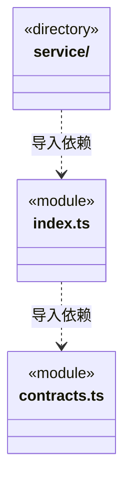

# src/logic/web 架构

## 目录定位

网页工具与设置纯契约；service 提供网络业务适配和配置持久化，工具权限与宿主装配在外层。

本文描述当前实现。通过分析目录边界后维护的 [源码架构脚本](../../../scripts/source-architecture.mjs) 同步清单和声明；代码变更时仍须核对职责、关键成员与关系。

## 代码清单

| 文件 | 当前职责 |
| --- | --- |
| [contracts.ts](contracts.ts) | 公开网页读取与搜索的有界工具协议，以及桌面 robots/搜索设置契约。 |
| [index.ts](index.ts) | 网页工具和设置的纯业务协议入口。 |

## 架构类图

各图中的同名节点表示同一目录边界；跨组及完整直接依赖如下（无边不代表继承）：

- `index.ts` → `contracts.ts`：导入。
- `service` → `index.ts`：导入。

## 子目录导航

- [service/](service/ARCHITECTURE.md)：WebService 的正文适配和 Brave 搜索；WebSettings 的版本、搜索开关、robots 策略和加密配置。公开服务入口与纯协议分开。

[返回上层](../ARCHITECTURE.md)。

每次修改本目录代码，同步维护文件头、关键契约说明及本图。未实现的治理、证据验收和自动编排能力不列入当前类图。

## 设计契约 v1 与落地范围

以下内容区分已接通能力与后续设计；以各节的实现状态为准，不将目标图当作现状图。维护源：[CONTRACT.md](CONTRACT.md)；生成类图时同步附加，勿直接修改本附录。

# Web 业务边界

index.ts 只公开工具输入输出、设置输入及摘要类型，不加载 service 或平台。service/index.ts 向宿主公开 WebService 与 WebSettings；旧调度器仅消费纯工具契约。新 Logic 不依赖旧 backend、Bridge 或 View。

工具注册、运行权限仍由调度器拥有；WebService 只组合 Core 读取器并标注 untrusted，搜索固定 Brave API。WebSettings 保存 revision、搜索开关、加密密钥和浏览器 robots 策略。

bridge/contracts/web.ts 是迁移期唯一具名设置契约出口，只公开 webConfigureInput 与 WebSettingsView。IPC 操作名和字段保持，不开放工具执行、服务实例或密钥端口；后续 Bridge DTO 迁移时退出此兼容许可。

修改 robots/搜索业务配置进入 [service](service/CONTRACT.md)，修改抓取和浏览器机制进入 [Core 网页](../../core/platform/node/web/CONTRACT.md)。
