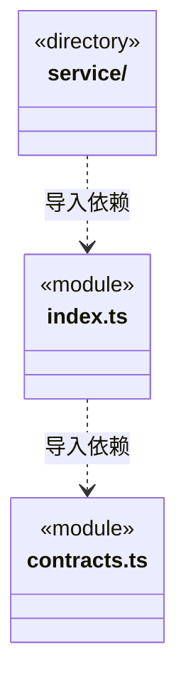
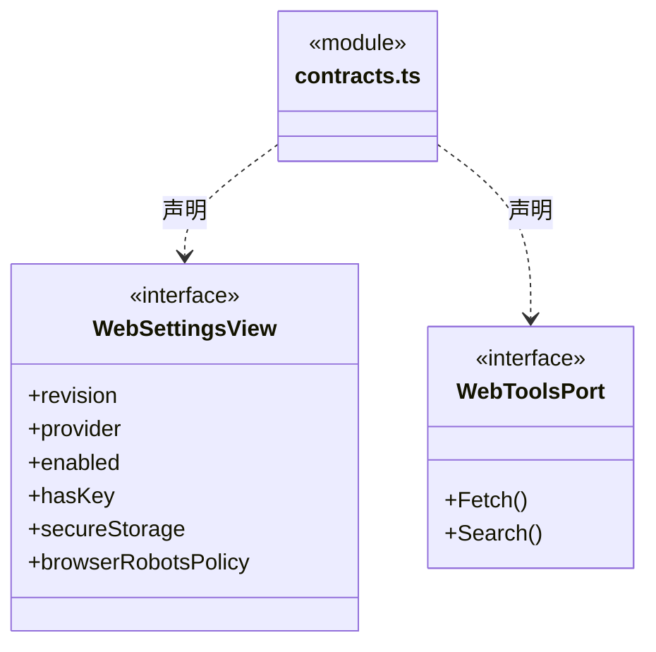
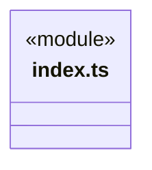

# src/logic/web 架构

本目录只维护这一份说明。设计与契约直接编辑本文；文件清单、类图和导航由 [架构脚本](../../../scripts/source-architecture.mjs) 更新，生成区域之外的人工说明会保留。

## 封装意图

网页工具与设置纯契约；service 提供网络业务适配和配置持久化，工具权限与宿主装配在外层。

## 类与模块的设计意图

下表依据源码声明及文件头说明定位封装。字段表示该实例持有的状态或协作引用，不表示它拥有被引用服务的生命周期；实际资源责任和调用限制见下文契约及源码注释。

| 类／模块 | 实现形式与实例字段 | 封装依据 |
| --- | --- | --- |
| [contracts.ts](contracts.ts) | 函数／契约模块 | 模型只能提交地址或关键词，网络策略和凭据留在主进程；返回资料不是执行指令。 |
| [index.ts](index.ts) | 函数／契约模块 | 调度器和桥接只需参数与结果契约，不加载网络、配置存储或凭据实现。 |

## 接口设计契约

### Web 业务边界

index.ts 只公开工具输入输出、设置输入及摘要类型，不加载 service 或平台。service/index.ts 向宿主公开 WebService 与 WebSettings；Logic 工具编排仅消费纯工具契约。业务模块不依赖 Bridge 或 View。

工具注册、运行权限仍由调度器拥有；WebService 只组合 Core 读取器并标注 untrusted，搜索固定 Brave API。WebSettings 保存 revision、搜索开关、加密密钥和浏览器 robots 策略。

bridge/contracts/web.ts 是已登记的具名设置契约出口，只公开 webConfigureInput 与 WebSettingsView。IPC 操作名和字段保持，不开放工具执行、服务实例或密钥端口；如后续独立通信 DTO，需同步替换实际消费者后再退出此兼容许可。

修改 robots/搜索业务配置进入 [service](service/ARCHITECTURE.md#contract)，修改抓取和浏览器机制进入 [Core 网页](../../core/platform/node/web/ARCHITECTURE.md#contract)。

## 开闭边界

本目录的职责及允许协作由[封装意图](#封装意图)限定，输入输出、状态与失败语义以[接口设计契约](#接口设计契约)为准。扩展从已有公开入口及实际装配位置进入；没有明确可替换契约的部分按真实影响修改和验证，不预建未使用的基类或插件入口。

<!-- architecture:generated:start -->

## 文件清单

| 文件 | 形式 | 当前职责 |
| --- | --- | --- |
| [ARCHITECTURE.md](ARCHITECTURE.md) | 说明文档 | 本目录的文件清单、真实声明、依赖与子封装导航。 |
| [contracts.ts](contracts.ts) | 源码模块 | 公开网页读取与搜索的有界工具协议，以及桌面 robots/搜索设置契约。 |
| [index.ts](index.ts) | 源码模块 | 网页工具和设置的纯业务协议入口。 |

## 架构类图

成员标记：`+` 公开、`-` 私有、`#` 受保护、`$` 静态；构造函数单独列出。文档和资源仅在文件清单中导航，不作为代码节点。

各图中的同名节点表示同一目录边界；跨组及完整直接依赖如下（无边不代表继承）：

- `index.ts` → `contracts.ts`：导入。
- `service` → `index.ts`：导入。

### contracts.ts

### index.ts

直接依赖：[contracts.ts](contracts.ts)。

## 子目录导航

- [service/](service/ARCHITECTURE.md)：WebService 的正文适配和 Brave 搜索；WebSettings 的版本、搜索开关、robots 策略和加密配置。公开服务入口与纯协议分开。

[返回上层](../ARCHITECTURE.md)。

每次修改本目录代码，同步维护文件头、关键契约说明及本图。未实现的治理、证据验收和自动编排能力不列入当前类图。

<!-- architecture:generated:end -->
