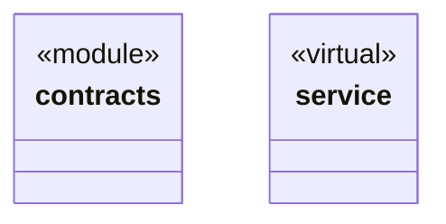

# src/logic/web 架构

## 设计意图

定义网页读取、搜索及设置的业务边界，把公开工具协议与网络实现隔开。

本层纯契约供工具和 Bridge 消费，`service` 组合基础网页读取、搜索供应商与配置。工具权限和工作区运行归属由外层装配提供，协议本身不保存密钥或发网络请求。

## 主要组成

| 组成 | 定位 |
| --- | --- |
| [contracts](contracts.ts) | 公开网页读取与搜索的有界工具协议，以及桌面 robots/搜索设置契约。 |

## 现状与目标边界

当前 [contracts.ts](contracts.ts) 与 [index.ts](index.ts) 是父层纯入口，service 管理业务适配及配置。目标是明确协议子封装，父层只组合能力并保留必要转接。迁移不能使 Bridge 或浏览器消费者加载 Node/Electron，也不能改变 robots、搜索开关与凭据摘要语义。

<!-- architecture:generated:start -->

## 架构关系

标注为 `virtual` 的节点是直接子模块的虚拟类封装；内部设计沿下方入口阅读。

## 子模块

| 虚拟封装 | 整体职责 |
| --- | --- |
| [service](service/ARCHITECTURE.md) | 将 Core 网页机制和 Brave 搜索适配到业务工具，同时集中管理可公开设置与私有凭据。 |

[上层设计](../ARCHITECTURE.md)

<!-- architecture:generated:end -->
