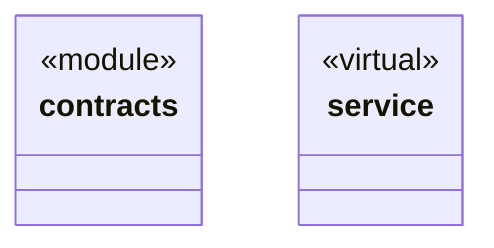

# src/logic/web 架构

## 设计意图

网页工具与设置纯契约；service 提供网络业务适配和配置持久化，工具权限与宿主装配在外层。

## 主要组成

| 组成 | 定位 |
| --- | --- |
| [contracts](contracts.ts) | 公开网页读取与搜索的有界工具协议，以及桌面 robots/搜索设置契约。 |

<!-- architecture:generated:start -->

## 架构关系

标注为 `virtual` 的节点是直接子模块的虚拟类封装；内部设计沿下方入口阅读。

## 子模块

| 虚拟封装 | 整体职责 |
| --- | --- |
| [service](service/ARCHITECTURE.md) | WebService 的正文适配和 Brave 搜索；WebSettings 的版本、搜索开关、robots 策略和加密配置。公开服务入口与纯协议分开。 |

[上层设计](../ARCHITECTURE.md)

<!-- architecture:generated:end -->
