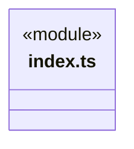
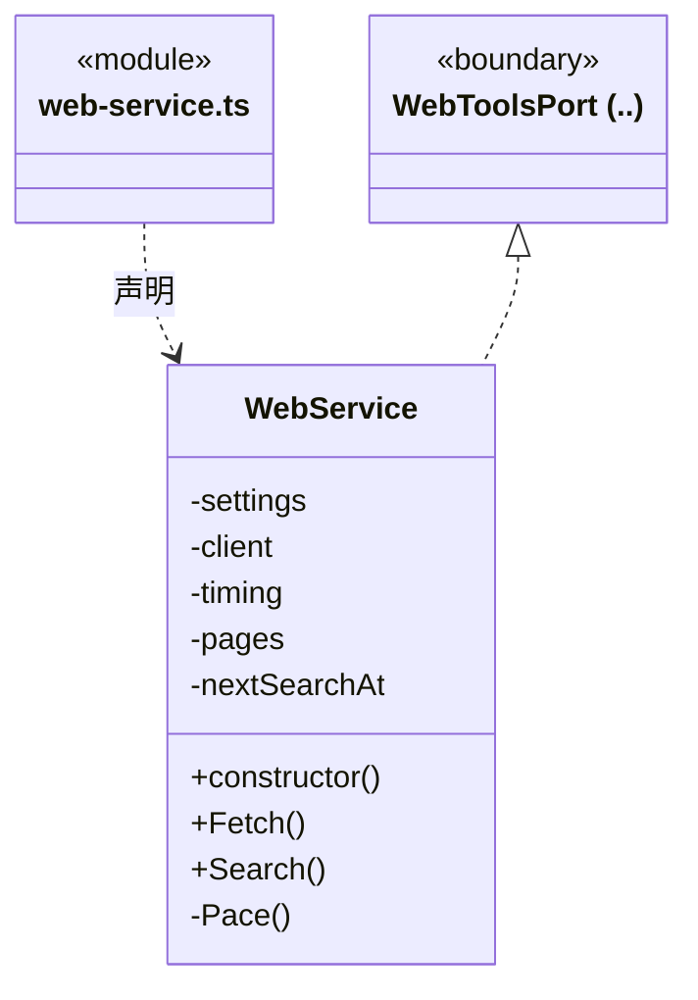
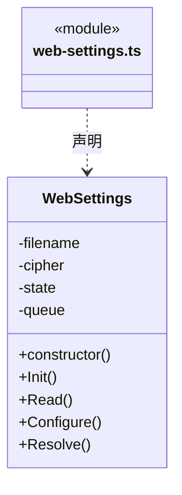
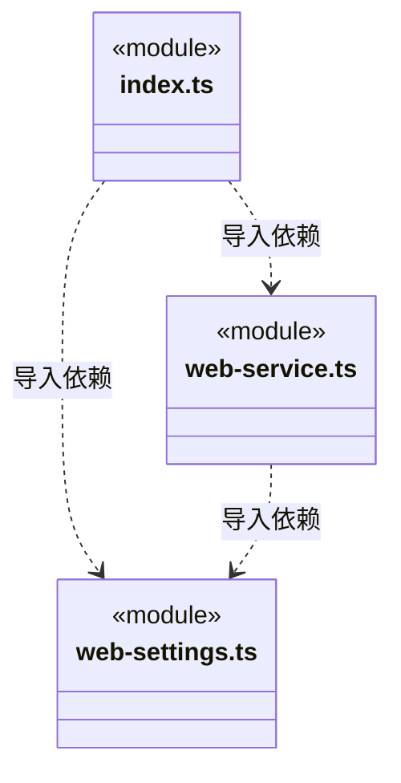

# src/logic/web/service 架构

本目录只维护这一份说明。设计与契约直接编辑本文；文件清单、类图和导航由 [架构脚本](../../../../scripts/source-architecture.mjs) 更新，生成区域之外的人工说明会保留。

## 封装意图

WebService 的正文适配和 Brave 搜索；WebSettings 的版本、搜索开关、robots 策略和加密配置。公开服务入口与纯协议分开。

## 类与模块的设计意图

下表依据源码声明及文件头说明定位封装。字段表示该实例持有的状态或协作引用，不表示它拥有被引用服务的生命周期；实际资源责任和调用限制见下文契约及源码注释。

| 类／模块 | 实现形式与实例字段 | 封装依据 |
| --- | --- | --- |
| [index.ts](index.ts) | 函数／契约模块 | 将有副作用的搜索、页面读取和凭据配置与纯工具协议隔离；浏览器由宿主显式注入。 |
| [WebService](web-service.ts) | 实例类；持有 `pages`、`nextSearchAt`、`settings`、`client`、`timing` | 应用级配置适配；页面缓存属于 WebPageReader，搜索节流只针对固定 Brave API。 |
| [WebSettings](web-settings.ts) | 实例类；持有 `state`、`queue`、`filename`、`cipher` | robots 策略由每次网页读取捕获；搜索开关及密钥独立生效。旧文件缺省 allow，旧客户端保存不重置策略。 |

## 接口设计契约

### Web 服务与配置

WebService 实现纯业务 WebToolsPort，默认创建 Core WebPageReader；可注入同契约读取端口，既有四个构造参数及默认装配保持。页面缓存和浏览器资源由读取器拥有，搜索节流由本服务拥有。

fetch 每次捕获 browserRobotsPolicy（默认 allow），向读取器传递原取消信号，校验输入并添加 untrusted:true。设置更新只影响下一次调用，基础读取器按策略隔离缓存。缺少浏览器时保留原静态错误；不将渲染超时或正文为空改写成登录失败。

search 只向固定 Brave API 发送搜索密钥，不跟随重定向、不自动读取结果正文；过滤非公开 URL 并限制标题/摘要。搜索关闭或密钥错误不控制浏览器正文策略。

WebSettings 拥有实例队列、revision 与配置状态。加密和写盘成功后才发布新状态，冲突或写入失败不覆盖旧配置。旧文件默认 allow，旧客户端省略策略不重置已有策略。SecretCipher 来自 Core，宿主负责实现和路径。

独立服务单元用读取端口替身验证策略捕获和标记；设置单元使用临时目录；真实页面/浏览器兜底与业务服务的协作仍由 web-browser-fallback 契约覆盖，不用替身替代它。

#### 搜索与渲染边界

搜索仅固定 Brave API GET，密钥用 X-Subscription-Token；不自动跳转、不把密钥或服务原错误正文放入返回。每次读取当前已保存设置，关闭阻止下一次请求，已经发出的请求仍由运行取消管理。搜索结果不自动抓正文。既有聊天材料导入仍使用原协议，本工具不改写来源证据。

## 开闭边界

本目录的职责及允许协作由[封装意图](#封装意图)限定，输入输出、状态与失败语义以[接口设计契约](#接口设计契约)为准。扩展从已有公开入口及实际装配位置进入；没有明确可替换契约的部分按真实影响修改和验证，不预建未使用的基类或插件入口。

<!-- architecture:generated:start -->

## 文件清单

| 文件 | 形式 | 当前职责 |
| --- | --- | --- |
| [ARCHITECTURE.md](ARCHITECTURE.md) | 说明文档 | 本目录的文件清单、真实声明、依赖与子封装导航。 |
| [index.ts](index.ts) | 源码模块 | 网页服务与配置的宿主装配入口。 |
| [web-service.ts](web-service.ts) | 源码模块 | 将基础网页读取方案适配到 CBIM 工具协议，并连接用户配置的 Brave 搜索。 |
| [web-settings.ts](web-settings.ts) | 源码模块 | 版本化保存浏览器 robots 策略、Brave 搜索开关及加密凭据，桌面只取得摘要。 |

## 架构类图

成员标记：`+` 公开、`-` 私有、`#` 受保护、`$` 静态；`function` 为函数值成员，`get`／`set` 为访问器。调用／构造／索引签名按匿名签名列出，不虚构方法名；`global.` 表示全局声明补充，非运行时嵌套类。构造函数单独列出，运行时私有字段保留 `#`。文档和资源仅在文件清单中导航，不作为代码节点。

### index.ts

[查看源码](index.ts)。

直接依赖：[web-service.ts](web-service.ts)、[web-settings.ts](web-settings.ts)。

### web-service.ts

[查看源码](web-service.ts)。

继承／实现来源：`WebToolsPort` → [../contracts.ts](../contracts.ts)（声明 `WebToolsPort`）。
直接依赖：[../../../core/platform/node/web/index.ts](../../../core/platform/node/web/index.ts)、[../index.ts](../index.ts)、[web-settings.ts](web-settings.ts)。

### web-settings.ts

[查看源码](web-settings.ts)。

直接依赖：[../../../core/contracts/secrets.ts](../../../core/contracts/secrets.ts)、[../../../core/errors.ts](../../../core/errors.ts)、[../../../core/platform/node/files/index.ts](../../../core/platform/node/files/index.ts)、[../../../core/utility/index.ts](../../../core/utility/index.ts)、[../index.ts](../index.ts)。

### 本目录调用边界

## 子目录导航

无子目录。

[返回上层](../ARCHITECTURE.md)。

每次修改本目录代码，同步维护文件头、关键契约说明及本图。未实现的治理、证据验收和自动编排能力不列入当前类图。

<!-- architecture:generated:end -->
