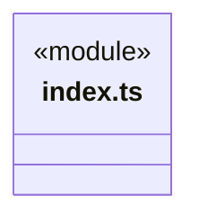
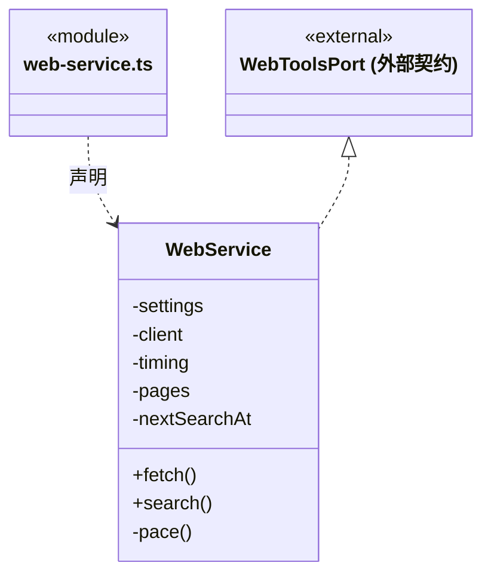
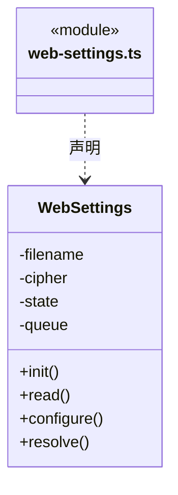
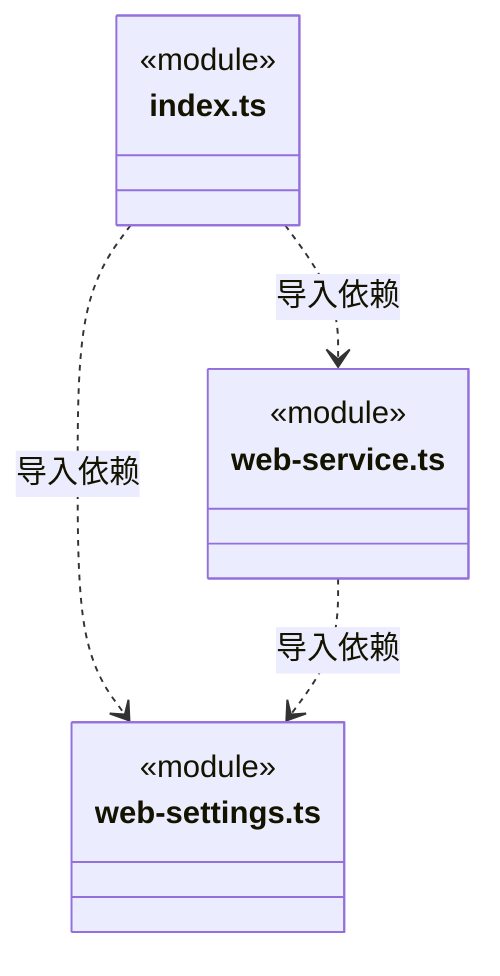

# src/logic/web/service 架构

## 目录定位

WebService 的正文适配和 Brave 搜索；WebSettings 的版本、搜索开关、robots 策略和加密配置。公开服务入口与纯协议分开。

本文描述当前实现。通过分析目录边界后维护的 [源码架构脚本](../../../../scripts/source-architecture.mjs) 同步清单和声明；代码变更时仍须核对职责、关键成员与关系。

## 代码清单

| 文件 | 当前职责 |
| --- | --- |
| [index.ts](index.ts) | 网页服务与配置的宿主装配入口。 |
| [web-service.ts](web-service.ts) | 将基础网页读取方案适配到 CBIM 工具协议，并连接用户配置的 Brave 搜索。 |
| [web-settings.ts](web-settings.ts) | 版本化保存浏览器 robots 策略、Brave 搜索开关及加密凭据，桌面只取得摘要。 |

## 架构类图

### index.ts

直接依赖：[web-service.ts](web-service.ts)、[web-settings.ts](web-settings.ts)。

### web-service.ts

直接依赖：[../index.ts](../index.ts)、[../../../core/platform/node/web/index.ts](../../../core/platform/node/web/index.ts)、[web-settings.ts](web-settings.ts)。

### web-settings.ts

直接依赖：[../../../core/utility/index.ts](../../../core/utility/index.ts)、[../../../core/platform/node/files/index.ts](../../../core/platform/node/files/index.ts)、[../../../core/errors.ts](../../../core/errors.ts)、[../index.ts](../index.ts)、[../../../core/contracts/secrets.ts](../../../core/contracts/secrets.ts)。

### 本目录调用边界

## 子目录导航

无子目录。

[返回上层](../ARCHITECTURE.md)。

每次修改本目录代码，同步维护文件头、关键契约说明及本图。未实现的治理、证据验收和自动编排能力不列入当前类图。

## 设计契约 v1 与落地范围

以下内容区分已接通能力与后续设计；以各节的实现状态为准，不将目标图当作现状图。维护源：[CONTRACT.md](CONTRACT.md)；生成类图时同步附加，勿直接修改本附录。

# Web 服务与配置

WebService 实现纯业务 WebToolsPort，默认创建 Core WebPageReader；可注入同契约读取端口，既有四个构造参数及默认装配保持。页面缓存和浏览器资源由读取器拥有，搜索节流由本服务拥有。

fetch 每次捕获 browserRobotsPolicy（默认 allow），向读取器传递原取消信号，校验输入并添加 untrusted:true。设置更新只影响下一次调用，基础读取器按策略隔离缓存。缺少浏览器时保留原静态错误；不将渲染超时或正文为空改写成登录失败。

search 只向固定 Brave API 发送搜索密钥，不跟随重定向、不自动读取结果正文；过滤非公开 URL 并限制标题/摘要。搜索关闭或密钥错误不控制浏览器正文策略。

WebSettings 拥有实例队列、revision 与配置状态。加密和写盘成功后才发布新状态，冲突或写入失败不覆盖旧配置。旧文件默认 allow，旧客户端省略策略不重置已有策略。SecretCipher 来自 Core，宿主负责实现和路径。

独立服务单元用读取端口替身验证策略捕获和标记；设置单元使用临时目录；真实页面/浏览器兜底与业务服务的协作仍由 web-browser-fallback 契约覆盖，不用替身替代它。

## 搜索与渲染边界

搜索仅固定 Brave API GET，密钥用 X-Subscription-Token；不自动跳转、不把密钥或服务原错误正文放入返回。每次读取当前已保存设置，关闭阻止下一次请求，已经发出的请求仍由运行取消管理。搜索结果不自动抓正文。既有聊天材料导入仍使用原协议，本工具不改写来源证据。
