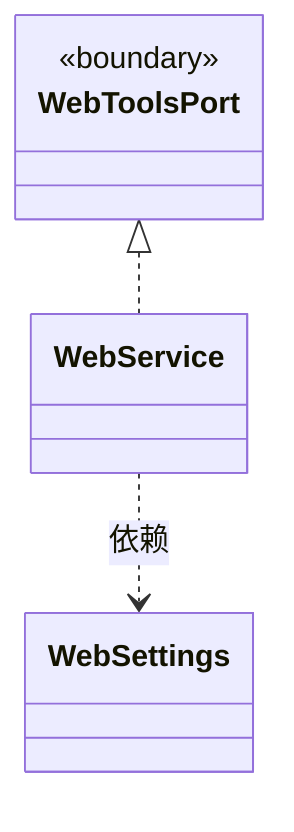

# src/logic/web/service 架构

## 设计意图

将 Core 网页机制和 Brave 搜索适配到业务工具，同时集中管理可公开设置与私有凭据。

`WebSettings` 保存版本、robots 策略、搜索开关与加密密钥，`WebService` 根据配置读取正文或搜索。浏览器和加密端口由宿主注入，页面只取得摘要；基础缓存与取消不能替代业务授权。

## 主要组成

| 组成 | 定位 |
| --- | --- |
| [WebService](web-service.ts) | 将基础网页读取方案适配到 CBIM 工具协议，并连接用户配置的 Brave 搜索。 |
| [WebSettings](web-settings.ts) | 版本化保存浏览器 robots 策略、Brave 搜索开关及加密凭据，桌面只取得摘要。 |

<!-- architecture:generated:start -->

## 架构关系

外部继承／实现边界：[WebToolsPort](../contracts.ts)。

[上层设计](../ARCHITECTURE.md)

<!-- architecture:generated:end -->
