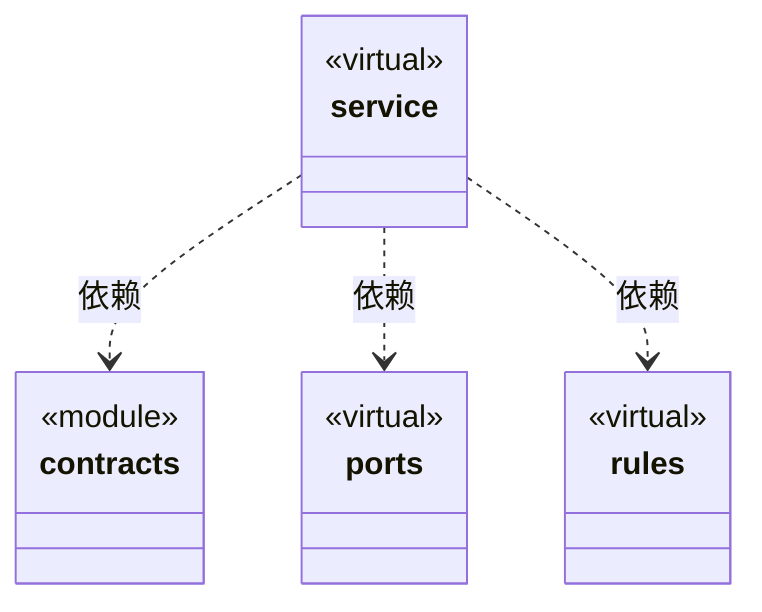

# src/logic/workspace 架构

## 设计意图

管理工作区身份、业务模块、Workflow 和本机资源边界，为知识与执行提供可信工作对象。

本层契约表达登记与公开视图，`rules` 定义范围和责任，`ports` 隔离路径结构，`service` 实施目录、打开、源码浏览和治理入口。工作区有效不等于知识校验或执行准入已经通过。

## 主要组成

| 组成 | 定位 |
| --- | --- |
| [contracts](contracts.ts) | 工作区登记与运行视图的公开数据，由工作区业务拥有，供桥接协议转接。 |

## 现状与目标边界

当前 [contracts.ts](contracts.ts) 是父层公开数据，rules、ports 和 service 已分别表达规则、路径能力与本机实现。目标是把公开协议归入明确契约边界，父层仅描述组合；尚未调整其物理路径。工作区登记数据不能携带服务实例，路径端口也不能反向依赖具体 Paths 类。

<!-- architecture:generated:start -->

## 架构关系

标注为 `virtual` 的节点是直接子模块的虚拟类封装；内部设计沿下方入口阅读。

## 子模块

| 虚拟封装 | 整体职责 |
| --- | --- |
| [ports](ports/ARCHITECTURE.md) | 以结构化路径能力连接工作区规则与本机布局，避免领域直接依赖宿主路径实现。 |
| [rules](rules/ARCHITECTURE.md) | 定义工程模块、Workflow、冻结执行范围及负责人关系，统一知识声明与运行准备的业务含义。 |
| [service](service/ARCHITECTURE.md) | 组织本机工作区的登记、打开与受控知识服务，为可信桌面和应用装配提供入口。 |

[上层设计](../ARCHITECTURE.md)

<!-- architecture:generated:end -->
