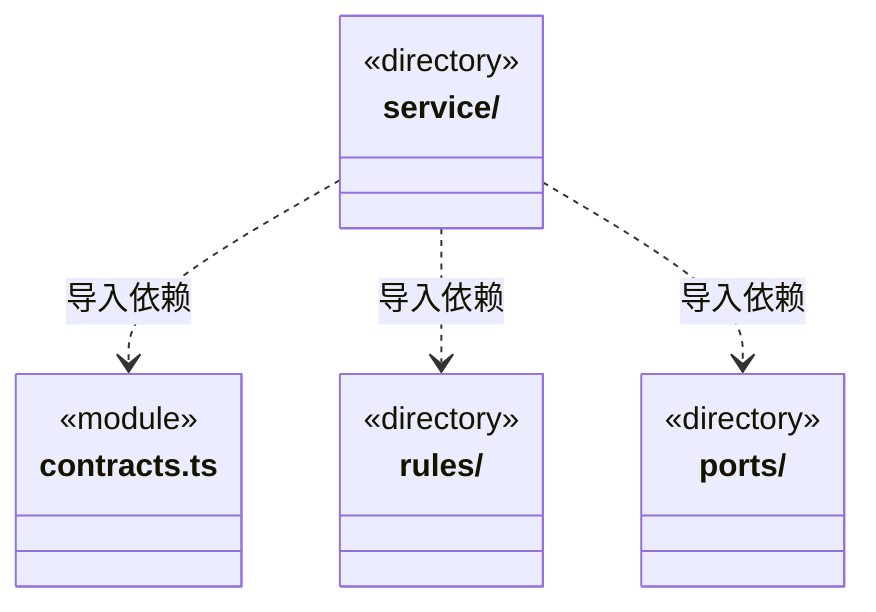

# src/logic/workspace 架构

本目录只维护这一份说明。设计与契约直接编辑本文；文件清单、类图和导航由 [架构脚本](../../../scripts/source-architecture.mjs) 更新，生成区域之外的人工说明会保留。

## 封装意图

工作区定义、工作流和执行范围规则；服务与规则分开归属，实际依赖通过明确入口验证。

## 类与模块的设计意图

下表依据源码声明及文件头说明定位封装。字段表示该实例持有的状态或协作引用，不表示它拥有被引用服务的生命周期；实际资源责任和调用限制见下文契约及源码注释。

| 类／模块 | 实现形式与实例字段 | 封装依据 |
| --- | --- | --- |
| [contracts.ts](contracts.ts) | 函数／契约模块 | 纯 DTO 不反向引用调用桥，避免操作响应与 Bridge 形成类型循环。 |

## 接口设计契约

- [contracts.ts](contracts.ts)：工作区登记与运行视图的公开数据，由工作区业务拥有，供桥接协议转接。

## 开闭边界

本目录的职责及允许协作由[封装意图](#封装意图)限定，输入输出、状态与失败语义以[接口设计契约](#接口设计契约)为准。扩展从已有公开入口及实际装配位置进入；没有明确可替换契约的部分按真实影响修改和验证，不预建未使用的基类或插件入口。

<!-- architecture:generated:start -->

## 文件清单

| 文件 | 形式 | 当前职责 |
| --- | --- | --- |
| [ARCHITECTURE.md](ARCHITECTURE.md) | 说明文档 | 本目录的文件清单、真实声明、依赖与子封装导航。 |
| [contracts.ts](contracts.ts) | 源码模块 | 工作区登记与运行视图的公开数据，由工作区业务拥有，供桥接协议转接。 |

## 架构类图

成员标记：`+` 公开、`-` 私有、`#` 受保护、`$` 静态；构造函数单独列出。文档和资源仅在文件清单中导航，不作为代码节点。

各图中的同名节点表示同一目录边界；跨组及完整直接依赖如下（无边不代表继承）：

- `service` → `contracts.ts`：导入。
- `service` → `rules`：导入。
- `service` → `ports`：导入。

## 子目录导航

- [ports/](ports/ARCHITECTURE.md)：工作区存储路径的结构化端口，规则不依赖宿主 Paths 实现。
- [rules/](rules/ARCHITECTURE.md)：领域工程、Module、Workflow与稳定岗位责任协议。来源代次和写前屏障由纯规则投影；内容指纹、来源身份、负责人关系分别核实。同负责人明确采纳递增关系版本，不迁移任务；旧缺省记录不补造来源。Workflow验证不自行读文件或签发业务验收。 只读视图归 logic/knowledge/rules/read-models，外部通过其 index.ts 访问；项目根定义仍为独立纯公开契约。 executionScope只收窄原权限，全模块一致冻结，预算合并取小。 主调度的负责人发现按所选模块真实分组，缺口不推测继承或默认负责者。
- [service/](service/ARCHITECTURE.md)：本机工作区、静态编辑与受控来源协调。获取工作区锁后在唯一DispatchStore核身份、恢复知识和来源，再发布服务。岗位和负责人以同知识快照明确采纳；首次真实观察与消费者同事务保存。来源、能力、模型分别展示，不以登记回执启动实例或改写旧任务。 负责岗位和模块责任只读发现供实际主工具调用；当前配置观察与历史执行事实分开。 原知识事务适配复用现有串行 journal 核验，固定计划与旧实例只读；不提交、刷新、恢复或修剪目录。 ControlledFiles 连接原成员授权、唯一 Store、文件平台与私有备份；原not_applied与真实退出才解除运行屏障，显式补偿重新核文件身份/摘要/关闭周期，未知不重试。

[返回上层](../ARCHITECTURE.md)。

每次修改本目录代码，同步维护文件头、关键契约说明及本图。未实现的治理、证据验收和自动编排能力不列入当前类图。

<!-- architecture:generated:end -->
