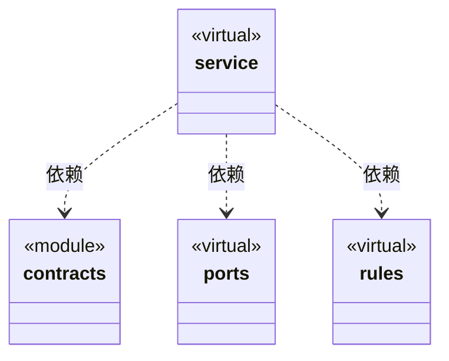

# src/logic/workspace 架构

## 设计意图

封装工作区身份、领域模块、Workflow 和本机服务。规则定义范围与责任关系，路径端口隔离存储布局，服务连接知识与运行所需的可信资源。

## 主要组成

| 组成 | 定位 |
| --- | --- |
| [contracts](contracts.ts) | 工作区登记与运行视图的公开数据，由工作区业务拥有，供桥接协议转接。 |

<!-- architecture:generated:start -->

## 架构关系

标注为 `virtual` 的节点是直接子模块的虚拟类封装；内部设计沿下方入口阅读。

## 子模块

| 虚拟封装 | 整体职责 |
| --- | --- |
| [ports](ports/ARCHITECTURE.md) | 工作区存储路径的结构化端口，规则不依赖宿主 Paths 实现。 |
| [rules](rules/ARCHITECTURE.md) | 定义领域工程、模块、Workflow、执行范围与负责人关系。纯规则核对身份、来源和声明条件，文件读取、责任登记与执行行为由服务负责。 |
| [service](service/ARCHITECTURE.md) | 组织本机工作区的打开、知识服务、静态编辑与责任登记。Workspace 汇合当前工作区资源，各服务按目录、源码浏览、架构编辑和责任管理分工，运行准入由执行域负责。 |

[上层设计](../ARCHITECTURE.md)

<!-- architecture:generated:end -->
