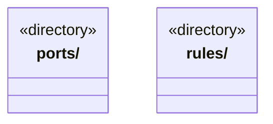

# src/logic/workspace 架构

## 目录定位

工作区定义、工作流和执行范围规则；服务与规则分开归属，实际依赖通过明确入口验证。

本文描述当前实现。通过分析目录边界后维护的 [源码架构脚本](../../../scripts/source-architecture.mjs) 同步清单和声明；代码变更时仍须核对职责、关键成员与关系。

## 代码清单

本层无直接代码文件。

## 架构类图

各图中的同名节点表示同一目录边界；跨组及完整直接依赖如下（无边不代表继承）：

本层无目录间直接导入关系。

## 子目录导航

- [ports/](ports/ARCHITECTURE.md)：工作区存储路径的结构化端口，规则不依赖宿主 Paths 实现。
- [rules/](rules/ARCHITECTURE.md)：领域工程、Module、Workflow与稳定岗位责任协议。来源代次和写前屏障由纯规则投影；内容指纹、来源身份、负责人关系分别核实。同负责人明确采纳递增关系版本，不迁移任务；旧缺省记录不补造来源。Workflow验证不自行读文件或签发业务验收。 model.ts 是知识读取模块的私有实现，外部通过 knowledge/read-models 访问；项目根定义仍为独立纯公开契约。 executionScope只收窄原权限，全模块一致冻结，预算合并取小。 主调度的负责人发现按所选模块真实分组，缺口不推测继承或默认负责者。

[返回上层](../ARCHITECTURE.md)。

每次修改本目录代码，同步维护文件头、关键契约说明及本图。未实现的治理、证据验收和自动编排能力不列入当前类图。
