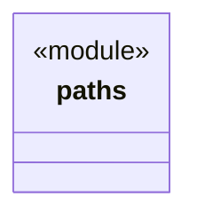

# src/logic/workspace/ports 架构

## 设计意图

工作区存储路径的结构化端口，规则不依赖宿主 Paths 实现。

## 主要组成

| 组成 | 定位 |
| --- | --- |
| [paths](paths.ts) | 工作区身份与受控路径解析端口。 |

<!-- architecture:generated:start -->

## 架构关系

[上层设计](../ARCHITECTURE.md)

<!-- architecture:generated:end -->
