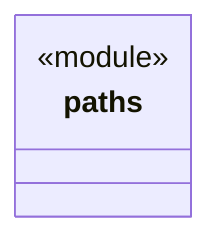

# src/logic/workspace/ports 架构

## 设计意图

以结构化路径能力连接工作区规则与本机布局，避免领域直接依赖宿主路径实现。

`paths` 声明身份与受控解析所需方法，实际 `Paths` 实现在 service。端口不执行磁盘授权、持锁或生命周期操作；消费者必须在已核实工作区范围内使用返回路径。

## 主要组成

| 组成 | 定位 |
| --- | --- |
| [paths](paths.ts) | 工作区身份与受控路径解析端口。 |

<!-- architecture:generated:start -->

## 架构关系

[上层设计](../ARCHITECTURE.md)

<!-- architecture:generated:end -->
