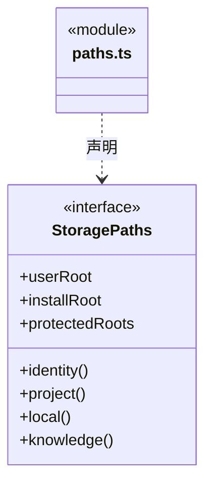

# src/logic/workspace/ports 架构

## 目录定位

工作区存储路径的结构化端口，规则不依赖宿主 Paths 实现。

本文描述当前实现。通过分析目录边界后维护的 [源码架构脚本](../../../../scripts/source-architecture.mjs) 同步清单和声明；代码变更时仍须核对职责、关键成员与关系。

## 代码清单

| 文件 | 当前职责 |
| --- | --- |
| [paths.ts](paths.ts) | 工作区身份与受控路径解析端口。 |

## 架构类图

### paths.ts

## 子目录导航

无子目录。

[返回上层](../ARCHITECTURE.md)。

每次修改本目录代码，同步维护文件头、关键契约说明及本图。未实现的治理、证据验收和自动编排能力不列入当前类图。

## 设计契约 v1 与落地范围

以下内容区分已接通能力与后续设计；以各节的实现状态为准，不将目标图当作现状图。维护源：[CONTRACT.md](CONTRACT.md)；生成类图时同步附加，勿直接修改本附录。

# 工作区路径端口

StoragePaths 只描述工作区持久化所需的目录和身份。实际 Paths 实现仍由宿主提供，权限校验、受保护根目录和磁盘副作用留在实现方。规则通过结构化端口使用路径，不依赖宿主实例。
