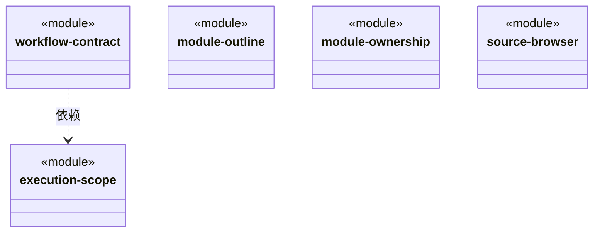

# src/logic/workspace/rules 架构

## 设计意图

定义领域工程、模块、Workflow、执行范围与负责人关系。纯规则核对身份、来源和声明条件，文件读取、责任登记与执行行为由服务负责。

## 主要组成

| 组成 | 定位 |
| --- | --- |
| [module-outline](module-outline.ts) | 模块正文的固定章节和可复制模板，供知识校验与桌面编辑共同使用。 |
| [workflow-contract](workflow-contract.ts) | 定义模块 Workflow 正文中可选执行条件的严格协议，供知识治理、资源包与执行准备共同解析。 |
| [module-ownership](module-ownership.ts) | 单模块负责人控制面的严格公开协议，供岗位、责任服务、持久化及桌面共用。 |
| [execution-scope](execution-scope.ts) | 模块 Workflow 的可冻结执行范围及任务合并规则，供知识准备、运行门禁与平台装配共用。 |
| [source-browser](source-browser.ts) | 模块绑定源码浏览的纯数据与请求契约，由工作区业务拥有。 |

<!-- architecture:generated:start -->

## 架构关系

[上层设计](../ARCHITECTURE.md)

<!-- architecture:generated:end -->
