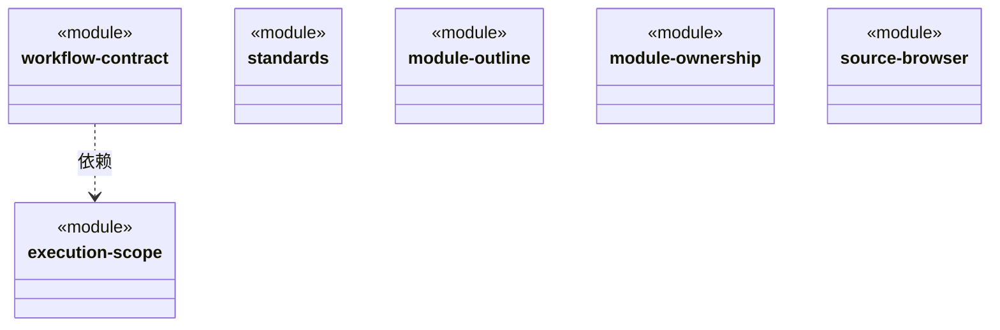
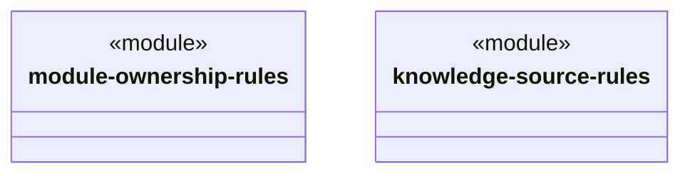

# src/logic/workspace/rules 架构

## 设计意图

定义工程模块、Workflow、冻结执行范围及负责人关系，统一知识声明与运行准备的业务含义。

规范与正文模板负责静态结构，Workflow 解析组合代码检查、产物和验证条件，来源与责任规则维护可追溯关系。声明有效不等于当前文件或岗位有效；服务在真实工作区和事务中继续核实。

## 主要组成

| 组成 | 定位 |
| --- | --- |
| [standards](standards.ts) | 模块定义、Workflow 创建规范与 Module Schema 的唯一代码正文。 |
| [module-outline](module-outline.ts) | 模块正文的固定章节和可复制模板，供知识校验与桌面编辑共同使用。 |
| [workflow-contract](workflow-contract.ts) | 定义模块 Workflow 正文中可选执行条件的严格协议，供知识治理、资源包与执行准备共同解析。 |
| [module-ownership](module-ownership.ts) | 单模块负责人控制面的严格公开协议，供岗位、责任服务、持久化及桌面共用。 |
| [execution-scope](execution-scope.ts) | 模块 Workflow 的可冻结执行范围及任务合并规则，供知识准备、运行门禁与平台装配共用。 |
| [source-browser](source-browser.ts) | 模块绑定源码浏览的纯数据与请求契约，由工作区业务拥有。 |
| [module-ownership-rules](module-ownership-rules.ts) | 核实负责人登记的依据、命令及关系头投影。 |
| [knowledge-source-rules](knowledge-source-rules.ts) | 解释来源代次和原命令，连接知识变更与显式采纳。 |

<!-- architecture:generated:start -->

## 架构关系

### 关系组 1：execution-scope

### 关系组 2：module-ownership-rules

### 跨图协作

按引用方归并目标，保留全部跨图关系；分图只用于阅读，不表示新增模块或依赖边界。

| 引用方 | 关系 | 目标 |
| --- | --- | --- |
| [module-ownership-rules](module-ownership-rules.ts)（图 2） | 依赖 | [module-ownership](module-ownership.ts)（图 1） |

[上层设计](../ARCHITECTURE.md)

<!-- architecture:generated:end -->
