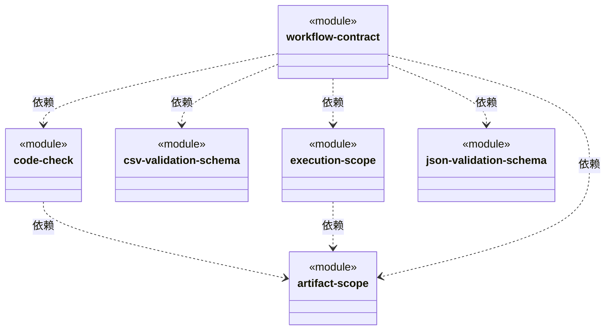
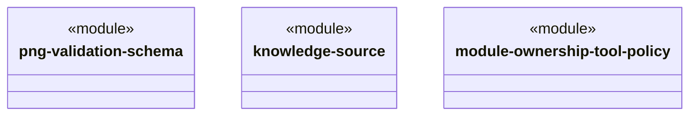

# src/logic/workspace/rules 架构

## 设计意图

保存引擎协议引用的执行范围、知识身份和产物校验规则。这里只计算声明与字节约束，真实文件和命令副作用由当前宿主负责。

## 主要组成

| 组成 | 定位 |
| --- | --- |
| [artifact-scope](artifact-scope.ts) | Workflow 可选完整产物观察范围的叶子契约，供知识冻结、运行采集和公开报告共用。 |
| [code-check](code-check.ts) | 代码 Workflow 的冻结命令与成功判据，供知识校验、执行和证据重算共用。 |
| [csv-validation-schema](csv-validation-schema.ts) | 定义冻结 CSV 表格要求并直接检查有界 UTF-8 字节，供知识声明与可信文件端口共用。 |
| [execution-scope](execution-scope.ts) | 模块 Workflow 的可冻结执行范围及任务合并规则，供知识准备、运行门禁与平台装配共用。 |
| [json-validation-schema](json-validation-schema.ts) | JSON 产物验证的有界声明和纯结构校验，供冻结 Workflow、运行时及知识入口共用。 |
| [knowledge-source](knowledge-source.ts) | 受控知识来源代次、读取状态和原日志握手的纯协议，供岗位、责任、Store 与桌面共用。 |
| [module-ownership-tool-policy](module-ownership-tool-policy.ts) | 模块责任控制面四项工具的纯名称、效果及业务工作分类，供授权与周期收口共用。 |
| [png-validation-schema](png-validation-schema.ts) | 冻结静态 PNG 的精确尺寸、通道要求和资源上限，供知识声明、运行端口与公开结果共用。 |
| [workflow-contract](workflow-contract.ts) | 定义模块 Workflow 正文中可选执行条件的严格协议，供知识治理、资源包与执行准备共同解析。 |

<!-- architecture:generated:start -->

## 架构关系

### 关系组 1：workflow-contract

### 关系组 2：png-validation-schema

### 跨图协作

按引用方归并目标，保留全部跨图关系；分图只用于阅读，不表示新增模块或依赖边界。

| 引用方 | 关系 | 目标 |
| --- | --- | --- |
| [workflow-contract](workflow-contract.ts)（图 1） | 依赖 | [png-validation-schema](png-validation-schema.ts)（图 2） |

[上层设计](../ARCHITECTURE.md)

<!-- architecture:generated:end -->
