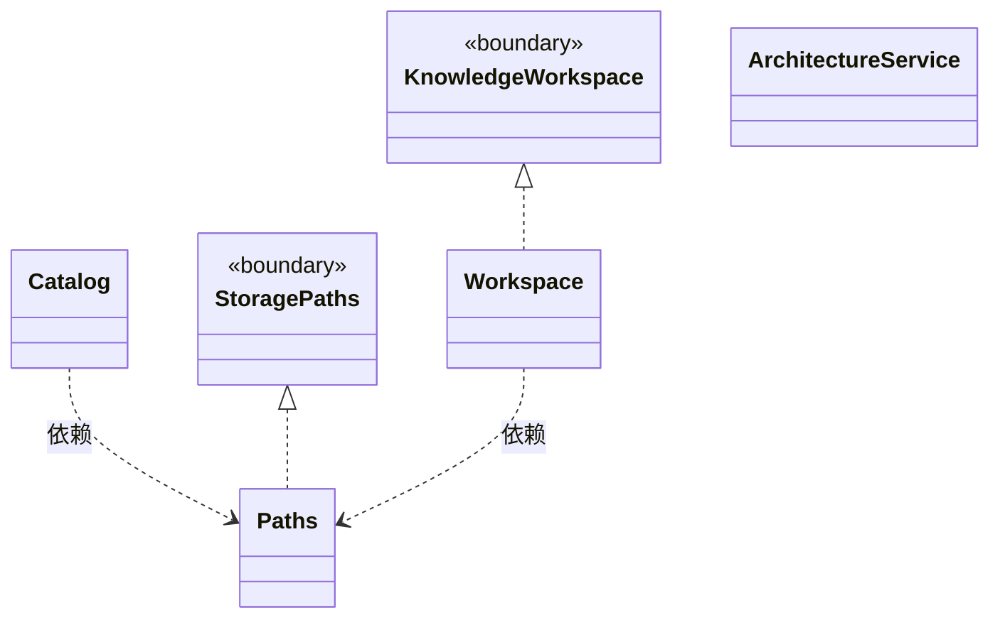
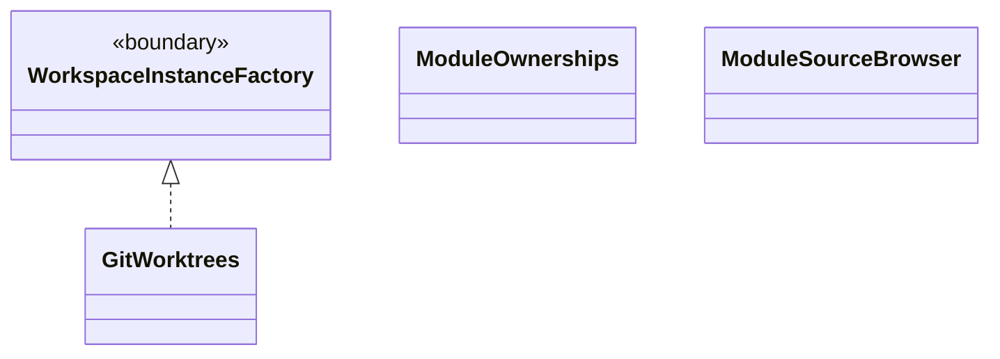

# src/logic/workspace/service 架构

## 设计意图

组织本机工作区的登记、打开与受控知识服务，为可信桌面和应用装配提供入口。

`Catalog` 和 `Paths` 维护本机身份与布局，`Workspace` 持有独占锁、知识监听及维护任务；架构编辑、源码浏览和负责人服务各处理对应入口。岗位与责任在唯一 DispatchStore 裁决，运行准入归 execution，工作区关闭由 Application 协调。

## 主要组成

| 组成 | 定位 |
| --- | --- |
| [ArchitectureService](architecture-service.ts) | 将团队/业务架构表单接到受控知识事务，作为可信桌面的预览与手动提交入口。 |
| [Catalog](catalog.ts) | 维护本机工作区清单及路径身份，串行处理登记、显示名称与重新定位。 |
| [ModuleOwnerships](module-ownerships.ts) | 桌面与真实主工具共用的模块负责人服务，关系和岗位在唯一 DispatchStore 内裁决。 |
| [GitWorktrees](git-worktrees.ts) | 按 Office 和仓库创建或恢复持久工作树，保持未提交修改。 |
| [Paths](paths.ts) | 本机应用目录、工程身份和知识路径的实际解析。 |
| [ModuleSourceBrowser](source-browser.ts) | 按正式模块的 sources 绑定提供只读目录枚举与文本预览，供可信桌面桥接调用。 |
| [Workspace](workspace.ts) | 管理本机工作区的身份、独占锁、知识监听和维护任务。 |

<!-- architecture:generated:start -->

## 架构关系

### 关系组 1：Paths

### 关系组 2：GitWorktrees

外部继承／实现边界：[WorkspaceInstanceFactory](../../../framework/business/workspace-instance.ts)、[StoragePaths](../ports/paths.ts)、[KnowledgeWorkspace](../../knowledge/rules/ports.ts)。

[上层设计](../ARCHITECTURE.md)

<!-- architecture:generated:end -->
