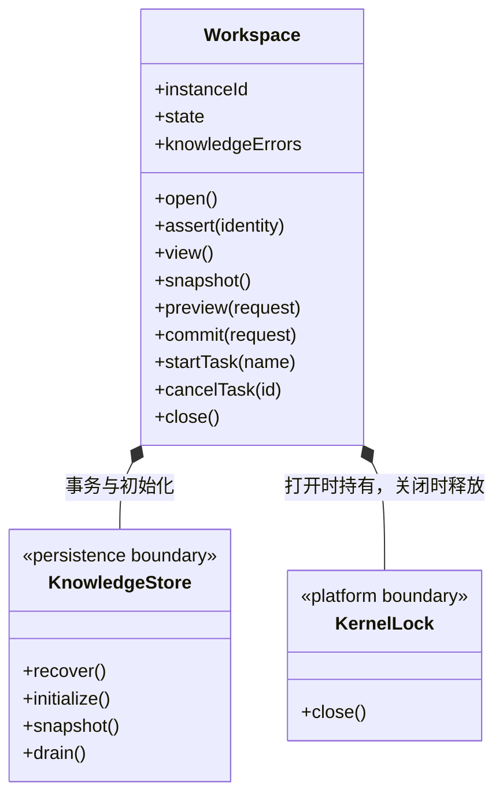

### 当前工作区生命周期

本目录实例只负责应用内部运行。`Application` 持有实例并装配执行管理器、成员调度与全局运行监控；界面选择不改变实例所有权。

- `open()` 校验真实路径身份、取得独占锁、核本地历史归属，再 await Main 注入的可信 `beforeDispatchLoad` 阶段，然后读取唯一 Store、恢复事务、初始化缺失知识并校验，之后进入 `running`。该阶段只为 Store 观察器提前恢复历史索引，不接 IPC/模型参数；失败不继续 Store 读取或事务恢复，沿原失败路径释放锁。知识校验错误计入 `knowledgeErrors`，不伪装为生命周期失败。
- `assert(identity)` 拒绝未运行或旧实例请求。`instanceId` 每次创建变化，不能用旧预览跨实例提交。
- `snapshot/preview/commit` 委托知识存储；运行授权由上层调用边界核验，事务仍校验版本、结构和幂等请求。
- `governance` 使用私有账本保存显式模块保护、观察、提案、人工决定和实施意图；`governed` 与普通知识提交共用队列。打开先核账本完整性锚，再恢复原事务并核 journal 关联；损坏失败关闭，不默默解除保护。重开不执行旧实施意图。
- `committedReceipt/hasRecordedRequest` 由当前运行实例只读查询完整原知识请求的 journal。前者核验原指纹和已提交结果，后者仅报告任何记录是否存在；旧实例请求可查但不可重新提交，损坏或未完成记录不能作为“从未受理”证明。两者不写入、回滚或自动恢复。
- `startTask/cancelTask` 只管理当前实例的知识检查与索引维护任务。取消前核验运行态；未知、其他工作区、对话或成员派发任务 ID 返回 `TASK_NOT_FOUND`。取消请求不伪造终态：正在提交的事务可继续完成，已完成/失败/取消的任务重复调用保持真实结果。
- `close()` 停止监听、取消维护任务、排空知识事务，最后释放锁。应用先排空执行及成员调度，才关闭工作区。
- 工作区诊断只读展示状态与问题，不提供重启操作。打开流程不修改项目的其他开发工具配置。

知识存储与平台边界分别见 [knowledge](../../knowledge/storage/ARCHITECTURE.md)、[platform](../../execution/platform/ARCHITECTURE.md)。

### 长期岗位登记

`WorkspaceMembers` 与成员派发使用同一 `DispatchStore`，通过单条 `workspaceMemberChanges` 审计派生当前岗位；登记不另外建立 registry 文件，也不创建 AgentInstance、Session、任务图、信封或模型运行。`memberId` 是长期岗位身份；静态 `agentId` 是采纳来源，二者均不等于执行实例身份。active/suspended/retired 是登记状态；正式派发另核当前模块责任、来源、能力及模型，不以 active 单独放行。

`preview/commit` 接收明确实例、变更与版本。登记和能力采纳读取实际原则及有效继承 Skill；模型配置使用显式 profileId/modelId 的公开字段，不解密、不探测网络。预览不生成岗位或采纳 ID。提交在 Store 串行回调内重建预览并复验登记游标、basis 及选定来源；知识和模型配置是独立存储，前后读取复验不宣称跨存储原子锁。读取期间关闭或来源变更拒绝新提交。

元信息修改只改明确选择的字段；能力与模型必须分别采纳，相同模型引用的配置刷新不能夹在普通编辑中。能力内容 hash 不包含整库知识 revision，模型 hash 保守包含完整公开配置及名称。暂停和恢复不要求当前来源可用，仍保留实际 currentDiff；退休终态不可修改或复活。

`list` 只给摘要，按初次登记顺序分页，后续页必须绑定同登记游标。`get` 每次重新读取知识与公开模型配置，返回 same/changed/missing/invalid；外部来源变化不推进登记游标，也不覆盖已采纳正文。详情读取前后再次比较登记游标，发生并发变更时明确要求重读。

提交先以完整原请求指纹查 `commandReceipt`，已提交命令即使原实例退役或来源不可用也返回原紧凑回执。冲突不能覆盖；只读 receipt 不调用 transact、知识读取或模型解析。未查到不等于证明未受理；未知响应只核实原命令，不自动换 ID 或重做操作。容量累计计算退休岗位与历史审计，超限拒绝写入而不删历史。

### 模块岗位负责人服务

`ModuleOwnerships` 与岗位和派发复用同一 Store，通过独立 ownershipChanges 保存单模块关系。指定或更换时从真实知识快照的模块注册表确认可见性，并从同一已验证树读取名称、从原 module.json 核实定义哈希；没有旧关系时返回 observed，不把同路径同字节当成来源代次证明。解除只核原关系与版本，知识缺失也可显式解除，不自动转派其他岗位。

列表、详情与反查每次重新读取来源及岗位状态；分页 basis 包含责任游标、岗位游标与知识版本。preview/commit 还冻结原关系、相关岗位版本和真实已派任务影响摘要。新提交在 Store 串行回调内重建依据，读取知识后再次核实来源、实例和停止信号；不在回调内重入 Store，也不声称知识与责任存储存在跨存储原子锁。已派任务只显示关联，不追改任务身份或流程。

原 commandReceipt 查询先于当前实例和来源校验；同原请求返回原回执，异参拒绝。持久提交后停止或输出失效保留原事实，不声称未受理。`main-module-ownership-tools.ts` 仅接实际当前主周期、主实例、conversation 通道、run 和工具调用；提交加入该周期在途集合，停止先撤销未受理操作再排空已在途事务。模型不能提供 actor，历史回执只查询同工作区同主根。

### 桌面架构编辑

`ArchitectureService` 接收 KnowledgeWorkspace 端口，经严格 schema 和 assert(identity) 核实桌面请求。preview 要求 workspaceId + instanceId + revision + operations，与对象工具复用同一操作；不接受 peopleUpserts、maintenance 或自报确认。不限制为单模块维护确认事务；岗位负责人由独立服务管理。

`commit` 只接受 `workspaceId + instanceId + planId`，使用冻结计划复核并提交，不接受正文覆盖。此服务是用户操作的桌面入口，不加入 Agent 工具注册表；运行中的知识工具仍执行逐次权限门禁。无模型调用、成员启动或业务文件修改副作用。

团队图和业务图是工作区共享的静态知识；多个主会话可同时持有各自独立的成员/目标/模块任务图。架构 CRUD 不创建动态成员，也不追改已派发任务中的角色或模块快照。知识版本变化后，由既有执行上下文检查拒绝过期基线，必须核实并重新准备任务。

## 受控知识来源与明确采纳

`KnowledgeSources` 只协调唯一 DispatchStore 的来源事件，不另建 registry。普通内容/方法编辑保留代次；实际创建、删除、可见性变化及可信对象/包重建范围才形成受控过渡。校验器省略无效定义不证明删除：原定义文件仍在时，普通修复保留已有代次，未追踪来源仍待明确采纳。不能识别没有受控事件的离线同字节重建。

`Workspace` 在持工程锁并核本地路径身份后加载同一 Store，先恢复来源握手再发布运行服务。能力或模块来源采纳使用 Knowledge→Store 单向锁序；新捕获和消费者审计在同一 Store 事务，预览不分配来源代次。旧岗位/责任不自动补引用，改名、状态、模型采纳及解除不采纳新能力/模块来源。

`WorkspaceMembers.get` 每次核当前来源并在返回前比较来源游标。责任列表依据额外绑定 `sourceCursor`，即使知识字节恢复相同也不能混用旧页；详情、预览最后复核岗位/责任/来源变化。`adopt_source` 保留原 bindingId 与负责人，要求当前负责人 active、精确原关系及当前预览，只提升关系版本与来源引用，不自动派发。原命令回执先于新实例、来源和状态判断。

主运行的 `mainModuleOwnershipTools` 对 moduleIds 查询同时调用 `OwnerExecutionService.discover`，两份读取的知识、岗位、责任和来源游标必须一致才返回。只读分组提供可提交的选择或具体缺口；实际计划/派发重新核实，发现结果不充当执行许可。岗位查询不返回解密凭据，原任务对照不覆盖历史绑定。

## 受控文件与显式补偿

forRun 的 confirmNotApplied 仅等待原平台排空并读原账本；核对冻结 binding、scope、workspaceInstanceId、toolCallId、inputHash 和 allowedSeq。只有可靠 not_applied 为 true；查无、applied、unknown、错身份、Store 读取或退出失败都不解除运行屏障，不启动新 child 或文件操作。

`ControlledFiles` 复用唯一 DispatchStore 保存每条文件阶段；原 member 工厂冻结 scope/run/岗位来源，Runtime 的可靠 allowed 序号只消费一次。文件/备份 IO 全在 Store 回调之外，prepared 和 executing 分别提交后才发送实际 apply；终态不因迟到停止、当前模型或知识变化被撤销。平台或保存未知不重做。原命令查询先于今日实例和文件校验。

`preview` 只取得短只读占用、打开独占句柄并核实原 applied/关闭周期/当前同文件 after/私有 before，返回只读摘要和 basis。`compensate` 是独立本机显式命令，重新持有写占用与同句柄，保存独立意图后恢复原 before；不改写原操作或原 canonical。`receipt` 仅读已有阶段，缺记录不推断未执行。首次确定预拒仅 FILE_COMPENSATION_PRE_ACCEPT_INPUT/REJECTED；任何 Store CAS/IO/保存后异常均保持未知。

关闭先 abort 在途文件会话并等待真实 child 退出；失败保留 lease/服务及 Store。再次关闭只确认原进程并释放占用，不触发 apply。文件身份证明不覆盖 ACL/ADS/外部恶意进程；readonly mapping 仍可能导致内容写后截断失败，unknown 不自动补偿。

### 原知识请求只读核实

knowledge-effect-reader.ts 在已打开工作区复用 governed 串行队列的 journal 读取，固定对象计划从原私有缓存加载并核原实例/requestId。来源、治理和前后正文核验仍由 KnowledgeStore 负责；查询不提交、刷新、恢复事务或修剪目录，不创建第二个存储。错误返回有界不可核实诊断，停止/关闭仍传播。当前实例身份不替换原请求，重开可只读原事务。

## 原治理与责任保存核实（Step39）

`persistent-effect-reader.ts` 只读已打开且验证通过的治理账本、唯一 DispatchStore 的责任审计与原回执。治理查询借用同一知识串行屏障，责任查询严格核完整事件、原输入、actor、指纹及派生回执；原实例来自匹配的持久请求，不换成当前实例。治理账本的整链完整性由原 init/append 校验，本查询不重读磁盘或初始化 Store。记录或端口未知均保留不可核实，不通过预览、当前保护/负责人、提交或模型来猜测。

## R07-B2 原删除与移动证明

artifact-transitions 将冻结定义适配为同一 production ControlledFileTransport.withExclusiveTransition；每个真实读取/操作前复核原工作区实例和当前运行，用户根与安装根仍受保护。平台身份及原字节回执严格对照固定操作，withExclusive 返回前必须确认 utility 已退出；不复制正文、不自建任务存储、不自动补偿。

## 原隔离执行核实与清理

IsolatedExecutions复核原冻结run/scope和唯一canonical proposed/allowed。报告只读；无旧记录不能认定未执行。显式清理要求当前实例、原报告basis、宿主创建身份已退出/复用且Job无活动进程。先持原目录对象，再可靠登记cleanup_requested，再删除profile与原对象，最后登记complete；中断后只接受原commandId/basis继续清理。原业务状态与日志不改。不同Windows登录会话、损坏来源、历史无协议资源或对象变化保留为不可核实。

### 自动与团队协作模式

ControlledFileService 接收岗位或自动兜底的冻结身份，按同一授权、原调用指纹和文件事务保存真实审计。fallback 不修改 read/ask/execute，不发明批准、不略过退出及补偿核实。

ModuleOwnerships 复用 Core 责任预期诊断，区分无需重设、已有记录和真实并发修改；不会把重复设置提示为盲目重新预览，诊断不修改责任历史。

### 实例变化的恢复指引

Workspace.assert 保留 STALE_INSTANCE 协议，分别指出工程选错与运行实例变化。后者返回当前 instanceId 并要求 cbim_workspace_identity 后重新读取/预览；未知写入须先核原回执，不自动跨实例重放或改绑。运行状态和身份仍先于知识读写检查。

### 岗位独立引擎

WorkspaceMembers 按岗位引用及已采纳快照解析 engine，同一供应商/模型可只改引擎。明确采纳、差异观察与复核均沿岗位原选型读取，不从供应商恢复引擎；旧字段缺省不回写，历史审计继续严格重放。

### 历史记录装配边界

`agent-history.ts` 的 `createAgentHistory` 通过 `AgentHistoryOwner` 只读取工作区身份、固定应用目录和运行态断言，装配 FileAgentHistoryStore、FileRunStorage 与 AgentHistoryService。构造不读盘，Application 仍在持锁且路径核验后初始化索引，并在排空索引后释放锁。详情保留逐级符号链接、真实路径及原 task/run/workspace 身份核验；不新增存储、不复制日志、不扩大写入能力。文件存储实现不得反向引用该装配或 Workspace。

主模块负责人 inspect 端口传递本轮 matches 给执行发现，并继续复核责任页与执行发现的知识/登记/来源游标一致；匹配不调用责任写入接口。
## 主工具岗位入口

main-workspace-member-tools 绑定真实主周期，将窄操作交给 WorkspaceMembers 的既有预览/CAS/来源事务；写操作纳入 context.track，提交前及异步复核后检查停止，落盘后不伪装回滚。登记静态选型在事务中再次核对，模型输入不能改选。mainReceipt 只读同根会话原审计，unknown 不授权重试。
